# PLAN 121 — The render check redraws HTML labels in GitHub's font, and the settings lines keep them whole

**TASK:** [docs/TASK.md](TASK.md) (revision 5) · **Covers:** R1–R8 · **Acceptance:** A1–A8.

**Revision:** 5, per fix round 2 of stage 2 (TASK D11). Revision 4 follows fix round 1 (TASK
D10), revision 3 the two comments of Mode B round 2 (n1, n2), and revision 2 round 1 (M1 to M4,
m1 to m8).

<!-- contract:sequence -->

## Sequencing rule

Stub first (TASK R8.4): each cluster writes its tests and runs them red against the base code,
then edits the code (Green). The staging of TASK R8 follows PLAN 120's mechanics: a scratchpad
driver, a stage-3 patch recorded in the audit, and `git apply`. No `docs/tasks/task-121-*.md`
file is written, on the precedent of PLAN 111 to PLAN 120.

In the steps, `S/` stands for `.agent/skills/mermaid-authoring-guidelines/`. The declared paths
below are written in full.

| Order | Cluster | Covers |
| :--- | :--- | :--- |
| A | Base check, staged copies and the driver | R8.1–R8.3 |
| B | Notation and its tests | R1, R6.5, A1 |
| C | Probe tests (Red), then the probe interface | R3, R6.2, R6.3, R8.4 |
| D | Probe logic (Green) | R3, R6.3, A3 |
| E | Lint tests (Red), then the staged lint (Green) | R4, R6.4, R8.4, A7 |
| H | The eval instrument | R6.6, R6.7, A8 |
| F | References, SKILL.md and the System/Docs figures | R2, R5, A2, A4, A6 |
| G | Evidence | R6.1, A2 |
| I | Documents and records | R7, A6 |
| J | The stage-3 patch and the gates | R8.5 |
| K | Stage 2 | R8.6 |
| L | §4.5, stage 3 and stage 4 | R8.2, R8.5–R8.7, A4, A5 |

<!-- contract:coverage -->

### Coverage

| Requirement | Steps |
| :--- | :--- |
| R1 | B1, B2 |
| R2 | F2, F3, F9, H2 |
| R3 | C1, C2, D1–D4 |
| R4 | E1–E3 |
| R5 | F1–F9 |
| R6 | B1, B2, C1, C2, D4, E1, G1, G2, H1–H3 |
| R7 | I1, I1b, I2, I3 |
| R8 | A1–A3, B1, C1, C2, E2, E3, J1, J2, K1, L1, L2 |

### Tests known red until a later step

The skill's suite in driver mode `next` holds tests that fail by design until a later step. Each
step names the tests it runs; only G2 and the gates of J2 and L1 run the whole suite.

| Test | Red from | Green at | Reason |
| :--- | :--- | :--- | :--- |
| `test_notation_consistency.py`, the settings-line tests | B2 | F2 | the references quote the old lines |
| `test_notation_consistency.py`, `test_settings_lines_found` | B2 | F2 | no figure quotes `settings.mindmap` yet |
| `test_paired_examples.py`, `test_evidence_was_measured_by_the_current_instruments` | C2 | G1 | the instruments and `render_settings()` change |
| `test_paired_examples.py`, the hash-binding tests | F2 | G1 | the fences change |
| `test_render_check.py`, `test_negative_render_check_names_are_the_gate_checks`, mode `base` only | C2 | L1 | the base `mermaid_model.py` keeps the old names until stage 3 |

## Declared paths

Edited:

- `.agent/skills/mermaid-authoring-guidelines/SKILL.md`
- `.agent/skills/mermaid-authoring-guidelines/assets/notation.json`
- `.agent/skills/mermaid-authoring-guidelines/scripts/measure_text.mjs`
- `.agent/skills/mermaid-authoring-guidelines/scripts/render_check.py`
- `.agent/skills/mermaid-authoring-guidelines/scripts/svg_geometry.py`
- `.agent/skills/mermaid-authoring-guidelines/scripts/lint_mermaid.py` (by the patch in L)
- `.agent/skills/mermaid-authoring-guidelines/scripts/mermaid_model.py` (by the patch in L)
- `.agent/skills/mermaid-authoring-guidelines/scripts/tests/test_svg_geometry.py`
- `.agent/skills/mermaid-authoring-guidelines/scripts/tests/test_render_check.py`
- `.agent/skills/mermaid-authoring-guidelines/scripts/tests/test_lint_mermaid.py`
- `.agent/skills/mermaid-authoring-guidelines/scripts/tests/test_notation_consistency.py`
- `.agent/skills/mermaid-authoring-guidelines/scripts/tests/fixtures/references-geometry.json`
- `.agent/skills/mermaid-authoring-guidelines/scripts/tests/fixtures/paired-examples-geometry.json`
- `.agent/skills/mermaid-authoring-guidelines/references/flowchart.md`
- `.agent/skills/mermaid-authoring-guidelines/references/state.md`
- `.agent/skills/mermaid-authoring-guidelines/references/other-kinds.md`
- `.agent/skills/mermaid-authoring-guidelines/references/paired-examples.md`
- `.agent/skills/mermaid-authoring-guidelines/references/layout-and-planarity.md`
- `.agent/skills/mermaid-authoring-guidelines/references/renderer-facts.md`
- `.agent/skills/mermaid-authoring-guidelines/references/review-checklist.md`
- `.agent/skills/mermaid-authoring-guidelines/evals/selftest_figure_evals.py`
- `.agent/skills/mermaid-authoring-guidelines/evals/fixtures/c0-control-thumbnails/pass.md`
- `.agent/skills/mermaid-authoring-guidelines/evals/fixtures/c1-wms-container-view/pass.md`
- `.agent/skills/mermaid-authoring-guidelines/evals/fixtures/c3-leave-request-lifecycle/pass.md`
- `.agent/skills/mermaid-authoring-guidelines/evals/fixtures/c5-sales-pipeline-dataflow/pass.md`
- `.agent/skills/mermaid-authoring-guidelines/evals/fixtures/c6-clinic-deployment/pass.md`
- `.agent/skills/mermaid-authoring-guidelines/evals/fixtures/c7-refund-decision/pass.md`
- `.agent/skills/mermaid-authoring-guidelines/evals/fixtures/c8-frontends-services-k33/pass.md`
- `System/Docs/WORKFLOWS.md`
- `System/Docs/PRODUCT_DEVELOPMENT.md`
- `System/Docs/SKILLS.md` (only if TASK R7.4 finds a stated fact this task changes)
- `docs/ARCHITECTURE.md`
- `CHANGELOG.md`
- `CHANGELOG.ru.md`
- `docs/BACKLOG.md`
- `docs/backlog/wi-53-mermaid-html-labels-are-cut-on-github.md`

Created:

- `.agent/skills/mermaid-authoring-guidelines/scripts/lint_mermaid_next.py` (removed by the patch
  in L)
- `.agent/skills/mermaid-authoring-guidelines/scripts/mermaid_model_next.py` (removed by the patch
  in L)
- `.agent/skills/mermaid-authoring-guidelines/evals/corpus/2026-10-opus55-xhigh-r1/notation.json`
- `docs/reviews/framework-audit-121-stage3.diff`

The run's `docs/TASK.md`, `docs/PLAN.md`, the audit record `docs/reviews/framework-audit-121.md`
and the TASK 120 archive pair are declared by `framework-upgrade` §5.

**Rollback point.** Base `eea6a96a53985b17a19cf5b8268fc35054644932`.

- No file outside the repository is edited except the scratchpad and the render cache of
  `setup_renderers.sh`, whose `check-*` directories `render_check.py` prunes.
- The scratchpad holds:
  - the research scripts and their logs: `swap_probe.mjs`, `swap_probe_q.mjs`, `newform.py`,
    `nf-probe.txt`, `nfr.json`, and the PNG crops;
  - `stage_driver.py`, `gen_stage3_patch.py`, `run_gates.sh` and the gate logs;
  - the scratch `.mmd` figures of F (SKILL.md Step 8) and their renders;
  - the audit text that waits during a review round.
- A1 deletes every research copy of a repository file and every research render, which hold the
  fence text. TASK §8 and the audit hold the numbers. Each other scratchpad file is deleted after
  L, or when the run stops.
- Every Python run in the repository sets `PYTHONDONTWRITEBYTECODE=1`, and every pytest run passes
  `-p no:cacheprovider`.
- While a review round runs, nothing under review is written (`skill-parallel-orchestration`
  §2.4.1).

## Cluster A — base check, staged copies and the driver

- [x] A1 Every check of `framework-upgrade` §3.1:
  - `HEAD` equals the base;
  - each edited path is tracked, and each created path gives `git check-ignore` exit 1;
  - each declared path matches `[A-Za-z0-9._/-]+`, has no `.git` or `..` segment, and does not
    start with `/`.

  Then the research copies and renders go: `research/nf`, `neg`, `p1`, `st`, `n6`, `mm`, `base`,
  `nfr`, `ok`, `ok2`, `okr2`, `negr`, `n6r`, `p1r` and `str`.
- [x] A2 `cp -p` makes `S/scripts/lint_mermaid_next.py` and `S/scripts/mermaid_model_next.py` byte
      copies of their final files, with the same mode. `rg` over `.claude/`, `tests/`, `.github/`
      and `System/` finds no staged name.
- [x] A3 `stage_driver.py` has the modes of TASK R8.3. On the copies of A2, three runs pass, and
      the audit records their summary lines:
  - `base`;
  - `next --no-prelude`, since `GUARD_PRELUDE` arrives in E1;
  - `next-selftest`.

## Cluster B — notation and its tests

- [x] B1 `test_notation_consistency.py`: `SETTINGS_KEY` gains `mindmap`; the test of R6.5. Against
      the base `notation.json`, the R6.5 test fails; the audit records the red run.
- [x] B2 `notation.json`: the lines of R1.1 and R1.2, and `renderers.font_swap` of R1.3. The R6.5
      test passes. From here until F2 the settings-line tests fail, as the table above states; the
      audit records that run.

## Cluster C — probe tests (Red), then the probe interface

- [x] C1 Tests first:
  - R6.2 in `test_svg_geometry.py`;
  - in `test_render_check.py`: the command-line, settings and report tests of R6.3, its stand-in
    test, and its exit-3 test with an accepted css that does not exit 3;
  - the installed-renderer test of R6.3.

  Run against the base code: each fails, or the audit names why it passes on the base. The base
  `measure_text.mjs` exits 3 on any unknown option, so only the accepted-css case tells the base
  from the new code.
- [x] C2 Interface:
  - `svg_geometry.py` adds `font_swap` to `METRIC_KEYS`, `_empty_metrics()`, `CHECKS` and
    `GATE_CHECKS`;
  - `mermaid_model_next.py` adds it to `RENDER_CHECK_NAMES`;
  - `render_check.py` passes `--font-swap` and holds `font_swap` in `render_settings()`;
  - `measure_text.mjs` parses the option, refuses a css with another character (exit 3), and
    prints an empty `font_swap`.

  Postcondition, in driver mode `next`: the command-line, settings and exit-3 tests pass. The R6.2
  tests and the installed-renderer test still fail.

## Cluster D — probe logic (Green)

- [x] D1 `measure_text.mjs`: the four steps of R3.1 and the label fields.
- [x] D2 `svg_geometry.py`: `hidden` and `past_border` of R3.3; the findings of R3.4.
- [x] D3 `render_check.py`: the swap font in the text report (R3.6).
- [x] D4 Driver mode `next` on `test_svg_geometry.py` and `test_render_check.py`: every test
      passes, and the installed-renderer test ran.

## Cluster E — the lint (Red, then Green)

- [x] E1 `test_lint_mermaid.py`: the cases of R6.4, and `GUARD_PRELUDE` in the GUARD template,
      before the body.
- [x] E2 Driver mode `base` on `test_lint_mermaid.py`: each new case fails, or the audit names why
      it passes on the base; `MA-LABEL-14`'s silence case passes there by design.
- [x] E3 `lint_mermaid_next.py`: `MA-LABEL-14`, `MA-SET-06` of R4.2 and D9, the hints and probes of
      R4.3. Then:
  - driver mode `next` on `test_lint_mermaid.py`: every test passes, with the prelude set;
  - `next --prelude-probe` on `TestWritesNoFile`: every guard test fails, which proves the
    subprocess runs the prelude before its import. The audit records the pytest summary, which
    names each collected guard test and its failure (pytest exit 1);
  - `next-lint --probe` exits 0.

## Cluster H — the eval instrument

- [x] H1 `S/evals/corpus/2026-10-opus55-xhigh-r1/notation.json` is the output of `git show
      <base>:.agent/skills/mermaid-authoring-guidelines/assets/notation.json`, byte for byte; its
      SHA-256 equals the base file's.
- [x] H2 `t_committed` of `selftest_figure_evals.py` reads the campaign's `notation.json` when
      present, and its docstring states the rule and the residual of TASK D8 (R6.6). The seven
      `pass.md` take the new lines and lose `<small>` (R6.7).
- [x] H3 Driver mode `next-selftest`: the selftest passes, TC-ME-17b, TC-ME-22 and TC-ME-23 among
      its checks; the audit records its summary line. `git diff --quiet <base> --` over
      `S/evals/grade_figures.py`, `S/evals/README.md` and every path that `S/evals/PROVENANCE.txt`
      lists exits 0.

## Cluster F — references, SKILL.md and the System/Docs figures

Each changed figure is written to a scratch `.mmd` first; `next-lint` and `render_check.py` run
on it before it goes into its file (SKILL.md Step 8).

- [x] F1 `SKILL.md`: version 1.2 and the four edits of R5.1.
- [x] F2 The settings lines of R5.2 in each quoted place, and `<small>` out of their labels (R5.3):
      `flowchart.md`, `state.md`, `other-kinds.md` (with the mindmap line), `paired-examples.md`,
      `layout-and-planarity.md`, `renderer-facts.md`, `review-checklist.md`.
- [x] F3 The prose of R5.6.
- [x] F4 P1 rework (R5.7) with its Rework note; N6 takes P1's labels (R5.3).
- [x] F5 RF-23 (R5.5), the RF-12 sentence and the safe-markup list.
- [x] F6 The markers of R5.4.
- [x] F7 The numbers of R5.8, measured again and dated.
- [x] F8 The figures of R5.9, `System/Docs/WORKFLOWS.md:324` and `PRODUCT_DEVELOPMENT.md:30`:
      `next-lint` reports neither `MA-LABEL-14` nor `MA-SET-06` on them, and each has the status
      `pass` in its file's `render_check.py --json` report.
- [x] F9 Postconditions:
  - `next-lint references/*.md` exits 0;
  - `next-lint` reports no `MA-LABEL-14` and no `MA-SET-06` in the files and figures of R2.1,
    outside a negative fence;
  - `test_notation_consistency.py` passes;
  - `run_evals.routing_words` gives `SKILL.md` fewer than 3000 words and each routed bundle fewer
    than 16000 (A6).

## Cluster G — evidence

- [x] G1 `render_check.py references/paired-examples.md --fixture
      scripts/tests/fixtures/paired-examples-geometry.json`, and every other `references/*.md`
      into `references-geometry.json`, from the skill directory. Exit 0 for each file.
- [x] G2 Driver mode `next` on the whole suite: every test passes.

## Cluster I — documents and records

- [x] I1 `docs/ARCHITECTURE.md` §10.1, §10.2 step 4, §10.4 and §10.7 (R7.1), written at
      `framework-upgrade` §2.1, before this PLAN. Its added lines carry no register `WARN`.
- [x] I1b `System/Docs/SKILLS.md` per R7.4: its row and note state no fact this task
      changes, so it is not edited.
- [x] I2 The changelogs (R7.2); WI-53 closed, its index line under `## Closed` (R7.3).
- [x] I3 The register check of each changed document: no `WARN` on an added line.

## Cluster J — the stage-3 patch and the gates

- [x] J1 `gen_stage3_patch.py` writes `docs/reviews/framework-audit-121-stage3.diff`:
  - the two final files take the staged text, the staged files are deleted, and no other path
    changes;
  - the patch holds no `old mode` or `new mode` line;
  - `git apply --check` passes.
- [x] J2 `run_gates.sh next`: the CI steps of `.github/workflows/framework-gates.yml`, with the
      skill's tests, the lint steps and the eval selftest in the driver's `next` modes. Every step
      passes. Every path of `git status` is a declared path.

## Cluster K — stage 2

- [x] K1 A `code-reviewer` and a `security-auditor` at one fingerprint, with the SHA-256 of the
      patch and of each staged file.
  - Each brief states the scope of TASK R8.6: the staged code, `measure_text.mjs`,
    `render_check.py`, `svg_geometry.py`, `notation.json`, the eval changes of R6.6 and R6.7, the
    tests and the TASK.
  - Each brief states the boundary of `framework-upgrade` §3 step 4.
  - The bound is 3 rounds.
  - A fix round runs its checks in this order. When the fix touches an instrument file
    (`render_check.py`, `svg_geometry.py`, `measure_text.mjs`), `notation.json` or a fence, F8 and
    G1 run first. Each new test runs red first (R8.4). Then D4, E3, F9, G2, H3, J1 and J2.
  - Fix round 1 (TASK D10). Red runs first, each in a scratch copy:
    - the real-render `past_border` test against a copy of `measure_text.mjs` whose hit test
      always answers "on a shape";
    - the two `_font_swap_from_measure` cases against copies without the `continue` and without
      the `visible` condition;
    - the `_QUOTED_SETTING_MAX` tests against copies with 37 and 500;
    - the malformed-value and escape tests against the current code.

    Then the edits of `svg_geometry.py` and `lint_mermaid_next.py`, the test fix of F4, the
    references of F6 and the blank lines of F7, and the order above. Round 2 resumes both
    reviewers on the new fingerprint.
  - Fix round 2 (TASK D11). Red runs first:
    - against the current code: the falsy stored metrics, the numeric string and the integer of
      400 digits, and the doubled backslash in both copies of the escape;
    - the test that pins the two copies, against the edited `svg_geometry.py` with a copy of the
      lint before its edit.

    Then the edits of N1 to N3, the escapes of N4, the documents of N5, and the order above.
    Round 3, the last of the bound, resumes both reviewers.

## Cluster L — §4.5, stage 3 and stage 4

- [x] L1 Stage 3, as PLAN 120 F1:
  1. §4.5: `check_positional_refs.py --targets-changed`, then with `--fix`; the audit record lists
     every file a repair touched;
  2. the patch and the staged files hash to the values K1 quoted; the audit record holds the patch
     text in a `~~~~diff` fence;
  3. the audit record holds the SHA-256 and mode of every file the patch touches;
  4. `git diff --quiet <base> -- S/scripts/lint_mermaid.py S/scripts/mermaid_model.py` exits 0;
     then `git apply --whitespace=nowarn` of the patch;
  5. postcondition: each final file has its staged file's SHA-256 of step 2 and its own mode of
     step 3 (R8.2), the staged files are gone, and `git apply --check -R` passes.

  A mismatch at step 2 means STOP: the patch returns to K1, unless a repair of step 1 changed it
  and K1's reviewers saw it. A non-zero exit at step 4 means STOP and report; `git apply` is
  atomic, so nothing was applied and nothing is restored.

  Then `run_gates.sh final` runs every gate of R8.5 as CI runs it, and the final lint reports no
  `MA-LABEL-14` and no `MA-SET-06` in the files and figures of R2.1 (A4).
- [x] L2 Stage 4: a `code-reviewer` and a `security-auditor` on the applied patch, with the
      boundary in each brief.

**Failure** (TASK R8.7):

- A failed postcondition of step 5 or gate of L1, or an L2 review that is rejected or `FAIL` →
  `git apply -R --whitespace=nowarn` of the same patch. Each file's SHA-256 and mode then equal
  those of step 3; a mismatch, or a non-zero exit, means STOP.
- The audit record then lists under `Pending after restore` every edit that landed before L1, and
  the operator decides on each. The same list is written when the run stops before step 4
  succeeds.
- An `INCOMPLETE` L2 security audit as the only failure → the same restore, then
  `security-audit` §6.2.

## Retro

`framework-upgrade` §6 with the run id `framework-upgrade-wi-53-github-font-swap`.

## Schedule

<!-- contract:schedule -->

```json
{
  "schema": "plan-schedule/v1",
  "tasks": [
    {"id": "121.A", "title": "Staged copies and driver", "stage": "Build", "est": 1, "deps": [], "status": "done"},
    {"id": "121.B", "title": "Notation", "stage": "Build", "est": 1, "deps": ["121.A"], "status": "done"},
    {"id": "121.C", "title": "Probe tests and interface", "stage": "Build", "est": 1, "deps": ["121.B"], "status": "done"},
    {"id": "121.D", "title": "Probe logic", "stage": "Build", "est": 2, "deps": ["121.C"], "status": "done"},
    {"id": "121.E", "title": "Lint", "stage": "Build", "est": 1, "deps": ["121.B"], "status": "done"},
    {"id": "121.H", "title": "Eval instrument", "stage": "Build", "est": 1, "deps": ["121.E"], "status": "done"},
    {"id": "121.F", "title": "References and figures", "stage": "Build", "est": 3, "deps": ["121.D", "121.E", "121.H"], "status": "done"},
    {"id": "121.G", "title": "Evidence", "stage": "Build", "est": 1, "deps": ["121.F"], "status": "done"},
    {"id": "121.I", "title": "Documents and records", "stage": "Build", "est": 1, "deps": ["121.F"], "status": "done"},
    {"id": "121.J", "title": "Patch and gates", "stage": "Closure", "est": 1, "deps": ["121.G", "121.H", "121.I"], "status": "done"},
    {"id": "121.K", "title": "Stage 2", "stage": "Closure", "est": 1, "deps": ["121.J"], "status": "done"},
    {"id": "121.L", "title": "Stage 3 and 4", "stage": "Closure", "est": 1, "deps": ["121.K"], "status": "done"}
  ]
}
```

<!-- generated:plan-gantt-start -->

**Plan chart.** Each bar starts when its last dependency ends and lasts its estimate; the axis counts estimate hours from the start, not dates.

```mermaid
%%{init: {"look": "classic", "themeVariables": {"doneTaskBkgColor": "#C8E6C9", "doneTaskBorderColor": "#2E7D32", "activeTaskBkgColor": "#FFF3C4", "activeTaskBorderColor": "#F9A825", "taskBkgColor": "#FFFFFF", "taskBorderColor": "#9E9E9E", "critBkgColor": "#FFFFFF", "critBorderColor": "#C62828", "taskTextColor": "#212121", "taskTextDarkColor": "#212121"}, "gantt": {"barHeight": 16, "barGap": 4, "topPadding": 50, "fontSize": 12, "sectionFontSize": 12, "numberSectionStyles": 2, "useWidth": 900, "leftPadding": 140, "rightPadding": 207}, "themeCSS": ".grid .tick line { stroke-opacity: 0.25; } .activeText0.taskTextOutsideRight, .activeText1.taskTextOutsideRight, .activeText2.taskTextOutsideRight, .activeText3.taskTextOutsideRight, .activeCritText0.taskTextOutsideRight, .activeCritText1.taskTextOutsideRight, .activeCritText2.taskTextOutsideRight, .activeCritText3.taskTextOutsideRight, .doneText0.taskTextOutsideRight, .doneText1.taskTextOutsideRight, .doneText2.taskTextOutsideRight, .doneText3.taskTextOutsideRight, .doneCritText0.taskTextOutsideRight, .doneCritText1.taskTextOutsideRight, .doneCritText2.taskTextOutsideRight, .doneCritText3.taskTextOutsideRight, .activeText0.taskTextOutsideLeft, .activeText1.taskTextOutsideLeft, .activeText2.taskTextOutsideLeft, .activeText3.taskTextOutsideLeft, .activeCritText0.taskTextOutsideLeft, .activeCritText1.taskTextOutsideLeft, .activeCritText2.taskTextOutsideLeft, .activeCritText3.taskTextOutsideLeft, .doneText0.taskTextOutsideLeft, .doneText1.taskTextOutsideLeft, .doneText2.taskTextOutsideLeft, .doneText3.taskTextOutsideLeft, .doneCritText0.taskTextOutsideLeft, .doneCritText1.taskTextOutsideLeft, .doneCritText2.taskTextOutsideLeft, .doneCritText3.taskTextOutsideLeft { fill: #ffffff !important; mix-blend-mode: difference; }"}}%%
gantt
  accTitle: Plan chart
  accDescr: Each bar starts when its last dependency ends and lasts its estimate, the axis counts estimate hours from the start, not dates.
  dateFormat x
  axisFormat %Q
  tickInterval 2millisecond
  todayMarker off
  section Build
    121.A Staged copies and driver:done, crit, t121xA, 0, 1ms
    121.B Notation:done, crit, t121xB, 1, 1ms
    121.C Probe tests and interface:done, crit, t121xC, 2, 1ms
    121.E Lint:done, t121xE, 2, 1ms
    121.D Probe logic:done, crit, t121xD, 3, 2ms
    121.H Eval instrument:done, t121xH, 3, 1ms
    121.F References and figures:done, crit, t121xF, 5, 3ms
    121.G Evidence:done, crit, t121xG, 8, 1ms
    121.I Documents and records:done, t121xI, 8, 1ms
  section Closure
    121.J Patch and gates:done, crit, t121xJ, 9, 1ms
    121.K Stage 2:done, crit, t121xK, 10, 1ms
    121.L Stage 3 and 4:done, crit, t121xL, 11, 1ms
```



Legend: green fill — done · red border — critical path.

Ready to start: none.

Critical path — 12 h by estimates, 9 of 9 tasks done, 0 h remaining: 121.A → 121.B → 121.C → 121.D → 121.F → 121.G → 121.J → 121.K → 121.L. Also at zero slack: 121.I.

<!-- generated:plan-gantt-end -->
