# PLAN 132 — The inbound walk and the file mode of `rebase_links.py` end without a traceback on a path that names a device

**TASK:** [docs/TASK.md](TASK.md) (revision 4) · **Covers:** R1–R6 · **Acceptance:** TASK A1–A7.

**Revision:** 7. Revision 2 applies M1, M2, m1 to m8 and N1 to N7 of round 1 of the Mode B audit
(the audit record). Revision 3 applies N1 to N6 of round 2, which passed, with no further round. Revision 4 records the
run of A to F: the ticks. Revision 5 ticks I1 and names TASK revision 4. Revision 6 ticks J1 to J4. Revision 7 ticks K1 and K2.

In this PLAN a step is named by its cluster letter and number, such as H2. An acceptance criterion
of the TASK is named with the prefix, such as TASK A4.

The run writes no task file under `docs/tasks/` for its steps. This departs from
`plan-review-checklist` §3 on the precedent of PLAN 111 to PLAN 131.

<!-- contract:sequence -->

## Sequencing rule

The change runs the four stages of `framework-upgrade` §3 step 4 for four files (TASK R6.1). Every
other edit lands in place:

1. stage 1 writes the two staged test modules, red in the red tree (B);
2. stage 1 writes the two staged scripts, the stub of `_relative` first and then the logic, green in
   the dev tree (C);
3. the changelogs and the record of ARC-14 land in place (D);
4. E writes the stage-3 patch, and H checks the live tree and the patched tree;
5. F runs the mutations in a copy of the patched tree;
6. stage 2 reviews the whole change at one fingerprint (I);
7. §4.5, then stage 3 applies the patch as the last edit of the change, the check of what runs
   follows, and stage 4 reviews it (J).

When a test is red where this PLAN expects green, the change returns to its cluster, B for a test
and C for a script, red first. E1, H1, H2 and F1 then run again.

Before stage 3 no code is edited in place. No allowed command but the three rules of A2 reaches a
staged copy: no collection pattern matches a staged name, no rule names one, and `rebase_links.py`
loads its siblings by fixed paths. The listings of H1 show it. The check of what runs of §3 step 4 therefore
runs after stage 3 only, at J3.

**Rules of every step.**

- Every Python run passes `-B` or sets `PYTHONDONTWRITEBYTECODE=1`; every pytest run passes
  `-p no:cacheprovider` or sets `PYTEST_ADDOPTS=-p no:cacheprovider`. A check that imports a
  staged copy runs it in a worktree or with `-B`, so no `.pyc` of a staged name is written.
- Every git command runs with `-c core.fsmonitor=false`.
- No tool input holds an escape of the form backslash, `u`, four hex digits; code builds the text
  that needs one. After each write of a file of the change, `bytescan.py` finds in it no control
  character but LF, no U+2028 or U+2029, no lone surrogate, and no byte-order mark.
- A rule of the settings is named by the first 12 hex digits of its SHA-256, and its text is never
  quoted.
- Each new or edited Python file parses with `ast.parse(..., feature_version=(3, 11))`. C1 and C2
  read each call that the change adds against the documentation of Python 3.11 (TASK D3).

**The stop rule.** In the check of §3 step 4, these differences end the step at once:
- a difference under `.git`;
- a difference in a file of the user;
- a file of the first listing that the second lacks.

The run then names each difference to the operator and runs no further git command.

**The live-state guard.** These steps run code of the change outside a check of §3 step 4: B2,
C1, C2, H1, H2, F1, J3, and each review round of I1 and J4. Each lists `.agent/sessions/` before
it and after it, each file with its SHA-256. A difference stops the run for the operator.

**The worktrees.** `wt132.sh` builds each tree under the session's scratchpad, in three steps:
1. `git worktree add --detach` at the base, then `git apply` of `git diff --binary <base>` of the
   live tree;
2. a copy of each file that `git ls-files --others --exclude-standard` lists in the live tree,
   the staged copies and the stage-3 patch aside;
3. by the tree's kind:
   - `wt132.sh live`: nothing more;
   - `wt132.sh red`: a copy of each staged test module over its final name;
   - `wt132.sh dev`: a copy of each of the four staged files over its final name;
   - `wt132.sh gen`: the edit of stage 3 by `stage3_edit132.py`, the diff of the four final files
     to stdout, and the removal of its own worktree;
   - `wt132.sh make`: a `git apply` of the stage-3 patch.

The tools pair each staged copy with its final file by full path. `wt132.sh remove` removes a tree
at the end of each step, a failed step included, after which `git worktree list` names it no more.

`framework-upgrade` §4:
- step 1: no file of `System/Docs/` names a call of `relpath` of the archive chain, and none
  changes;
- step 2: no skill version changes, so `System/Docs/SKILLS.md` and `WORKFLOWS.md` keep their base
  text;
- step 3: no core prompt changes, and no restart is needed.

The audit record, and the PLAN's ticks, schedule status and chart, are records of the run, not an
edit of the change. After stage 3 the run writes only those and the retro's records.

| Order | Cluster | Covers |
| :--- | :--- | :--- |
| A | Base check and the rules of the settings | R6.4 |
| B | Stage 1: the tests first | R3, TASK A3 |
| C | Stage 1: the staged scripts, stub then logic | R1, R2 |
| D | The changelogs and the record in place | R5 |
| E | The patch | R6.1 |
| H | The checks of the live and the patched tree | R3.2, R4.1, R6.2, R6.3, TASK A1, A2, A6 |
| F | The mutations | R3.4, TASK A4 |
| I | Stage 2: the reviews | R6.1 |
| J | §4.5, stage 3, the check of what runs, stage 4 | R6.3, R6.4, TASK A7 |
| K | The retro and the final report | R4.2; TASK A5 follows the push |

<!-- contract:coverage -->

### Coverage

| Requirement | Steps |
| :--- | :--- |
| R1 | B2, C2, F1, H2 |
| R2 | B2, C1, C2, F1, H2; R2.5 and R2.6 in C1 |
| R3 | B2, F1, H2; R3.2 in H2 |
| R4 | H2, K2 |
| R5 | D1, H1 |
| R6 | A1, A2, E1, H1, H2, I1, J1–J4 |

| Acceptance | Steps |
| :--- | :--- |
| TASK A1 | B2, C2, H2 |
| TASK A2 | B2, C1, C2, H2 |
| TASK A3 | B2, H2 |
| TASK A4 | F1 |
| TASK A5 | after the push; the next task (TASK R4.2) |
| TASK A6 | D1, H1 |
| TASK A7 | H1, H2, J1–J3 |

| Use case | Steps |
| :--- | :--- |
| UC-1, main flow | C1, C2, H2 |
| UC-1, alternatives 1a, 1b | TC-D5 of B2 |

### Tests known red until a later step

| Test | Red from | Green at | Reason |
| :--- | :--- | :--- | :--- |
| TC-D1 to TC-D5 | B2, in the red tree | C2, in the dev tree | they test the staged scripts |

## Declared paths

Edited by the stage-3 patch only:

- `.agent/tools/rebase_links.py`
- `.agent/tools/slot_links.py`
- `.agent/tools/test_slot_links.py`
- `tests/test_script_guards.py`

Edited in place:

- `CHANGELOG.md`
- `CHANGELOG.ru.md`
- `docs/KNOWN_ISSUES.md`
- `docs/issues/arc-14-the-inbound-walk-exits-1-on-windows-with-python-3-14-when-the-work-tree-holds-a-directory-named-nul.md`

Created:

- `docs/reviews/framework-audit-132-stage3.diff`

Created at stage 1 and removed at stage 3:

- `.agent/tools/staged_rebase_links.py`
- `.agent/tools/staged_slot_links.py`
- `.agent/tools/staged_test_slot_links.py`
- `tests/staged_script_guards.py`

The run's `docs/TASK.md`, `docs/PLAN.md`, the audit record `docs/reviews/framework-audit-132.md`
and the archive pair of TASK 131 are declared by `framework-upgrade` §5:
`docs/tasks/task-131-archive-chain-windows.md` and
`docs/plans/plan-131-archive-chain-windows.md`.

**Rollback point.** Base `6aedb2203c26e6f6c745a362f950008e63e5a291`.

- No file outside the repository is edited except the session's scratchpad.
- The scratchpad holds the tools and logs of this run, `tools-132/` and `logs-132/`:
  - `wt132.sh` builds and removes the live, red, dev and patched trees, and the tree of `gen`;
  - `stage3_edit132.py` makes the edit of stage 3 in a worktree: it copies each staged file over
    its final name, by full path, keeping the final file's mode;
  - `guard132.sh` lists `.agent/sessions/` around a run;
  - `mutate131.py` and `list_tests131.py` are reused from `tools-131/`, and `check.py`,
    `gates.py`, `bytescan.py`, `regcheck.py` and `rules_check.py` from `tools-128/`.
- No tool holds a whole repository file. `rules_132.json` holds the SHA-256 of each allow rule and
  each top-level key that the reading at §2.2 found, and no rule's text.
- Each staged file starts as a copy of its base file, made with `cp -p` inside the repository.
- Each worktree is removed after each use.
- While a review round runs, nothing in the tree is written (`skill-parallel-orchestration`
  §2.4.1).
- §5 removes files only. The run's own state under `.agent/sessions/` is ignored by design, and §5
  does not restore it.

## Cluster A — base check and the rules of the settings

- [x] A1 Every check of `framework-upgrade` §3.1: `HEAD` equals the base. Each edited path passes
      `git ls-files --error-unmatch`, and each created path gives `git check-ignore -q` exit 1.
      Each path matches `[A-Za-z0-9._/-]+`, has no `.git` or `..` segment, and does not start with
      `/`. `git worktree list` names the main worktree and no other but the prunable registrations
      of earlier sessions, a finding before the task.
- [x] A2 `rules_check.py compare` with the full scratchpad path of `rules_132.json`: the local and
      the user settings hash as at the reading of §2.2 (TASK R6.4). A changed file takes the steps
      of J1. The audit record names each file of the change that a rule of the local or the user
      settings runs. The local rule `ca2c33383ded` runs the modules of `tests/`, among them
      `tests/test_script_guards.py`, and through it both scripts. No rule of either file names
      `rebase_links.py` or `slot_links.py`.

  Three rules can reach any code, and no finite check covers them. The audit record names each as
  a finding before the task: the local rule `881e39b164a5`, and the user rules `89216e2cf097` and
  `aa8ebef8166f`.

## Cluster B — stage 1: the tests first

- [x] B1 `cp -p` each base module to its staged name: `tests/staged_script_guards.py` and
      `.agent/tools/staged_test_slot_links.py`.
- [x] B2 Write the tests of TASK §5 into the staged modules:
  - `.agent/tools/staged_test_slot_links.py`: TC-D1 to TC-D4. TC-D1 to TC-D3 skip on Windows
    (TASK R3.3);
  - `tests/staged_script_guards.py`, class `TestRebaseLinksGuard`: TC-D5, and TC-D6 on Windows
    only.

  The stand-in of TASK R3.1 is one helper per module, a patch of `os.path.relpath`. It raises the
  `ValueError` of `ntpath.relpath` when the last part of its path or of its start is `nul`. It
  calls the real function otherwise. `git diff` of each staged test module against its base module
  shows changes inside the new tests and their helpers only. The red tree of `wt132.sh red` runs
  both staged modules by
  their final names against the base scripts, under the guard. TC-D1 to TC-D5 fail there; TC-D6
  skips on macOS. The audit record lists the outcome of each new test. `wt132.sh remove` then
  removes the red tree.

## Cluster C — stage 1: the staged scripts, stub then logic

- [x] C1 `cp -p` each base script to its staged name. In `.agent/tools/staged_rebase_links.py`:
  1. the stub of `_relative` (TASK R2.1) returns `os.path.relpath(path, start)` and catches
     nothing, and each call of TASK R2.2 to R2.4 goes through it. The dev tree of `wt132.sh dev`
     runs both staged test modules under the guard: every test of the base passes, and TC-D5 is
     red. TC-D1 to TC-D4 are red too: `staged_slot_links.py` is still a copy of the base. The audit
     record holds the run;
  2. the catch of R2.1, and the checks of TASK R2.2 to R2.4. The check of R2.4 runs in `_main`,
     after `_leaves_tree`, for `--from` and `--to`;
  3. the audit record lists each call of `os.path.relpath` of the staged `rebase_links.py`, with
     the kind of each of its two arguments (TASK R2.5). It names the two callers of TASK R2.6 at
     the base, with the line that shows each reason.
- [x] C2 In `.agent/tools/staged_slot_links.py`, one nested helper of `_walk` derives the text of
      TASK R1.1, and the three sites of TASK R1.2 call it with their own paths. The dev tree of
      `wt132.sh dev` runs, under the guard:
  1. the two staged test modules: TC-D1 to TC-D5 pass, and every test of the base passes;
  2. the whole step of TASK 131 R7.1, in a new dev tree.

  The audit record holds both runs.

## Cluster D — the changelogs and the record in place

- [x] D1 In place, each checked by `regcheck.py` (0 warn) and `bytescan.py`:
  - `CHANGELOG.md` and `CHANGELOG.ru.md`: v3.50.1, under Fixed (TASK R5.1);
  - the record of ARC-14: `status: fixed`, `resolved_at` and `resolved_by: TASK 132`, and the
    resolution blockquote at the top of the body that `known-issues-format` requires. Its index
    line in `docs/KNOWN_ISSUES.md` takes the status and a summary of the fix (TASK R5.2).

## Cluster E — the patch

- [x] E1 `wt132.sh gen` builds the live tree, makes the edit of stage 3 in it, and prints the diff of
      the four final files; it removes its own worktree. The run writes that diff to
      `docs/reviews/framework-audit-132-stage3.diff`: each final file of TASK R6.1 with the bytes of
      its staged copy, no other path, no mode line and no staged copy. After a failed `gen`, the
      run removes the partial patch. `git apply --check` passes on the live tree. The audit record
      holds the SHA-256 of the patch, and of each file that it edits before and after the edit,
      with each mode.

## Cluster H — the checks of the live and the patched tree

- [x] H1 The live tree, under the guard:
  - `gates.py`: each step passes. The step of TASK 131 R7.1 runs the base scripts;
  - the four final files and the texts of TASK R5.3 equal the base;
  - `list_tests131.py`: no listing names a staged file, and each exits as at PLAN 131 H1;
  - `regcheck.py`: 0 warn on each changed document. `bytescan.py`: each changed and created file
    is clean. Each path of `git status` is declared.
- [x] H2 The patched tree of `wt132.sh make`, under the guard:
  - `gates.py`: each step passes. The step of TASK 131 R7.1 runs TC-D1 to TC-D5, with TC-D6
    skipped;
  - each final file equals its staged copy;
  - the file mode on the archive of TASK 131 with `--dry-run`, and the inbound mode with
    `--dry-run` and `--since` of that task's base. Each exits as at the archive of §1, with no
    stand-in and with the platform stand-ins of TASK 131 R6.2;
  - in a temporary root under the session's scratchpad, removed after the runs, each run below
    with the stand-in of TASK R3.1. No run ends in a traceback:
    - the file mode on a document with `[n](nul)`: exit 3, an `ESCAPES_ROOT` record;
    - the operand `docs/tasks/nul`: exit 2;
    - `--to nul`, and `--from nul`: exit 2;
    - the walk of the inbound mode, with `os.lstat` also failing for a directory `nul`: exit 3,
      and an `UNREADABLE` record for `nul`;
  - the source of TC-W16 equals that of the base, and the live and the patched tree skip the same
    tests of the base (TASK R3.2).

## Cluster F — the mutations

- [x] F1 After H2 passes, `wt132.sh make` builds the patched tree again. `mutate131.py` runs each
      mutation of the table in that worktree, and `wt132.sh remove` removes it at the end, also
      after an error. The run hashes the live tree before and after F1; a difference stops the
      run. For each mutation:
  1. a control run of the named test on the unmutated tree passes;
  2. each edit of the mutation replaces one exact text, which occurs once in its file;
  3. the named test then ends `failed`: pytest exits 1, and its summary names a failed test and no
     error of collection or of setup;
  4. the file gets back its bytes, and its SHA-256 equals the one before the mutation.

  A mutation marked `W` is killed only by a test that runs on Windows: F1 runs it, and records
  `not killed on macOS` (TASK A4). When a mutation without `W` survives, the run returns to B2, red
  first: its test gains the assertion that kills it. C, E1, H1, H2 and F1 then run again.

| # | File | Mutation | Test |
| :--- | :--- | :--- | :--- |
| 1 | slot_links | the record of an error of `os.walk` takes `os.path.relpath` | TC-D2 |
| 2 | slot_links | the record of a failed `os.lstat` takes `os.path.relpath` | TC-D1 |
| 3 | slot_links | the list of files takes `os.path.relpath` | TC-D3 |
| 4 | slot_links | the text of R1.1 keeps the separator that follows the root | TC-D4 |
| 5 | slot_links | the root gives an empty path, not `.` | TC-D2 |
| 6 | rebase_links | `_relative` catches no `ValueError` | TC-D5; on Windows TC-D6 |
| 7 | rebase_links | the check of TASK R2.2 removed | TC-D5; on Windows TC-D6 |
| 8 | rebase_links | the check of TASK R2.3 removed | TC-D5; on Windows TC-D6 |
| 9 | rebase_links | the check of TASK R2.4 removed | TC-D5; on Windows TC-D6 |
| 10 | rebase_links | the check of TASK R2.4 skips `--to` | TC-D5; on Windows TC-D6 |
| 11 | rebase_links | the check of TASK R2.4 skips `--from` | TC-D5 |
| 12 W | slot_links | the text of R1.1 keeps `os.sep` | TC-D4 on Windows |

## Cluster I — stage 2: the reviews

- [x] I1 A `code-reviewer` and a `security-auditor` at one fingerprint, with the SHA-256 values of
      E1. Each brief states the boundary of `framework-upgrade` §3 step 4, and that the staged
      copies are what lands. The bound is 3 rounds.
  - After each round, the run takes the listing of the live-state guard and lists the scratchpad.
    It removes each copy of a repository file that a reviewer left there, and the audit record
    lists each.
  - A fix round runs the steps of the clusters it touches, red first, then E1, H1, H2 and F1.
  - An `INCOMPLETE` security audit is not a round: `security-audit` §6.2 re-runs the unfinished
    part once, and then the operator decides.

## Cluster J — §4.5, stage 3, the check of what runs, stage 4

- [x] J1 §4.5: `check_positional_refs.py --targets-changed`, then with `--fix`; the audit record
      lists every file a repair touched. Then `rules_check.py compare` reads the local and the user
      settings again (TASK R6.4). When a rule that the reading at §2.2 lacks runs a file of the
      change, the run stops for the operator.
- [x] J2 Stage 3:
  1. the patch and each staged copy hash to the values that I1 quoted;
  2. the audit record holds the patch text in a `~~~~diff` fence, and the SHA-256 and mode of each
     staged copy and of each file that the patch edits;
  3. each file that the patch edits hashes to its value before the edit in E1; then
     `git apply --whitespace=nowarn` of the patch;
  4. postconditions: each final file hashes to its staged copy and keeps its mode, and
     `git apply --check -R` passes;
  5. `rm --` each staged copy. The audit record lists each removal; a failed `rm` is a failed
     postcondition.

  A mismatch at step 1 or step 3 means STOP: the patch returns to I1. A non-zero exit of
  `git apply` means STOP and report.
- [x] J3 The run runs the gates again, from the repository root, under the guard: `gates.py`,
      `regcheck.py` of the changed documents, and `bytescan.py`. Then it runs the check of
      `framework-upgrade` §3 step 4 with `check.py`, for each allowed command that reaches the
      change, each with the exit code named. Each command of `ce6cfae3843d` runs from the root as
      `python3 .agent/tools/rebase_links.py` with its arguments, and `<A>` stands for
      `docs/tasks/task-131-archive-chain-windows.md`:
  - the committed rules `68c87931dedb` and `e97c6d7e4fe6` from the root, from `tests/` and from
    `.agent/tools/`, exit 0, and from `.agent/`, exit 2 with the 21 errors of collection of the
    base;
  - the local rule `ca2c33383ded` and the committed rule `a8ddacaa1aa9` from the root, exit 0;
  - the committed rule `ce6cfae3843d`:
    - `rebase_links.py --help`, exit 0;
    - `rebase_links.py <A> --from docs --to docs/tasks --dry-run`, exit 0;
    - `rebase_links.py docs/tasks/nul --from docs --to docs/tasks --dry-run`, exit 2, refused as
      no markdown file;
    - `rebase_links.py <A> --from docs --to nul --dry-run`, exit 0: `posixpath.relpath` raises no
      `ValueError` for these paths, so R2.4 refuses `nul` only on Windows, or under the stand-in of
      H2 and TC-D5;
    - `rebase_links.py --inbound --task <A> --plan docs/plans/plan-131-archive-chain-windows.md
      --since 6f3d65c8d085c48ae36e2e63a7f47fc9ac2b8dce --dry-run`, exit 3, as at §1 of the audit
      record.

  The three rules of A2 that can reach any code stay findings before the task. The run first
  attributes each difference and each exit code other than the one named. One that code of the
  change causes is a failed gate of stage 3. A difference of the stop rule ends J3, as that rule
  states, and starts no Failure path. The local and the user settings are read again, as at J1.
  Every path of `git status` is declared.
- [x] J4 Stage 4: a `code-reviewer` and a `security-auditor` on the applied patch, at the new
      fingerprint. Each brief states the boundary of `framework-upgrade` §3 step 4. After the
      round, the guard and the scratchpad are checked as in I1.

**Failure** (`framework-upgrade` §3 step 4, as written): a failed postcondition or gate of J2 or
J3, or a J4 review that is rejected or `FAIL`, other than an `INCOMPLETE` audit alone.
1. The run writes each staged copy back from its final file when that file still hashes to the
   copy's SHA-256 in the audit record, with the mode recorded at J2 step 2. A mismatch means STOP.
2. It runs `git apply -R --whitespace=nowarn` of the same patch.
3. Each file's SHA-256 and mode then equal those of J2 step 2; a mismatch, or a non-zero exit,
   means STOP.
4. The audit record names the restore, and lists TASK R1 to R3 and R6.1 under
   `Pending after restore`. It also lists the texts that already state the change: the entries
   v3.50.1 of both changelogs, and the record of ARC-14 and its index line. The operator decides
   what follows.

An `INCOMPLETE` J4 security audit as the only failure: steps 1 to 3 of the restore. Then
`security-audit` §6.2 re-runs the unfinished part with the recorded patch. On a pass, J1 to J3 run
again, and then J4 on the new fingerprint. Otherwise the operator decides, and step 4 follows.

## Cluster K — the retro and the final report

- [x] K1 `framework-upgrade` §6 with the run id `framework-upgrade-task-132-arc-14-walk-relpath`.
      The audit record lists any record that the retro files. Such a record is no declared path,
      so a fallback after the retro stops at §5 step 1 and asks the operator.
- [x] K2 The run's last message asks the operator to commit and push, and says that the next task
      reads the first run of the step `Run the archive-chain tests` (TASK R4.2), TC-W16 and TC-D6
      among its tests.

## Schedule

<!-- contract:schedule -->

```json
{
  "schema": "plan-schedule/v1",
  "tasks": [
    {"id": "132.A", "title": "Base check", "stage": "Build", "est": 1, "deps": [], "status": "done"},
    {"id": "132.B", "title": "Stage 1 tests", "stage": "Build", "est": 1, "deps": ["132.A"], "status": "done"},
    {"id": "132.C", "title": "Staged scripts", "stage": "Build", "est": 1, "deps": ["132.B"], "status": "done"},
    {"id": "132.D", "title": "Changelogs and record", "stage": "Build", "est": 1, "deps": ["132.B"], "status": "done"},
    {"id": "132.E", "title": "The patch", "stage": "Build", "est": 1, "deps": ["132.C", "132.D"], "status": "done"},
    {"id": "132.H", "title": "Checks of the trees", "stage": "Closure", "est": 1, "deps": ["132.E"], "status": "done"},
    {"id": "132.F", "title": "Mutations", "stage": "Closure", "est": 1, "deps": ["132.H"], "status": "done"},
    {"id": "132.I", "title": "Stage 2 reviews", "stage": "Closure", "est": 2, "deps": ["132.F"], "status": "done"},
    {"id": "132.J", "title": "Stage 3 and 4", "stage": "Closure", "est": 1, "deps": ["132.I"], "status": "done"},
    {"id": "132.K", "title": "Retro and report", "stage": "Closure", "est": 1, "deps": ["132.J"], "status": "done"}
  ]
}
```

<!-- generated:plan-gantt-start -->

**Plan chart.** Each bar starts when its last dependency ends and lasts its estimate; the axis counts estimate hours from the start, not dates.

```mermaid
%%{init: {"look": "classic", "themeVariables": {"doneTaskBkgColor": "#C8E6C9", "doneTaskBorderColor": "#2E7D32", "activeTaskBkgColor": "#FFF3C4", "activeTaskBorderColor": "#F9A825", "taskBkgColor": "#FFFFFF", "taskBorderColor": "#9E9E9E", "critBkgColor": "#FFFFFF", "critBorderColor": "#C62828", "taskTextColor": "#212121", "taskTextDarkColor": "#212121"}, "gantt": {"barHeight": 16, "barGap": 4, "topPadding": 50, "fontSize": 12, "sectionFontSize": 12, "numberSectionStyles": 2, "useWidth": 900, "leftPadding": 140, "rightPadding": 229}, "themeCSS": ".grid .tick line { stroke-opacity: 0.25; } .activeText0.taskTextOutsideRight, .activeText1.taskTextOutsideRight, .activeText2.taskTextOutsideRight, .activeText3.taskTextOutsideRight, .activeCritText0.taskTextOutsideRight, .activeCritText1.taskTextOutsideRight, .activeCritText2.taskTextOutsideRight, .activeCritText3.taskTextOutsideRight, .doneText0.taskTextOutsideRight, .doneText1.taskTextOutsideRight, .doneText2.taskTextOutsideRight, .doneText3.taskTextOutsideRight, .doneCritText0.taskTextOutsideRight, .doneCritText1.taskTextOutsideRight, .doneCritText2.taskTextOutsideRight, .doneCritText3.taskTextOutsideRight, .activeText0.taskTextOutsideLeft, .activeText1.taskTextOutsideLeft, .activeText2.taskTextOutsideLeft, .activeText3.taskTextOutsideLeft, .activeCritText0.taskTextOutsideLeft, .activeCritText1.taskTextOutsideLeft, .activeCritText2.taskTextOutsideLeft, .activeCritText3.taskTextOutsideLeft, .doneText0.taskTextOutsideLeft, .doneText1.taskTextOutsideLeft, .doneText2.taskTextOutsideLeft, .doneText3.taskTextOutsideLeft, .doneCritText0.taskTextOutsideLeft, .doneCritText1.taskTextOutsideLeft, .doneCritText2.taskTextOutsideLeft, .doneCritText3.taskTextOutsideLeft { fill: #ffffff !important; mix-blend-mode: difference; }"}}%%
gantt
  accTitle: Plan chart
  accDescr: Each bar starts when its last dependency ends and lasts its estimate, the axis counts estimate hours from the start, not dates.
  dateFormat x
  axisFormat %Q
  tickInterval 2millisecond
  todayMarker off
  section Build
    132.A Base check:done, crit, t132xA, 0, 1ms
    132.B Stage 1 tests:done, crit, t132xB, 1, 1ms
    132.C Staged scripts:done, crit, t132xC, 2, 1ms
    132.D Changelogs and record:done, t132xD, 2, 1ms
    132.E The patch:done, crit, t132xE, 3, 1ms
  section Closure
    132.H Checks of the trees:done, crit, t132xH, 4, 1ms
    132.F Mutations:done, crit, t132xF, 5, 1ms
    132.I Stage 2 reviews:done, crit, t132xI, 6, 2ms
    132.J Stage 3 and 4:done, crit, t132xJ, 8, 1ms
    132.K Retro and report:done, crit, t132xK, 9, 1ms
```



Legend: green fill — done · red border — critical path.

Ready to start: none.

Critical path — 10 h by estimates, 9 of 9 tasks done, 0 h remaining: 132.A → 132.B → 132.C → 132.E → 132.H → 132.F → 132.I → 132.J → 132.K. Also at zero slack: 132.D.

<!-- generated:plan-gantt-end -->
