# PLAN 122 — The render check prints no raw control character, a bare pytest run collects, and the quick-reference figure is redrawn

**TASK:** [docs/TASK.md](../tasks/task-122-render-output-pytest-figure.md) (revision 7) · **Covers:** R1–R5 · **Acceptance:** A1–A6.

**Revision:** 5, per review round 2 (TASK D12). Revision 4 followed review round 1 (TASK D11). Revision 3 followed Mode B round 2 (r2-1, r2-2
and the notes). Revision 2 followed Mode B round 1
(M1, m1 to m8, and the notes).

<!-- contract:sequence -->

## Sequencing rule

Stub first (TASK R5.6): each cluster writes its tests and runs them red against the base code,
then edits the code (Green). No step is staged: the run edits no code that §3 step 4 covers.
Of the edited files, only the example and the new test module run without a prompt, as test
modules that §3 step 4 exempts (TASK R5.5).
- `tests/run_tests.py`, which an allow rule names, runs `test_python_floor`. Its TC-04 runs
  `evals/grade_figures.py`, which imports `svg_geometry` before its version guard.
- So `svg_geometry.py` stays unedited (TASK D10). C2 checks that. Each review brief names the
  chain, and the two test modules that run without a prompt.

No `docs/tasks/task-122-*.md` file is written, on the precedent of PLAN 111 to PLAN 121.

In the steps, `S/` stands for `.agent/skills/mermaid-authoring-guidelines/`. The declared paths
below are written in full.

| Order | Cluster | Covers |
| :--- | :--- | :--- |
| A | Base check | R5.5 |
| B | Tests (Red) | R1, R2, R3, R5.2, R5.6 |
| C | Code (Green) | R1, R2, R3, A1–A3 |
| D | The quick-reference figures | R4, A4 |
| E | Evidence | R5.1, A2 |
| F | Documents and records | R5.3, R5.4, R5.7 |
| G | Gates | A5, A6 |
| H | Reviews | all |
| I | §4.5 and the retro | A6 |

<!-- contract:coverage -->

### Coverage

| Requirement | Steps |
| :--- | :--- |
| R1 | B1, B2, B3, C1, C2 (R1.3 withdrawn, TASK D10) |
| R2 | B4, C3 |
| R3 | B5, C4, C5 |
| R4 | D1, D2 |
| R5 | A1, B1–B5, E1, E2, F1–F4, G1 |

### Tests known red until a later step

The skill's whole suite runs only at E2 and in the gates of G1, so one test is red between steps
by design:

| Test | Red from | Green at | Reason |
| :--- | :--- | :--- | :--- |
| `test_paired_examples.py`, `test_evidence_was_measured_by_the_current_instruments` | C1 | E1 | the instruments change |

<!-- contract:paths -->

## Declared paths

Edited:

- `.agent/skills/mermaid-authoring-guidelines/scripts/render_check.py`
- `.agent/skills/mermaid-authoring-guidelines/scripts/measure_text.mjs`
- `.agent/skills/mermaid-authoring-guidelines/scripts/tests/test_render_check.py`
- `.agent/skills/mermaid-authoring-guidelines/scripts/tests/fixtures/references-geometry.json`
- `.agent/skills/mermaid-authoring-guidelines/scripts/tests/fixtures/paired-examples-geometry.json`
- `examples/skill-testing/test_skill.py`
- `.github/workflows/framework-gates.yml`
- `System/Docs/WORKFLOWS.md`
- `docs/ARCHITECTURE.md`
- `CHANGELOG.md`
- `CHANGELOG.ru.md`

- `tests/test_mock_agent.py` (fix round 1, TASK R3.4)
- `tests/test_tool_runner.py` (fix round 1, TASK R3.4)

Created:

- `tests/test_bare_pytest.py`

The run's `docs/TASK.md`, `docs/PLAN.md`, the audit record `docs/reviews/framework-audit-122.md`
and the TASK 121 archive pair are declared by `framework-upgrade` §5.

**Rollback point.** Base `b6362e3444eaa1b9109a104a445b100f7e4e964d`.

- No file outside the repository is edited except the scratchpad and the render cache of
  `setup_renderers.sh`, whose `check-*` directories `render_check.py` prunes.
- The scratchpad holds the gate runner, the scratch figures and their renders, the logs, and the
  audit text that waits during a review round. Each file is deleted after I, or when the run stops.
- Every Python run in the repository sets `PYTHONDONTWRITEBYTECODE=1`, and every pytest run passes
  `-p no:cacheprovider`.
- While a review round runs, nothing under review is written (`skill-parallel-orchestration`
  §2.4.1).

## Cluster A — base check

- [x] A1 Every check of `framework-upgrade` §3.1:
  - `HEAD` equals the base;
  - each edited path is tracked, and `git check-ignore` exits 1 for `tests/test_bare_pytest.py`;
  - each declared path matches `[A-Za-z0-9._/-]+`, has no `.git` or `..` segment, and does not
    start with `/`.

## Cluster B — tests (Red)

Each step writes its tests and runs them against the base code; the audit records each red run.
Every run sets `PYTHONDONTWRITEBYTECODE=1` and passes `-p no:cacheprovider`.

- [x] B1 `S/scripts/tests/test_render_check.py`: the `json_text` tests of R5.2. Red: `json_text`
      does not exist.
- [x] B2 `S/scripts/tests/test_render_check.py`, `StubbedRun` cases:
  - the clean font name, a finding, a note, a render's error line and a `not rendered` reason hold
    control characters and a lone surrogate. The text output, the `--json` output and
    `evidence.json` then hold no non-printable character but newlines;
  - `dump_json` of such a value;
  - a command-line error naming a path with ESC;
  - a run with no renderer whose install home holds ESC and U+009B: the `home` and `missing` of
    the `--json` report of `_stop_early`, and its `not rendered` lines;
  - a run with `--fixture` at a path that holds ESC and U+009B: the `fixture.path` of the
    `--json` report, the `fixture:` line and the written fixture.

  Red: the raw characters print; with `--json`, the lone surrogate makes `_write_evidence` raise.
- [x] B3 `S/scripts/tests/test_render_check.py`, `TestRenderWithStandIns`: a stand-in measurement
      whose font name holds C1 controls, U+202E and a lone surrogate leaves the render `ok`. The
      measurement file holds no non-printable character but newlines, and reads back (R1.5). Red:
      `UnicodeEncodeError` at the write.
- [x] B4 `S/scripts/tests/test_render_check.py`, `TestWithInstalledRenderers`: a label of 119
      letters and an emoji is measured as those 120 code points, in `labels` and in
      `font_swap.labels` (R2.1). Red: the write of the measurement raises before the cut is
      checked; the red run for the cut itself is C2's postcondition. `-rs` shows that the test
      ran and did not skip.
- [x] B5 `tests/test_bare_pytest.py` (R3.3): the nested collection, `--co -q -p
      no:cacheprovider`; the import of the example; `query_model` without a key and with a
      placeholder key. Each child runs with `import openai` failing, `PYTHONDONTWRITEBYTECODE=1`,
      and `OPENAI_BASE_URL` cleared, and prints a marker after the import. Red: exit 3 with
      `INTERNALERROR`, and the exit at import before the marker.

## Cluster C — code (Green)

- [x] C1 `S/scripts/render_check.py`: `json_text` (R1.1).
- [x] C2 `S/scripts/render_check.py`: `_shown` and `_say` (R1.4); every `print` call goes through
      `_say`. The measurement file, `mermaid-config.json`, `evidence.json`, both `--json` prints
      and `dump_json` go through `json_text` (R1.2). `browser_stat_digest` and argparse stay as
      they are (R1.2, D8). Postconditions:
  - B1 to B3 pass;
  - B4 still fails, now on the text: its last code point is a lone U+D83D, not U+1F4E6. The audit
    records that run as the red run for C3;
  - `git diff --quiet <base> -- S/scripts/svg_geometry.py` exits 0 (TASK D10).
- [x] C3 `S/scripts/measure_text.mjs`: both cuts count code points; the header states it (R2).
      B4 passes, and `-rs` shows that it ran.
- [x] C4 `examples/skill-testing/test_skill.py`: `openai` is imported in `query_model` (R3.1,
      R3.2).
- [x] C5 `.github/workflows/framework-gates.yml`: the tooling step lists
      `tests/test_bare_pytest.py` (R3.3).
- [x] C6 Postcondition: B5 passes. `python3 -c "import openai"` fails here, and
      `python3 -m pytest --co -q -p no:cacheprovider` from the repository root exits 0 (A3).

## Cluster D — the quick-reference figures

- [x] D1 `System/Docs/WORKFLOWS.md`: the two figures of R4.1 to R4.3 replace the legacy figure,
      each with its caption paragraph. The fences are those measured in TASK §8.
- [x] D2 `lint_mermaid.py System/Docs/WORKFLOWS.md`: 0 errors and 0 warnings.
      `render_check.py System/Docs/WORKFLOWS.md`: exit 0, every figure `pass` (A4).

## Cluster E — evidence

- [x] E1 From the skill's directory: `render_check.py references/paired-examples.md --fixture
      scripts/tests/fixtures/paired-examples-geometry.json`; every other `references/*.md` into
      `references-geometry.json`. Exit 0 for each file with a fence, exit 2 for the two without.
      Both fixtures hold the instrument hash of the current files (R5.1).
- [x] E2 The skill's whole suite passes (A2), and `-rs` shows that the installed-renderer tests
      ran; `evals/selftest_figure_evals.py` passes.

## Cluster F — documents and records

- [x] F1 `docs/ARCHITECTURE.md` §10.7: one bullet for R1 (R5.3), written at `framework-upgrade`
      §2.1, before this PLAN.
- [x] F2 `CHANGELOG.md` and `CHANGELOG.ru.md`: v3.42.1 (R5.4).
- [x] F3 `System/Docs/SKILLS.md` states no fact this task changes; not edited (R5.7).
- [x] F4 No register `WARN` on an added line of the changed documents.

## Cluster G — gates

- [x] G1 The CI steps of `.github/workflows/framework-gates.yml`, run from the scratchpad runner,
      which reads the tooling step's arguments from that file: every step passes. Then the bare
      `python3 -m pytest -p no:cacheprovider` from the repository root: every test passes (R5.5).
      Every path of `git status` is a declared path (A5, A6). The sha256 of
      `.agent/sessions/latest.yaml` is the same before and after the bare run (A3).

## Cluster H — reviews

- [x] H1 A `code-reviewer` and a `security-auditor` at one fingerprint (CLAUDE.md, Self-Improvement
      Mode). Each brief states the boundary of `framework-upgrade` §3 step 4. The bound is 3 rounds.
      A fix round runs B and C of the fix first, then E1 when an instrument changes, and D2 when
      a fence of `WORKFLOWS.md` or an instrument changes. Then E2, F4 and G1.
  - An `INCOMPLETE` security audit is not a round: `security-audit` §6.2 re-runs the unfinished
    part once, and then the operator decides.
  - A round may find only LOW routes of a class that an earlier round fixed. The operator then
    chooses a residual in the TASK with one backlog record, or one more round.

### Fix round 1 (TASK D11)

Red runs first, each recorded in the audit:
- against the current code: the newline tests of `test_render_check.py`, and the live-state
  assertion of `test_mock_agent.py` and the `git check-ignore` assertion of `test_tool_runner.py`,
  each before its test changes how it runs;
- against a copy of the base `render_check.py`: the forward `note:` test;
- the AST test against a copy with one `_say` call turned back into `print`.

Then the edits: `_shown` and `_say` of `render_check.py`, the docstring of `json_text`, the two
test modules, the changelogs and the ARCHITECTURE bullet. The order of H1 follows: E1 and D2,
since `render_check.py` changes, then E2, F4 and G1. Round 2 resumes both reviewers. The live
session state is written anew, and its test records are dropped.

### Fix round 2 (TASK D12)

The round passed; the run applies its LOW findings in the touched lines, then round 3, the last.
- The AST check of `lines` runs red against a copy that passes `lines=True` to the `note:` line.
- `tests/test_mock_agent.py` builds its sandbox in a `TemporaryDirectory`, which removes it.
- The audit record gives the replay of the fixtures; TASK §9 and D12 are written.
- Then E2, F4 and G1; no instrument changes, so E1 and D2 do not run.

## Cluster I — §4.5 and the retro

- [x] I1 §4.5: `check_positional_refs.py --targets-changed`, then with `--fix`; the audit record
      lists every file a repair touched. When a repair lands, the `refs-living` step of G1 and the
      `git status` check run again.
- [x] I2 `framework-upgrade` §6 with the run id `framework-upgrade-render-output-pytest-figure`.
      The audit record lists any record the retro files. Such a record is no declared path, so a
      fallback after the retro stops at §5 step 1 and asks the operator.

**Failure.** A failed gate of G1, or a review round that does not pass, returns the run to a fix
round, inside the bound of H1. A run that stops leaves every edit in the tree; the audit record
lists them under `Pending`, and the operator decides on each.

## Schedule

<!-- contract:schedule -->

```json
{
  "schema": "plan-schedule/v1",
  "tasks": [
    {"id": "122.A", "title": "Base check", "stage": "Build", "est": 1, "deps": [], "status": "done"},
    {"id": "122.B", "title": "Tests (Red)", "stage": "Build", "est": 1, "deps": ["122.A"], "status": "done"},
    {"id": "122.C", "title": "Code (Green)", "stage": "Build", "est": 2, "deps": ["122.B"], "status": "done"},
    {"id": "122.D", "title": "Quick-reference figures", "stage": "Build", "est": 1, "deps": ["122.C"], "status": "done"},
    {"id": "122.E", "title": "Evidence", "stage": "Build", "est": 1, "deps": ["122.C"], "status": "done"},
    {"id": "122.F", "title": "Documents and records", "stage": "Build", "est": 1, "deps": ["122.C", "122.D"], "status": "done"},
    {"id": "122.G", "title": "Gates", "stage": "Closure", "est": 1, "deps": ["122.E", "122.F"], "status": "done"},
    {"id": "122.H", "title": "Reviews", "stage": "Closure", "est": 1, "deps": ["122.G"], "status": "done"},
    {"id": "122.I", "title": "Refs and retro", "stage": "Closure", "est": 1, "deps": ["122.H"], "status": "done"}
  ]
}
```

<!-- generated:plan-gantt-start -->

**Plan chart.** Each bar starts when its last dependency ends and lasts its estimate; the axis counts estimate hours from the start, not dates.

```mermaid
%%{init: {"look": "classic", "themeVariables": {"doneTaskBkgColor": "#C8E6C9", "doneTaskBorderColor": "#2E7D32", "activeTaskBkgColor": "#FFF3C4", "activeTaskBorderColor": "#F9A825", "taskBkgColor": "#FFFFFF", "taskBorderColor": "#9E9E9E", "critBkgColor": "#FFFFFF", "critBorderColor": "#C62828", "taskTextColor": "#212121", "taskTextDarkColor": "#212121"}, "gantt": {"barHeight": 16, "barGap": 4, "topPadding": 50, "fontSize": 12, "sectionFontSize": 12, "numberSectionStyles": 2, "useWidth": 900, "leftPadding": 140, "rightPadding": 214}, "themeCSS": ".grid .tick line { stroke-opacity: 0.25; } .activeText0.taskTextOutsideRight, .activeText1.taskTextOutsideRight, .activeText2.taskTextOutsideRight, .activeText3.taskTextOutsideRight, .activeCritText0.taskTextOutsideRight, .activeCritText1.taskTextOutsideRight, .activeCritText2.taskTextOutsideRight, .activeCritText3.taskTextOutsideRight, .doneText0.taskTextOutsideRight, .doneText1.taskTextOutsideRight, .doneText2.taskTextOutsideRight, .doneText3.taskTextOutsideRight, .doneCritText0.taskTextOutsideRight, .doneCritText1.taskTextOutsideRight, .doneCritText2.taskTextOutsideRight, .doneCritText3.taskTextOutsideRight, .activeText0.taskTextOutsideLeft, .activeText1.taskTextOutsideLeft, .activeText2.taskTextOutsideLeft, .activeText3.taskTextOutsideLeft, .activeCritText0.taskTextOutsideLeft, .activeCritText1.taskTextOutsideLeft, .activeCritText2.taskTextOutsideLeft, .activeCritText3.taskTextOutsideLeft, .doneText0.taskTextOutsideLeft, .doneText1.taskTextOutsideLeft, .doneText2.taskTextOutsideLeft, .doneText3.taskTextOutsideLeft, .doneCritText0.taskTextOutsideLeft, .doneCritText1.taskTextOutsideLeft, .doneCritText2.taskTextOutsideLeft, .doneCritText3.taskTextOutsideLeft { fill: #ffffff !important; mix-blend-mode: difference; }"}}%%
gantt
  accTitle: Plan chart
  accDescr: Each bar starts when its last dependency ends and lasts its estimate, the axis counts estimate hours from the start, not dates.
  dateFormat x
  axisFormat %Q
  tickInterval 1millisecond
  todayMarker off
  section Build
    122.A Base check:done, crit, t122xA, 0, 1ms
    122.B Tests (Red):done, crit, t122xB, 1, 1ms
    122.C Code (Green):done, crit, t122xC, 2, 2ms
    122.D Quick-reference figures:done, crit, t122xD, 4, 1ms
    122.E Evidence:done, t122xE, 4, 1ms
    122.F Documents and records:done, crit, t122xF, 5, 1ms
  section Closure
    122.G Gates:done, crit, t122xG, 6, 1ms
    122.H Reviews:done, crit, t122xH, 7, 1ms
    122.I Refs and retro:done, crit, t122xI, 8, 1ms
```



Legend: green fill — done · red border — critical path.

Ready to start: none.

Critical path — 9 h by estimates, 8 of 8 tasks done, 0 h remaining: 122.A → 122.B → 122.C → 122.D → 122.F → 122.G → 122.H → 122.I.

<!-- generated:plan-gantt-end -->
