# PLAN 123 — `framework-upgrade` counts local allow rules and checks what a change runs; the findings that TASK 122 left open are fixed

**TASK:** [docs/TASK.md](../tasks/task-123-staging-rules-and-loose-ends.md) (revision 8) · **Covers:** R1–R9 · **Acceptance:** A1–A10.

**Revision:** 7, per the operator's choice after round 3 of stage 2 (TASK D20): I2 files WI-54,
and the check of H3 and J3 stops at the first listing that differs. Revision 6 followed fix round 2
(TASK D19): H3 lists as revision 7 of the TASK states, and H4 runs the gates on the patched tree.
Revision 5 followed fix round 1 (TASK D18). Revision 4 followed Mode B round 3 (L1 to L4 and its
notes), which passed, with no further round. Revision 3 followed Mode B round 2 (F1 to F8).
Revision 2 followed Mode B round 1 (M1 to M4, m1 to m13, N1 to N3).

<!-- contract:sequence -->

## Sequencing rule

The change runs the four stages of `framework-upgrade` §3 step 4 (TASK R9.1, D11). Stage 1 writes
each staged copy, the tests first. Each new test runs red against the base code, then green against
the staged code (TASK R9.3); the audit record holds each red run. `stage_driver.py` runs a staged
test module with the staged modules loaded under their final names. The in-place edits of TASK R9.2
follow the same order, red first. Stage 2 reviews the whole change at one fingerprint. Stage 3
applies the patch after §4.5, and stage 4 reviews the applied patch.

No `docs/tasks/task-123-*.md` file is written, on the precedent of PLAN 111 to PLAN 122.

In the steps, `S/` stands for `.agent/skills/mermaid-authoring-guidelines/`. The declared paths
below are written in full. Every Python run passes `-B` or sets `PYTHONDONTWRITEBYTECODE=1`, so no
bytecode lands in the tree or the scratchpad. Every pytest run passes `-p no:cacheprovider` or sets
`PYTEST_ADDOPTS=-p no:cacheprovider`.

The check of TASK R1.1 runs its commands through `listing.py`. The operator approves that command
once, not permanently (TASK D4). Neither `listing.py` nor `rerender.py` runs through the local rule
that runs standard input as Python (TASK §9): each runs as `python3 <its path>`.

The audit record, and the PLAN's ticks, schedule status and chart, are records of the run, not an
edit of the change. After stage 3 the run writes only those and the retro's records. It settles the
PLAN's status and writes its chart again before the fingerprint of J4, which runs
`plan_gantt.py --check`.

| Order | Cluster | Covers |
| :--- | :--- | :--- |
| A | Base check and the rules of the settings | R1.5, R9.1, R9.2 |
| B | Stage 1: the copies | R9.1 |
| C | The pin and the workflow text | R1.1–R1.3 |
| D | TC-04 | R2 |
| E | The lint and `svg_geometry.py` | R3, R4.1, R4.2 |
| F | The fixtures | R4.4 |
| G | Edits in place | R5–R8, R1.4, R9.5, R9.8 |
| H | Patch, gates and the check | R4.3, R9.6, A2, A10 |
| I | Stage 2: reviews | all |
| J | §4.5, stage 3 and stage 4 | R1.5, A1–A10 |
| K | Retro | — |

`docs/ARCHITECTURE.md` §10.7 took the bullet of TASK R9.7 at `framework-upgrade` §2.1, before this
PLAN.

<!-- contract:coverage -->

### Coverage

| Requirement | Steps |
| :--- | :--- |
| R1 | A2, C1, C2, G5, G8, H1, H3, H4, J1–J3 |
| R2 | D1, D2, H1, J2 |
| R3 | E1–E3, H1, J2 |
| R4 | E1–E3, F1, F2, H1, J2 |
| R5 | G1 |
| R6 | G2 |
| R7 | G3 |
| R8 | G4, J1 |
| R9 | A1, B1, G5–G8, H1–H4, I1, J1–J4; R9.7 done at §2.1 |

### Tests known red until a later step

| Test | Red from | Green at | Reason |
| :--- | :--- | :--- | :--- |
| the staged tests of C, D and E, run against the base code | B1 | stage 3 | they test the staged code |

The tree holds no red test. A staged test module is named `staged_*.py`, which pytest and unittest
collect only when it is named on their command line.

<!-- contract:paths -->

## Declared paths

Edited by the stage-3 patch:

- `.agent/workflows/framework-upgrade.md`
- `tests/test_run_safety_rules.py`
- `tests/test_python_floor.py`
- `.agent/skills/mermaid-authoring-guidelines/scripts/lint_mermaid.py`
- `.agent/skills/mermaid-authoring-guidelines/scripts/svg_geometry.py`
- `.agent/skills/mermaid-authoring-guidelines/scripts/render_check.py`
- `.agent/skills/mermaid-authoring-guidelines/scripts/tests/fixtures/paired-examples-geometry.json`
- `.agent/skills/mermaid-authoring-guidelines/scripts/tests/fixtures/references-geometry.json`

Edited in place:

- `docs/ARCHITECTURE.md`
- `.agent/skills/mermaid-authoring-guidelines/evals/render_corpus.py`
- `.agent/skills/mermaid-authoring-guidelines/evals/selftest_figure_evals.py`
- `examples/skill-testing/test_skill.py`
- `tests/test_bare_pytest.py`
- `.agent/skills/run-feedback/scripts/tests/test_ledger_hardening.py`
- `.agent/skills/run-feedback/scripts/tests/test_wi_tail.py`
- `.agent/skills/mermaid-authoring-guidelines/scripts/tests/test_lint_mermaid.py`
- `.agent/tools/test_task_id_tool.py`
- `CHANGELOG.md`
- `CHANGELOG.ru.md`
- `docs/reviews/framework-audit-105.md`
- `docs/reviews/framework-audit-20260813-reference-gate-scope.md`
- `docs/plans/plan-103-referent-carrying-positional-references.md`
- `docs/reviews/review-095-independent.md`
- `docs/reviews/vdd-adversarial-known-issues-format.md`
- `System/Docs/WORKFLOWS.md`
- `docs/BACKLOG.md`, by I2

Created at stage 1 and removed at stage 3:

- `tests/staged_run_safety_rules.py`
- `tests/staged_python_floor.py`
- `.agent/skills/mermaid-authoring-guidelines/scripts/staged_lint_mermaid.py`
- `.agent/skills/mermaid-authoring-guidelines/scripts/staged_svg_geometry.py`
- `.agent/skills/mermaid-authoring-guidelines/scripts/tests/staged_printed_output.py`
- `.agent/skills/mermaid-authoring-guidelines/scripts/tests/fixtures/staged_paired-examples-geometry.json`
- `.agent/skills/mermaid-authoring-guidelines/scripts/tests/fixtures/staged_references-geometry.json`

Created:

- `.agent/skills/mermaid-authoring-guidelines/scripts/tests/test_printed_output.py`, by the patch
- `docs/reviews/framework-audit-123-stage3.diff`
- `docs/backlog/wi-54-residual-routes-of-the-task-123-put-back.md`, by I2

The run's `docs/TASK.md`, `docs/PLAN.md`, the audit record `docs/reviews/framework-audit-123.md`
and the TASK 122 archive pair are declared by `framework-upgrade` §5.

**Rollback point.** Base `09765e1d1379bd70eae996fe87e483ce73cf96fa`.

- No file outside the repository is edited except the scratchpad and the render cache of
  `setup_renderers.sh`, whose `check-*` directories `render_check.py` prunes.
- The scratchpad holds the tools of this run and their logs: `staging.py`, `stage_driver.py`,
  `rerender.py`, `replay.py`, `listing.py`, `h3.sh`, `gen_stage3_patch.py`, `run_gates.sh`,
  `regcheck.py`, `make_stage1.py`, `make_inplace.py`, `dryrun.py` and `rules_check.py`. `make_stage1.py` and
  `make_inplace.py` hold the code and text they write into the tree, and no whole repository
  file; `dryrun.py` runs them on an overlay in memory and writes nothing. It also holds
  `printed_output_draft.py`, the text of the new test module, which E1 deletes once it has written
  the staged module. `rules_22.json` holds the SHA-256 of each allow rule that the reading at §2.2
  found, and no rule's text.
- While a review round runs, the scratchpad also holds the audit text that waits for the round to
  end. Each file is deleted after K, or when the run stops.
- H4 adds a git worktree under the scratchpad, `patched/`, and its entry under `.git/worktrees`.
  H4 removes both with `git worktree remove --force` of that path, and `git worktree list` then
  names no `patched/` (TASK D19).
- While a review round runs, nothing in the tree is written (`skill-parallel-orchestration`
  §2.4.1).

## Cluster A — base check and the rules of the settings

- [x] A1 Every check of `framework-upgrade` §3.1: `HEAD` equals the base, and each edited path
      passes `git ls-files --error-unmatch`. Each created path gives `git check-ignore -q` exit 1.
      Each path matches `[A-Za-z0-9._/-]+`, has no `.git` or `..` segment, and does not start with
      `/`.
- [x] A2 `rules_check.py compare`, given the full scratchpad path of `rules_22.json`, reads
      `.claude/settings.local.json` and the user's `~/.claude/settings.json` again (TASK R1.5, D13,
      D16). The SHA-256 of each equals that of the reading at §2.2. The audit record holds that
      reading: the SHA-256 of each file, and the first 16 hex digits of the SHA-256 of each rule
      that runs a file of the change, with the files it runs. A changed file takes the steps of
      J1.

## Cluster B — stage 1: the copies

- [x] B1 Each staged code file starts as a byte copy of its base file, and `cmp` shows it equal:
      `tests/staged_run_safety_rules.py`, `tests/staged_python_floor.py`,
      `S/scripts/staged_lint_mermaid.py` and `S/scripts/staged_svg_geometry.py`.
      `stage_driver.py pin base` passes every case on the byte copy.

## Cluster C — the pin and the workflow text

`staging.py` reads the fences of TASK R1.1 and R4.3, so no second copy of either text exists. Its
`patched_workflow(text)` replaces the span of R1.1, and fails unless each anchor occurs once.

- [x] C1 Tests first: the staged pin's `STEP_4` takes the text of the R1.1 fence at its place, and
      its docstring names the two new parts (TASK R1.3).
- [x] C2 `stage_driver.py pin base`: `test_step_4_is_the_reviewed_text_to_the_end_of_section_3`
      fails, every other case passes. `pin patched`: every case passes. `pin old-pin`, the base
      pin against the patched text: the same case fails, every other case passes (A1).

## Cluster D — TC-04

- [x] D1 Tests first: in `tests/staged_python_floor.py`, the grader's child reports at its exit the
      files of `GRADER_PATH` in `sys.modules`. TC-04 asserts that it holds none, the grader aside
      (TASK R2.2). `stage_driver.py floor nostub` empties the stubs, as the base TC-04 has none,
      and fails when the staged module has no `_grader_local_imports`. There the assertion fails
      and names the six modules of TASK §8 (A3, TASK R9.3).
- [x] D2 The stubs of TASK R2.1, found by `_grader_local_imports`, and the docstring of R2.3.
      `stage_driver.py floor staged`: every case passes.

## Cluster E — the lint and `svg_geometry.py`

- [x] E1 Tests first: `S/scripts/tests/staged_printed_output.py` holds the tests of TASK R9.4 for R3
      and R4.1. Among them are the usage error of `--probe` with a path and the internal-error
      line. Each test reaches the code in the process, and reads a source through the module's
      `__file__`. The newline of R9.4 reaches the output through a finding's message that quotes a
      label, through a path and through the error lines. The module holds no raw non-printable
      character but newlines. Once it is written, `printed_output_draft.py` is deleted.
      `stage_driver.py printed base`: each test fails against the base lint and
      `svg_geometry.py`.
- [x] E2 The staged lint: `_json_text`, `_shown` and `_say`, built from the source text of
      `render_check.py`, so no escape is typed again. Every `print` goes through `_say`, and the
      two formatters pass each line through `_shown` (TASK R3.1–R3.3). The staged
      `svg_geometry.py`: the JSON and the two error lines of `main()` (R4.1).
      `stage_driver.py svgdiff` shows that every changed line lies in `main` (R4.2).
- [x] E3 `stage_driver.py printed staged`: every case passes. `stage_driver.py regress`, the skill's
      whole suite with the staged modules: every case passes. In `regress`, `GUARD_PRELUDE` of
      `test_lint_mermaid.py` loads the staged lint in the child of `TestWritesNoFile`. A collection
      hook shows that pytest collected the module that holds the prelude, and
      `stage_driver.py probe` shows that child holding `staged_lint_mermaid.py`. The staged lint
      also runs by its own path as CI runs the lint: `--probe`, and the references of the skill.

## Cluster F — the fixtures

- [x] F1 From the skill's directory, `rerender.py` renders `references/paired-examples.md` with
      `--fixture scripts/tests/fixtures/staged_paired-examples-geometry.json`, and every other
      `references/*.md` into `staged_references-geometry.json`. Exit 0 for each file with a
      fence, and exit 2 for the two without, as PLAN 122 E1.
- [x] F2 `replay.py` of each staged fixture against its base fixture: every file key and figure
      entry equal, and only `instruments` and `generated` differ per file (TASK R4.4, A5). Every
      `instruments` value equals `rerender.py --hash`.

## Cluster G — edits in place

- [x] G1 TC-ME-49 first, red against the base write of `render_corpus.py`; then `rc.json_text`, and
      `EXPECTED_CASES` 226. `evals/selftest_figure_evals.py` passes (TASK R5, A6).
- [x] G2 The two tests of TASK R6.3 first, red against the base example; then R6.1 and R6.2.
      `tests/test_bare_pytest.py` passes, and the example as a script exits 0 (A7).
- [x] G3 TASK R7: `make_inplace.py r7` writes each raw non-printable character of the named lines as
      its escape. `ast.dump` of each file equals that of its base text; no non-printable character
      but a newline remains; the suite of each file passes (A8).
- [x] G4 TASK R8: the pins of R8.1 and R8.3, and the prose of R8.2; no line count changes.
      `check_positional_refs.py --all docs .` reports none of the 16 errors (A9).
- [x] G5 `System/Docs/WORKFLOWS.md` item 6 from the fence of TASK R1.4.
- [x] G6 `CHANGELOG.md` and `CHANGELOG.ru.md`: v3.43.0 (TASK R9.5).
- [x] G7 `git diff --quiet <base> -- System/Docs/SKILLS.md` exits 0 (TASK R9.8).
- [x] G8 `regcheck.py` of every changed document: no `WARN` on an added line (A2). The scanner skips
      fenced text, so `staging.py scan` pipes `patched_workflow(base)` through `scan_register.py`
      on stdin. The span of TASK R1.1 holds lines 111 to 172 of the patched text, and no `WARN`
      falls in it. Each fix round repeats both.

## Cluster H — the patch, the gates and the check

- [x] H1 `gen_stage3_patch.py docs/reviews/framework-audit-123-stage3.diff`. The patch gives each
      file on the right of TASK R9.1 the bytes of its staged copy, and the workflow and
      `render_check.py` the texts of `staging.py` (R1.1, R4.3). It touches no other path, the
      staged copies stay out of it (TASK D17), and it holds no raw non-printable character but
      newlines. `git apply --check` passes. The generator prints the SHA-256 of the patch, of each
      staged copy and of each file after the patch.
- [x] H2 `run_gates.sh`, the steps of `.github/workflows/framework-gates.yml`: every step passes.
      Only the step that CI marks `continue-on-error` may exit non-zero. Every path of `git status`
      is declared.
- [x] H3 The check of TASK R1.1 before stage 3, with `listing.py <repo> [--cwd DIR] -- <command>`.
      Its listing holds every file and directory under the root, each regular file with its
      SHA-256, ignored files included and no link followed. Of `.git` it holds every file but
      `index` and those under `objects` and `logs`, and of `logs` the file `refs/stash`. It holds
      the output of `git rev-parse HEAD` and `git ls-files -s -v`, and the user's `~/.gitconfig`,
      `~/.config/git/config` and `~/.claude/settings.json` (TASK D18, D19). Each git command of
      the check and of the put-back runs with `-c core.fsmonitor=false`. The command runs with
      `PYTHONDONTWRITEBYTECODE=1` and `PYTEST_ADDOPTS=-p no:cacheprovider`. First,
      `listing.py <repo> --show-git` names the top entries of `.git` that it lists, and the five
      views. Then `h3.sh <repo> <log dir>` runs each command of TASK R9.6 but the lint, in this
      order, and stops at the first listing that differs. The run puts back as TASK R1.1 states,
      and then runs `h3.sh` again from the next command (TASK D20):
  - `python3 -m pytest` from the repository root, `S/`, `.agent/skills/run-feedback` and
    `.agent/tools`;
  - `python3 tests/run_tests.py` and `python3 -m unittest discover -s tests -v`, from the root;
  - `python3 -m unittest discover -s scripts/tests`, from `S/`;
  - `bash -x tests/test_e2e.sh`, from `.agent/skills/run-feedback/scripts`.

  The audit record names the code that wrote each difference, and the run puts back each
  difference the command was not meant to write, or stops, as TASK R1.1 states. A difference that
  code of the change writes fails the check: the fix returns to its cluster, red first, then H1 to
  H4, and a second check holds equal listings. Any other difference is a finding before the task,
  named to the operator. The audit record holds each command with its paths relative to the
  repository root, and its result.
- [x] H4 `run_gates.sh` on the patched tree (TASK D19). `git worktree add --detach` of the base
      makes `patched/` under the scratchpad. Into it go the tracked changes of the repository, as
      `git diff --binary <base>` applies them, and each declared file that git does not track,
      the staged copies aside. The patch of H1 is then applied there with `git apply`. Every step
      of `run_gates.sh <scratchpad>/patched <log dir>` passes, as H2 states, with
      `tests/test_git_rollback_contract.py` and the pin among them. Then
      `git worktree remove --force` of that path, and `git worktree list` names no `patched/`.

## Cluster I — stage 2: the reviews

- [x] I1 A `code-reviewer` and a `security-auditor` at one fingerprint, with the SHA-256 values of
      H1. Each brief states the boundary of `framework-upgrade` §3 step 4, and that the staged
      copies and the patched texts are what lands. The bound is 3 rounds.
  - A fix round runs the steps of the clusters it touches, red first, then G8 and H1 to H4.
  - A fix round that changes `staged_svg_geometry.py` or the fence of TASK R4.3 runs F again.
  - An `INCOMPLETE` security audit is not a round: `security-audit` §6.2 re-runs the unfinished
    part once, and then the operator decides.
  - A round may find only LOW routes of a class that an earlier round fixed. The operator then
    chooses a residual in the TASK with one backlog record, or one more round.
- [x] I2 Round 3 passed with only such routes, and the operator chose the record (TASK D20). The
      routes in the text of R1.1 go to §9 of the TASK. WI-54 holds them, as `known-issues-format`
      Registry B states, in the file
      `docs/backlog/wi-54-residual-routes-of-the-task-123-put-back.md` and its line after the
      anchor of `docs/BACKLOG.md`. A1's checks pass for both paths. The run fixes the round's
      findings in its records and tools; the patch and the staged copies keep the SHA-256 values
      of round 3, which J2 step 1 checks.

## Cluster J — §4.5, stage 3 and stage 4

- [x] J1 §4.5: `check_positional_refs.py --targets-changed`, then with `--fix`; the audit record
      lists every file a repair touched. No document of the living corpus cites a line inside the
      span that the patch replaces, so the run before the patch misses no coordinate. Then the
      local file and the user's are read again with `rules_check.py compare` (TASK R1.5, D13). It
      prints each rule that the reading at §2.2 lacks. A new rule that runs a file the change adds
      or edits in place, directly or through other code, stops the run for the operator. A new rule
      that runs only a file of the patch adds its commands, with relative paths, to the check of J3.
      Exit 2, a changed file with no new allow rule, names each changed key to the operator, such
      as a hook or a deny rule. The audit record names the outcome and quotes no rule (TASK D3).
      `--targets-changed` reports no error in a line that TASK R8 names (A9).
- [x] J2 Stage 3:
  1. the patch and each staged copy hash to the values that I1 quoted;
  2. the audit record holds the patch text in a `~~~~diff` fence, the SHA-256 of each staged copy,
     and the SHA-256 and mode of every file the patch touches;
  3. `git diff --quiet <base> --` each file the patch edits exits 0; then
     `git apply --whitespace=nowarn` of the patch;
  4. postcondition: each file on the right of TASK R9.1 hashes to its staged copy. Each file the
     patch edits hashes to the value of H1 and keeps its mode, and the new test module has mode
     `100644`. `git apply --check -R` passes;
  5. `rm --` each staged copy, one file at a time, and the audit record lists each removal. A
     failed `rm` is a failed postcondition.

  A mismatch at step 1 means STOP: the patch returns to I1. A non-zero exit at step 3 means STOP
  and report; `git apply` is atomic, so nothing was applied.
- [x] J3 The gates again, from the repository root: `run_gates.sh`; `regcheck.py` of the changed
      documents, `.agent/workflows/framework-upgrade.md` among them; and the check of TASK R1.1 for
      every command of R9.6, with `h3.sh <repo> <log dir> 1 lint`. Those are the commands of H3,
      and these runs of `S/scripts/lint_mermaid.py`: the text output, `--json`, `--inventory` and
      `--inventory --json` of `S/references/paired-examples.md`, `--probe`, `--probe` with a path,
      and a path that does not exist. A listing that differs stops `h3.sh`, as at H3. A failed
      check is a failed gate of stage 3. Then both settings files are read again, as at J1 (TASK
      D13); a rule that this reading finds first goes to the operator. Every path of `git status`
      is declared.
- [x] J4 Stage 4: a `code-reviewer` and a `security-auditor` on the applied patch, at the new
      fingerprint. Each brief states the boundary of `framework-upgrade` §3 step 4.

**Failure** (`framework-upgrade` §3 step 4, TASK D17):

- A failed postcondition or gate of J2 or J3, or a J4 review that is rejected or `FAIL`: the run
  writes back only the copies that J2 step 5 removed. Each comes from the file on its right, and
  only when that file still hashes to the copy's SHA-256 in the audit record; a mismatch means
  STOP. Then `git apply -R --whitespace=nowarn` of the same patch. Each file's SHA-256 and mode then
  equal those of J2 step 2, and the new test module is absent; a mismatch, or a non-zero exit,
  means STOP. The audit record lists R1 to
  R4, R9.5 and R9.7 under `Pending after restore`, and the operator decides.
- An `INCOMPLETE` J4 security audit as the only failure: the same restore, then `security-audit`
  §6.2 re-runs the unfinished part with the recorded patch. On a pass, J1 to J3 run again with
  every step, and then J4; otherwise the operator decides.

## Cluster K — the retro

- [x] K1 `framework-upgrade` §6 with the run id `framework-upgrade-staging-rules-and-loose-ends`.
      The audit record lists any record the retro files. Such a record is no declared path, so a
      fallback after the retro stops at §5 step 1 and asks the operator.

## Schedule

<!-- contract:schedule -->

```json
{
  "schema": "plan-schedule/v1",
  "tasks": [
    {"id": "123.A", "title": "Base check", "stage": "Build", "est": 1, "deps": [], "status": "done"},
    {"id": "123.B", "title": "Stage 1 copies", "stage": "Build", "est": 1, "deps": ["123.A"], "status": "done"},
    {"id": "123.C", "title": "Pin and workflow text", "stage": "Build", "est": 1, "deps": ["123.B"], "status": "done"},
    {"id": "123.D", "title": "TC-04 stubs", "stage": "Build", "est": 1, "deps": ["123.B"], "status": "done"},
    {"id": "123.E", "title": "Lint and svg_geometry", "stage": "Build", "est": 2, "deps": ["123.B"], "status": "done"},
    {"id": "123.F", "title": "Fixtures", "stage": "Build", "est": 1, "deps": ["123.E"], "status": "done"},
    {"id": "123.G", "title": "Edits in place", "stage": "Build", "est": 2, "deps": ["123.A"], "status": "done"},
    {"id": "123.H", "title": "Patch, gates, check", "stage": "Closure", "est": 1, "deps": ["123.C", "123.D", "123.F", "123.G"], "status": "done"},
    {"id": "123.I", "title": "Stage 2 reviews", "stage": "Closure", "est": 1, "deps": ["123.H"], "status": "done"},
    {"id": "123.J", "title": "Stage 3 and 4", "stage": "Closure", "est": 1, "deps": ["123.I"], "status": "done"},
    {"id": "123.K", "title": "Retro", "stage": "Closure", "est": 1, "deps": ["123.J"], "status": "done"}
  ]
}
```

<!-- generated:plan-gantt-start -->

**Plan chart.** Each bar starts when its last dependency ends and lasts its estimate; the axis counts estimate hours from the start, not dates.

```mermaid
%%{init: {"look": "classic", "themeVariables": {"doneTaskBkgColor": "#C8E6C9", "doneTaskBorderColor": "#2E7D32", "activeTaskBkgColor": "#FFF3C4", "activeTaskBorderColor": "#F9A825", "taskBkgColor": "#FFFFFF", "taskBorderColor": "#9E9E9E", "critBkgColor": "#FFFFFF", "critBorderColor": "#C62828", "taskTextColor": "#212121", "taskTextDarkColor": "#212121"}, "gantt": {"barHeight": 16, "barGap": 4, "topPadding": 50, "fontSize": 12, "sectionFontSize": 12, "numberSectionStyles": 2, "useWidth": 900, "leftPadding": 140, "rightPadding": 150}, "themeCSS": ".grid .tick line { stroke-opacity: 0.25; } .activeText0.taskTextOutsideRight, .activeText1.taskTextOutsideRight, .activeText2.taskTextOutsideRight, .activeText3.taskTextOutsideRight, .activeCritText0.taskTextOutsideRight, .activeCritText1.taskTextOutsideRight, .activeCritText2.taskTextOutsideRight, .activeCritText3.taskTextOutsideRight, .doneText0.taskTextOutsideRight, .doneText1.taskTextOutsideRight, .doneText2.taskTextOutsideRight, .doneText3.taskTextOutsideRight, .doneCritText0.taskTextOutsideRight, .doneCritText1.taskTextOutsideRight, .doneCritText2.taskTextOutsideRight, .doneCritText3.taskTextOutsideRight, .activeText0.taskTextOutsideLeft, .activeText1.taskTextOutsideLeft, .activeText2.taskTextOutsideLeft, .activeText3.taskTextOutsideLeft, .activeCritText0.taskTextOutsideLeft, .activeCritText1.taskTextOutsideLeft, .activeCritText2.taskTextOutsideLeft, .activeCritText3.taskTextOutsideLeft, .doneText0.taskTextOutsideLeft, .doneText1.taskTextOutsideLeft, .doneText2.taskTextOutsideLeft, .doneText3.taskTextOutsideLeft, .doneCritText0.taskTextOutsideLeft, .doneCritText1.taskTextOutsideLeft, .doneCritText2.taskTextOutsideLeft, .doneCritText3.taskTextOutsideLeft { fill: #ffffff !important; mix-blend-mode: difference; }"}}%%
gantt
  accTitle: Plan chart
  accDescr: Each bar starts when its last dependency ends and lasts its estimate, the axis counts estimate hours from the start, not dates.
  dateFormat x
  axisFormat %Q
  tickInterval 1millisecond
  todayMarker off
  section Build
    123.A Base check:done, crit, t123xA, 0, 1ms
    123.B Stage 1 copies:done, crit, t123xB, 1, 1ms
    123.G Edits in place:done, t123xG, 1, 2ms
    123.C Pin and workflow text:done, t123xC, 2, 1ms
    123.D TC-04 stubs:done, t123xD, 2, 1ms
    123.E Lint and svg_geometry:done, crit, t123xE, 2, 2ms
    123.F Fixtures:done, crit, t123xF, 4, 1ms
  section Closure
    123.H Patch, gates, check:done, crit, t123xH, 5, 1ms
    123.I Stage 2 reviews:done, crit, t123xI, 6, 1ms
    123.J Stage 3 and 4:done, crit, t123xJ, 7, 1ms
    123.K Retro:done, crit, t123xK, 8, 1ms
```



Legend: green fill — done · red border — critical path.

Ready to start: none.

Critical path — 9 h by estimates, 8 of 8 tasks done, 0 h remaining: 123.A → 123.B → 123.E → 123.F → 123.H → 123.I → 123.J → 123.K.

<!-- generated:plan-gantt-end -->
