# PLAN 124 — `mermaid_model.py` becomes the package `mermaid_model/`, one module per section

**TASK:** [docs/TASK.md](../tasks/task-124-mermaid-model-package.md) (revision 9) · **Covers:** R1–R6 · **Acceptance:** TASK A1–A10.

**Revision:** 8, per round 5 of stage 2 (TASK D17): stage 2 closes at that round, by the
operator's choice, and J1 follows.
Revision 7 followed fix round 4 (TASK D16): H2 adds a mutation of each new guard of the floor
test. A fifth round reviewed the fix.
Revision 6 followed fix round 3 (TASK D15): H2 adds the mutation of the check of regular files.
A fourth round reviewed that fix, beyond the bound of 3, by the operator's choice.
Revision 5 followed fix round 2 (TASK D14): H2 adds the mutation of the floor test's walk.
Revision 4 followed fix round 1 (TASK D13): H3 adds the mutation of TC-03.
Revision 3 followed Mode B round 2 (m11, m12, N9 to N16), which passed, with no further round.
Revision 2 followed Mode B round 1 (M1, m1 to m10, N1 to N6 and N8) and TASK revision 4 (D12).

In this PLAN a step is named by its cluster letter and number, such as H2. An acceptance criterion
of the TASK is named with the prefix, such as TASK A9.

<!-- contract:sequence -->

## Sequencing rule

The change runs the four stages of `framework-upgrade` §3 step 4 (TASK R6.2). Stage 1 writes each
staged copy, the tests first. A new test runs red against the base layout. TC-04, TC-06 and TC-07
pass there; in the throwaway worktree, each of them fails with a mutation applied (TASK R4.2). The
audit record holds each red run. The in-place edits of TASK R6.4 land in the live tree and pass there
before stage 3. Stage 2 reviews the whole change at one fingerprint. Stage 3 applies the patch
after §4.5, and stage 4 reviews the applied patch.

No `docs/tasks/task-124-*.md` file is written, on the precedent of PLAN 111 to PLAN 123.

In the steps, `S/` stands for `.agent/skills/mermaid-authoring-guidelines/`. The declared paths
below are written in full. Every Python run passes `-B` or sets `PYTHONDONTWRITEBYTECODE=1`, and
every pytest run passes `-p no:cacheprovider` or sets `PYTEST_ADDOPTS=-p no:cacheprovider`. Each
git command of the check of §3 step 4 and of its put-back runs with `-c core.fsmonitor=false`.

**The stop rule.** In the check of §3 step 4, these differences end the step at once:
- a difference under `.git`;
- a difference in a file of the user;
- a file of the first listing that the second lacks.

The run then names each difference to the operator. It runs no further git command, no `h3.sh` and
no Failure path, and the operator decides what follows.

The operator approves each command of the run's tools once, not permanently. A permanent approval
adds a local rule, which J1 finds (TASK 123 D4).

**The patched tree** is a throwaway git worktree under the session's scratchpad (TASK D9).
`wt.sh make` builds it:
1. `git worktree add --detach` at the base;
2. `git apply` of `git diff --binary <base>` of the live tree;
3. a copy of each file that `git ls-files --others --exclude-standard` lists in the live tree, the
   staged copies aside;
4. `git apply` of the stage-3 patch, and a print of the worktree's `git status`.

`wt.sh remove` runs `git worktree remove --force` of its path, after which `git worktree list`
names it no more. The run removes the worktree on every exit of H2 and H3, a failed step included.

The audit record, and the PLAN's ticks, schedule status and chart, are records of the run, not an
edit of the change. After stage 3 the run writes only those and the retro's records. It settles the
PLAN's status and writes its chart again; `plan_gantt.py --check` passes before J4 takes its
fingerprint.

`framework-upgrade` §4 holds no step of this run: `System/Docs/` stays unedited (TASK R5.4), and no
core prompt changes.

| Order | Cluster | Covers |
| :--- | :--- | :--- |
| A | Base check and the rules of the settings | R6.8 |
| B | Stage 1: the copies | R1, R2.4, R4, R6.1, R6.5 |
| C | Edits of the tests in place | R2.2, R2.3, R2.5 |
| D | Records in place | R5.3; the §10.3 wording of R5.1 done at §2.1; R5.2 done at §2.1 and rewritten at §2.2 |
| E | The patch | R3.1, R5.1, R6.2 |
| H | The checks before stage 3 | R6.5–R6.7, TASK A2–A6, A8, A9 |
| I | Stage 2: reviews | all |
| J | §4.5, stage 3 and stage 4 | R6.3, R6.7, R6.8, TASK A1–A10 |
| K | Retro | — |

<!-- contract:coverage -->

### Coverage

| Requirement | Steps |
| :--- | :--- |
| R1 | B3, B4, E1, H2, J2 |
| R2 | B2, C1, C2, H2 |
| R3 | E1, H2, J2 |
| R4 | B1, H2 |
| R5 | D1, E1, H1, H2, J2, J3; R5.2 and the §10.3 wording of R5.1 done at §2.1 and §2.2 |
| R6 | A1, A2, B1–B4, E1, H1–H4, I1, J1–J4 |

| Acceptance | Steps |
| :--- | :--- |
| TASK A1 | J2 step 4 |
| TASK A2 | B4, H2 |
| TASK A3 | B1, H2 |
| TASK A4 | B2, H2 |
| TASK A5 | H3 |
| TASK A6 | H2, H4, J3 |
| TASK A7 | D1, J3 |
| TASK A8 | H1, J3 |
| TASK A9 | H1 |
| TASK A10 | the audit's reading at §2.2, A2, J1, J3 |

### Tests known red until a later step

| Test | Red from | Green at | Reason |
| :--- | :--- | :--- | :--- |
| the staged test module of R4, run against the base layout | B1 | the patched tree of H2, then stage 3 | it tests the package |
| `tests/base_python_floor.py` and the `base_*.py` copies of H2, in the worktree only | H2 | — | the patch replaces them |

The tree holds no red test. A staged test module is named `staged_*.py`, which pytest and unittest
collect only when it is named on their command line.

<!-- contract:paths -->

## Declared paths

Created by the stage-3 patch:

- `.agent/skills/mermaid-authoring-guidelines/scripts/mermaid_model/__init__.py`
- `.agent/skills/mermaid-authoring-guidelines/scripts/mermaid_model/base.py`
- `.agent/skills/mermaid-authoring-guidelines/scripts/mermaid_model/document.py`
- `.agent/skills/mermaid-authoring-guidelines/scripts/mermaid_model/figure.py`
- `.agent/skills/mermaid-authoring-guidelines/scripts/mermaid_model/hazards.py`
- `.agent/skills/mermaid-authoring-guidelines/scripts/mermaid_model/labels.py`
- `.agent/skills/mermaid-authoring-guidelines/scripts/mermaid_model/kinds.py`
- `.agent/skills/mermaid-authoring-guidelines/scripts/mermaid_model/settings.py`
- `.agent/skills/mermaid-authoring-guidelines/scripts/mermaid_model/preprocessing.py`
- `.agent/skills/mermaid-authoring-guidelines/scripts/mermaid_model/flowchart.py`
- `.agent/skills/mermaid-authoring-guidelines/scripts/mermaid_model/sequence.py`
- `.agent/skills/mermaid-authoring-guidelines/scripts/mermaid_model/state.py`
- `.agent/skills/mermaid-authoring-guidelines/scripts/mermaid_model/gantt.py`
- `.agent/skills/mermaid-authoring-guidelines/scripts/mermaid_model/er.py`
- `.agent/skills/mermaid-authoring-guidelines/scripts/mermaid_model/other_kinds.py`
- `.agent/skills/mermaid-authoring-guidelines/scripts/mermaid_model/ascii_figures.py`
- `.agent/skills/mermaid-authoring-guidelines/scripts/tests/test_mermaid_model_package.py`

Edited by the stage-3 patch:

- `tests/test_python_floor.py`
- `.agent/skills/mermaid-authoring-guidelines/evals/render_corpus.py`
- `docs/ARCHITECTURE.md`, its row of §10.1; the file is also edited in place

Removed by the stage-3 patch:

- `.agent/skills/mermaid-authoring-guidelines/scripts/mermaid_model.py`

Edited in place:

- `docs/ARCHITECTURE.md`
- `.agent/skills/mermaid-authoring-guidelines/scripts/tests/test_lint_mermaid.py`
- `.agent/skills/mermaid-authoring-guidelines/scripts/tests/test_render_check.py`
- `CHANGELOG.md`
- `CHANGELOG.ru.md`

Created at stage 1 and removed at stage 3:

- `.agent/skills/mermaid-authoring-guidelines/scripts/staged_mermaid_model/__init__.py`
- `.agent/skills/mermaid-authoring-guidelines/scripts/staged_mermaid_model/base.py`
- `.agent/skills/mermaid-authoring-guidelines/scripts/staged_mermaid_model/document.py`
- `.agent/skills/mermaid-authoring-guidelines/scripts/staged_mermaid_model/figure.py`
- `.agent/skills/mermaid-authoring-guidelines/scripts/staged_mermaid_model/hazards.py`
- `.agent/skills/mermaid-authoring-guidelines/scripts/staged_mermaid_model/labels.py`
- `.agent/skills/mermaid-authoring-guidelines/scripts/staged_mermaid_model/kinds.py`
- `.agent/skills/mermaid-authoring-guidelines/scripts/staged_mermaid_model/settings.py`
- `.agent/skills/mermaid-authoring-guidelines/scripts/staged_mermaid_model/preprocessing.py`
- `.agent/skills/mermaid-authoring-guidelines/scripts/staged_mermaid_model/flowchart.py`
- `.agent/skills/mermaid-authoring-guidelines/scripts/staged_mermaid_model/sequence.py`
- `.agent/skills/mermaid-authoring-guidelines/scripts/staged_mermaid_model/state.py`
- `.agent/skills/mermaid-authoring-guidelines/scripts/staged_mermaid_model/gantt.py`
- `.agent/skills/mermaid-authoring-guidelines/scripts/staged_mermaid_model/er.py`
- `.agent/skills/mermaid-authoring-guidelines/scripts/staged_mermaid_model/other_kinds.py`
- `.agent/skills/mermaid-authoring-guidelines/scripts/staged_mermaid_model/ascii_figures.py`
- `tests/staged_python_floor.py`
- `.agent/skills/mermaid-authoring-guidelines/scripts/tests/staged_test_mermaid_model_package.py`

Created:

- `docs/reviews/framework-audit-124-stage3.diff`

The run's `docs/TASK.md`, `docs/PLAN.md`, the audit record `docs/reviews/framework-audit-124.md`
and the TASK 123 archive pair are declared by `framework-upgrade` §5.

**The pairs of stage 3.** Each staged copy and the final file that takes its bytes. `<m>` stands for
each of `__init__`, `base`, `document`, `figure`, `hazards`, `labels`, `kinds`, `settings`,
`preprocessing`, `flowchart`, `sequence`, `state`, `gantt`, `er`, `other_kinds` and
`ascii_figures`: 16 pairs in that row, 18 in all.

| Staged copy | Final file |
| :--- | :--- |
| `S/scripts/staged_mermaid_model/<m>.py` | `S/scripts/mermaid_model/<m>.py` |
| `tests/staged_python_floor.py` | `tests/test_python_floor.py` |
| `S/scripts/tests/staged_test_mermaid_model_package.py` | `S/scripts/tests/test_mermaid_model_package.py` |

**Rollback point.** Base `44520ba6197264c744b105ecf428b93496ba428f`.

- No file outside the repository is edited except the session's scratchpad.
- The scratchpad holds the tools of this run and their logs: `make_package.py`, `make_tests.py`,
  `move_check.py`, `dryrun_check.py`, `wt.sh`, `behaviour_check.py`, `gen_stage3_patch.py`,
  `list_tests.py`, `run_gates.sh`, `listing.py`, `h3.sh`, `regcheck.py` and `rules_check.py`.
  `make_package.py` reads the base file and holds the docstrings it writes. `make_tests.py` holds
  the new test text and the replacement pairs of C. No tool holds a whole repository file.
  `rules_124.json` holds the SHA-256 of each allow rule that the reading at §2.2 found, and no
  rule's text. `listing.py` and `h3.sh` keep the fixes of TASK 123 D19 and D20. `dryrun_check.py`
  ran once before B3: it served the package of `make_package.build()` from memory, linted the
  documents of H3 with it and with the base module, and wrote nothing (audit record).
- While a review round runs, the scratchpad holds the round's audit text until the round ends.
  Each file of the scratchpad is deleted after K, or when the run stops.
- While a review round runs, nothing in the tree is written (`skill-parallel-orchestration`
  §2.4.1).
- §5 removes files only. After a fallback, `S/scripts/staged_mermaid_model/` or
  `S/scripts/mermaid_model/` may stay. The run removes an empty one with `rmdir --`, and names one
  that holds an ignored `__pycache__/` to the operator.

## Cluster A — base check and the rules of the settings

- [x] A1 Every check of `framework-upgrade` §3.1: `HEAD` equals the base. Each edited or removed
      path passes `git ls-files --error-unmatch`, and each created path gives
      `git check-ignore -q` exit 1. Each path matches `[A-Za-z0-9._/-]+`, has no `.git` or `..`
      segment, and does not start with `/`.
- [x] A2 `rules_check.py compare` with the full scratchpad path of `rules_124.json`: both settings
      files hash as at the reading of §2.2 (TASK R6.8). A changed file takes the steps of J1.

## Cluster B — stage 1: the copies

- [x] B1 Tests first: `make_tests.py b1` writes
      `S/scripts/tests/staged_test_mermaid_model_package.py`, TC-01 to TC-07 of TASK R4.1. Its
      list of TC-03 comes from `make_package.build()`: the 230 names of the base file by AST, and
      the module of each from the section of its line. The run starts the module by its path with
      pytest from `S/`, against the base layout of the live tree. TC-01, TC-02, TC-03 and TC-05
      fail or raise an error, and TC-04, TC-06 and TC-07 pass (TASK R4.2).
- [x] B2 `make_tests.py b2` writes `tests/staged_python_floor.py`: the text of
      `tests/test_python_floor.py` with R2.4. Run by its path with pytest from the root, against
      the live tree, every test passes.
- [x] B3 `make_package.py write S/scripts/staged_mermaid_model` writes the 16 files of the package,
      as TASK R1.1 to R1.3 state. It slices the base file at the 15 section comment lines, and
      computes each module's imports from the names that its lines read, annotations included. It
      refuses to write when the base file differs from `git show <base>:<path>`.
- [x] B4 `move_check.py S/scripts/staged_mermaid_model` (TASK R6.5) passes, with `SKILL_DIR`'s line
      as its only difference (TASK A2). Each module parses under the 3.9 grammar. It imports only
      modules of the package and of `STDLIB_3_9`, and only names of `FROM_3_9` from the standard
      library (R1.7). Its relative imports name only modules above it (R1.4).

## Cluster C — edits of the tests in place

- [x] C1 `make_tests.py c1` applies to `S/scripts/tests/test_lint_mermaid.py` R2.2 at the 7 lines of
      `NEGATIVE_ROOTS` and the 3 lines of `negative_markers` of TASK §8, through one expression
      each, R2.3, and the docstring of R2.5. The skill's suite passes in the live tree.
- [x] C2 `make_tests.py c2` applies R2.2 to `S/scripts/tests/test_render_check.py` at its 4 lines
      of `NEGATIVE_ROOTS`. The skill's suite passes in the live tree.

## Cluster D — records in place

- [x] D1 `CHANGELOG.md` and `CHANGELOG.ru.md`: v3.44.0 under **Changed** (TASK R5.3, TASK A7), in
      the register of `artifact-formalizer`. `regcheck.py` finds no warning on an added line.

## Cluster E — the patch

- [x] E1 `gen_stage3_patch.py docs/reviews/framework-audit-124-stage3.diff` writes the patch of
      TASK R6.2. It creates the 17 files of the pairs, gives `tests/test_python_floor.py` the bytes
      of its copy, removes `S/scripts/mermaid_model.py`, and applies the fences of R3.1 and R5.1.
      It touches no other path, holds no staged copy, and holds no raw non-printable character but
      newlines. `git apply --check` passes. The generator prints the SHA-256 of the patch and of
      each staged copy. It also prints the SHA-256 of each file that the patch edits or removes,
      before the patch, and of each file after it.

## Cluster H — the checks before stage 3

- [x] H1 On the live tree:
  - `run_gates.sh`, the steps of `.github/workflows/framework-gates.yml`: every step passes, and
    only the step that CI marks `continue-on-error` may exit non-zero;
  - `git diff --quiet <base> --` exits 0 for `S/evals/grade_figures.py`, `S/evals/fidelity.py`,
    `S/scripts/render_check.py`, `S/evals/corpus` and `System/Docs` (TASK A8);
  - `list_tests.py <repo>`: pytest's `--co` from the root and from `S/`, and the unittest discoveries
    of `tests` and of `scripts/tests` without a run, list no staged file (TASK A9). Any empty
    directory of `tests/.scratch/` that the discovery leaves is removed with `rmdir --`, inner
    first, and recorded;
  - `regcheck.py` of every changed document, `docs/ARCHITECTURE.md` among them, finds no warning on
    an added line. A warning returns to its cluster before I1;
  - every path of `git status` is declared.
- [x] H2 `wt.sh make` builds the patched tree. There:
  - `run_gates.sh` passes every step (TASK A6);
  - `S/scripts/tests/test_mermaid_model_package.py` passes (TASK A3), and `move_check.py` passes on
    the worktree's package;
  - `regcheck.py`, run on the worktree's `docs/ARCHITECTURE.md`, finds no warning in the row of
    R5.1. A warning returns to its cluster before I1;
  - `tests/test_python_floor.py`, the staged copy's bytes, passes. The base copy, written as
    `tests/base_python_floor.py` of the worktree, fails TC-03 and TC-04 (TASK A4);
  - the base copies of the two test modules of C, written beside them as `base_test_lint_mermaid.py`
    and `base_test_render_check.py`, fail
    `test_one_root_list_decides_for_every_instrument` and `test_the_marker_scope_is_the_lints`.
    Every other test they fail relies on a document of its temporary root that counts as a
    teaching file, through a `%% negative:` marker there. The audit record lists each failed test;
  - R2.3 red: the edited counting test, with its assignment made through `mm` in a copy, fails at
    its new assertion;
  - the floor test without the walk of a package's modules, in a copy, fails
    `test_the_walk_parses_a_module_reached_only_by_an_absolute_import` (TASK D14);
  - the floor test without its check of regular files, in a copy, fails
    `test_a_package_that_python_imports_otherwise_fails_the_walk` (TASK D15);
  - each guard of TASK D16, removed from a copy of the floor test, fails the test that plants its
    form. Those guards are the filter of names, the walk of `__pycache__/`, the fixed suffixes,
    each spelling of a search-path change, the checks of `_walk_names` and the check beside a
    guarded script.
- [x] H3 `behaviour_check.py <live> <worktree>` (TASK R6.6). Each lint run and the run of
      `plan_gantt.py` starts in its tree's root, with relative paths, and the outputs and exits are
      equal. The eval selftest passes 226 of 226 in both. Then, in the worktree, the mutations of
      TASK R4.2 run, each on a copy, before `wt.sh remove`:
  - `.parent.parent` in `base.py` fails TC-04;
  - the assignment of TC-06 through `mm` fails TC-06;
  - an `import yaml` in a module of the package fails TC-07;
  - a constant moved to a module above and imported back fails TC-03 (TASK D13).

  The run writes nothing in the tree from `wt.sh make` to the end of H3.
- [x] H4 The check of `framework-upgrade` §3 step 4 before stage 3, for the first list of TASK R6.7,
      with `h3.sh <repo> <log dir> 1`. `h3.sh` stops at the first listing that differs.
  - A difference of the stop rule ends H4, as that rule states.
  - A difference that code of the change writes fails the check. The run puts it back as the step
    states. The fix returns to its cluster, red first, then E1 and H1 to H4, and a second check
    holds equal listings.
  - A difference that other code writes is a finding before the task, named to the operator. The
    run puts it back as the step states, and runs `h3.sh` again from the next command.

  The audit record names the code that wrote each difference, and holds each command with its
  paths relative to the repository root, and its result.

## Cluster I — stage 2: the reviews

- [x] I1 A `code-reviewer` and a `security-auditor` at one fingerprint, with the SHA-256 values of
      E1. Each brief states the boundary of `framework-upgrade` §3 step 4, and that the staged
      copies and the patched texts are what lands. The security auditor's brief adds that each
      scanner hit on a staged module repeats a base line, which `move_check.py` shows. The bound
      is 3 rounds.
  - A fix round runs the steps of the clusters it touches, red first, then E1 and H1 to H4.
  - An `INCOMPLETE` security audit is not a round: `security-audit` §6.2 re-runs the unfinished
    part once, and then the operator decides.
  - A round may find only LOW routes of a class that an earlier round fixed. The operator then
    chooses a residual in the TASK with one backlog record, or one more round. Before a backlog
    record is written, a PLAN revision declares `docs/BACKLOG.md` and the record's path, and A1's
    checks pass for both.

## Cluster J — §4.5, stage 3 and stage 4

- [x] J1 §4.5: `check_positional_refs.py --targets-changed`, then with `--fix`; the audit record
      lists every file a repair touched. The patch replaces line 606 of `docs/ARCHITECTURE.md`
      with one line, and no coordinate of the living corpus cites a line of it past 319. The two
      pinned coordinates of TASK §8 cite `mermaid_model.py`. So the run before the patch misses no
      coordinate. Then `rules_check.py compare`
      reads both settings files again (TASK R6.8), and prints each rule that the reading at §2.2
      lacks. A new rule that runs a file of the change stops the run for the operator. On exit 2,
      a changed file with no new allow rule, the run names each changed key to the operator. The
      audit record names the outcome and quotes no rule.
- [x] J2 Stage 3:
  1. the patch and each staged copy hash to the values that I1 quoted;
  2. the audit record holds the patch text in a `~~~~diff` fence and the SHA-256 of each staged
     copy. It holds the SHA-256 and mode of each file that the patch edits or removes;
  3. each file that the patch edits or removes hashes to its value of E1, and each file that it
     creates is absent; then `git apply --whitespace=nowarn` of the patch;
  4. postconditions, all before step 5:
     - each final file of the 18 pairs hashes to its staged copy, and each created one has mode
       `100644`;
     - `render_corpus.py` and `docs/ARCHITECTURE.md` hash to their values of E1 after the patch;
       they and `tests/test_python_floor.py` keep their modes;
     - `S/scripts/mermaid_model.py` is absent, and `git apply --check -R` passes;
  5. `rm --` each staged copy, one file at a time, then `rmdir --` of
     `S/scripts/staged_mermaid_model/`. The audit record lists each removal; a failed `rm` or
     `rmdir` is a failed postcondition.

  A mismatch at step 1 or step 3 means STOP: the patch returns to I1. A non-zero exit of
  `git apply` means STOP and report; `git apply` is atomic, so nothing was applied.
- [x] J3 The gates again, from the repository root:
  - `run_gates.sh`, and `regcheck.py` of the changed documents;
  - the command of TASK A8 exits 0 for its five paths, and §10.1 holds the row of R5.1 and the rule
    of R5.2 (TASK A7, A8);
  - the check of `framework-upgrade` §3 step 4 for the second list of TASK R6.7, with
    `h3.sh <repo> <log dir> 1 after`. A difference of the stop rule ends J3, as that rule states,
    and starts no Failure path. A difference that code of the change writes is a failed gate of
    stage 3. A difference that other code writes goes as at H4: the run puts it back, names it, and
    runs `h3.sh` again from the next command;
  - both settings files are read again, as at J1; a rule that this reading finds first goes to the
    operator;
  - every path of `git status` is declared.
- [x] J4 Stage 4: a `code-reviewer` and a `security-auditor` on the applied patch, at the new
      fingerprint. Each brief states the boundary of `framework-upgrade` §3 step 4.

**Failure** (`framework-upgrade` §3 step 4, TASK R6.3):

- A failed postcondition or gate of J2 or J3, or a J4 review that is rejected or `FAIL`. A
  difference of the stop rule is not such a failure.
  1. The run creates `S/scripts/staged_mermaid_model/` when it is absent.
  2. It writes back each copy that J2 step 5 removed, from the final file of its pair. It writes a
     copy only when that file still hashes to the copy's SHA-256 in the audit record; a mismatch
     means STOP.
  3. It runs `git apply -R --whitespace=nowarn` of the same patch.
  4. Each file's SHA-256 and mode then equal those of J2 step 2, `S/scripts/mermaid_model.py` is
     back, and each created file is absent. A mismatch, or a non-zero exit, means STOP.
  5. An ignored `__pycache__/` may keep `S/scripts/mermaid_model/` on disk; the run names it to the
     operator.
  6. The audit record lists R1 to R4, the row of R5.1 and R5.3 under `Pending after restore`, and
     the operator decides.
- An `INCOMPLETE` J4 security audit as the only failure: the same restore, then `security-audit`
  §6.2 re-runs the unfinished part with the recorded patch. On a pass, J1 to J3 run again with
  every step, and then J4; otherwise the operator decides.

## Cluster K — the retro

- [x] K1 `framework-upgrade` §6 with the run id `framework-upgrade-mermaid-model-package`. The audit
      record lists any record the retro files. Such a record is no declared path, so a fallback
      after the retro stops at §5 step 1 and asks the operator.

## Schedule

<!-- contract:schedule -->

```json
{
  "schema": "plan-schedule/v1",
  "tasks": [
    {"id": "124.A", "title": "Base check", "stage": "Build", "est": 1, "deps": [], "status": "done"},
    {"id": "124.B", "title": "Stage 1 copies", "stage": "Build", "est": 2, "deps": ["124.A"], "status": "done"},
    {"id": "124.C", "title": "Test edits in place", "stage": "Build", "est": 1, "deps": ["124.A"], "status": "done"},
    {"id": "124.D", "title": "Records in place", "stage": "Build", "est": 1, "deps": ["124.A"], "status": "done"},
    {"id": "124.E", "title": "The patch", "stage": "Build", "est": 1, "deps": ["124.B"], "status": "done"},
    {"id": "124.H", "title": "Checks before stage 3", "stage": "Closure", "est": 2, "deps": ["124.C", "124.D", "124.E"], "status": "done"},
    {"id": "124.I", "title": "Stage 2 reviews", "stage": "Closure", "est": 1, "deps": ["124.H"], "status": "done"},
    {"id": "124.J", "title": "Stage 3 and 4", "stage": "Closure", "est": 1, "deps": ["124.I"], "status": "done"},
    {"id": "124.K", "title": "Retro", "stage": "Closure", "est": 1, "deps": ["124.J"], "status": "done"}
  ]
}
```

<!-- generated:plan-gantt-start -->

**Plan chart.** Each bar starts when its last dependency ends and lasts its estimate; the axis counts estimate hours from the start, not dates.

```mermaid
%%{init: {"look": "classic", "themeVariables": {"doneTaskBkgColor": "#C8E6C9", "doneTaskBorderColor": "#2E7D32", "activeTaskBkgColor": "#FFF3C4", "activeTaskBorderColor": "#F9A825", "taskBkgColor": "#FFFFFF", "taskBorderColor": "#9E9E9E", "critBkgColor": "#FFFFFF", "critBorderColor": "#C62828", "taskTextColor": "#212121", "taskTextDarkColor": "#212121"}, "gantt": {"barHeight": 16, "barGap": 4, "topPadding": 50, "fontSize": 12, "sectionFontSize": 12, "numberSectionStyles": 2, "useWidth": 900, "leftPadding": 140, "rightPadding": 150}, "themeCSS": ".grid .tick line { stroke-opacity: 0.25; } .activeText0.taskTextOutsideRight, .activeText1.taskTextOutsideRight, .activeText2.taskTextOutsideRight, .activeText3.taskTextOutsideRight, .activeCritText0.taskTextOutsideRight, .activeCritText1.taskTextOutsideRight, .activeCritText2.taskTextOutsideRight, .activeCritText3.taskTextOutsideRight, .doneText0.taskTextOutsideRight, .doneText1.taskTextOutsideRight, .doneText2.taskTextOutsideRight, .doneText3.taskTextOutsideRight, .doneCritText0.taskTextOutsideRight, .doneCritText1.taskTextOutsideRight, .doneCritText2.taskTextOutsideRight, .doneCritText3.taskTextOutsideRight, .activeText0.taskTextOutsideLeft, .activeText1.taskTextOutsideLeft, .activeText2.taskTextOutsideLeft, .activeText3.taskTextOutsideLeft, .activeCritText0.taskTextOutsideLeft, .activeCritText1.taskTextOutsideLeft, .activeCritText2.taskTextOutsideLeft, .activeCritText3.taskTextOutsideLeft, .doneText0.taskTextOutsideLeft, .doneText1.taskTextOutsideLeft, .doneText2.taskTextOutsideLeft, .doneText3.taskTextOutsideLeft, .doneCritText0.taskTextOutsideLeft, .doneCritText1.taskTextOutsideLeft, .doneCritText2.taskTextOutsideLeft, .doneCritText3.taskTextOutsideLeft { fill: #ffffff !important; mix-blend-mode: difference; }"}}%%
gantt
  accTitle: Plan chart
  accDescr: Each bar starts when its last dependency ends and lasts its estimate, the axis counts estimate hours from the start, not dates.
  dateFormat x
  axisFormat %Q
  tickInterval 1millisecond
  todayMarker off
  section Build
    124.A Base check:done, crit, t124xA, 0, 1ms
    124.B Stage 1 copies:done, crit, t124xB, 1, 2ms
    124.C Test edits in place:done, t124xC, 1, 1ms
    124.D Records in place:done, t124xD, 1, 1ms
    124.E The patch:done, crit, t124xE, 3, 1ms
  section Closure
    124.H Checks before stage 3:done, crit, t124xH, 4, 2ms
    124.I Stage 2 reviews:done, crit, t124xI, 6, 1ms
    124.J Stage 3 and 4:done, crit, t124xJ, 7, 1ms
    124.K Retro:done, crit, t124xK, 8, 1ms
```



Legend: green fill — done · red border — critical path.

Ready to start: none.

Critical path — 9 h by estimates, 7 of 7 tasks done, 0 h remaining: 124.A → 124.B → 124.E → 124.H → 124.I → 124.J → 124.K.

<!-- generated:plan-gantt-end -->
