# PLAN 127 — `update_state.py` runs on Windows, and a failed run of it reaches the operator

**TASK:** [docs/TASK.md](../tasks/task-127-session-state-windows.md) (revision 6) · **Covers:** R1–R8 · **Acceptance:** TASK A1–A13.

**Revision:** 4, per fix round 1 of stage 2 (TASK D17): four mutations join H2.
Revision 3 followed Mode B round 2 (N1 to N8), which passed, with no further round.
Revision 2 followed Mode B round 1 (M1, m1 to m6, N1 to N10) and TASK revision 4.

In this PLAN a step is named by its cluster letter and number, such as H2. An acceptance criterion
of the TASK is named with the prefix, such as TASK A9.

<!-- contract:sequence -->

## Sequencing rule

The change runs the four stages of `framework-upgrade` §3 step 4 (TASK R8.1). Stage 1 writes each
staged copy, the tests first. A new test runs red against the base script, and the audit record
holds each red run. The in-place edits of TASK R8.2 land in the live tree and pass there before
stage 3. Stage 2 reviews the whole change at one fingerprint. Stage 3 applies the patch after
§4.5, and stage 4 reviews the applied patch.

No `docs/tasks/task-127-*.md` file is written. This departs from `plan-review-checklist` §3 on
the precedent of PLAN 111 to PLAN 124. The audit's §0 records `[BYPASS_TIER_PROTECTION]`:
`skill-session-state` is a TIER 0 skill.

In the steps, `S/` stands for `.agent/skills/skill-session-state/`. The declared paths below are
written in full. Every Python run passes `-B` or sets `PYTHONDONTWRITEBYTECODE=1`, and every
pytest run passes `-p no:cacheprovider` or sets `PYTEST_ADDOPTS=-p no:cacheprovider`. Each git
command of the check of §3 step 4 and of its put-back runs with `-c core.fsmonitor=false`.

**The stop rule.** In the check of §3 step 4, these differences end the step at once:
- a difference under `.git`;
- a difference in a file of the user;
- a file of the first listing that the second lacks.

The run then names each difference to the operator. It runs no further git command, no check and
no Failure path, and the operator decides what follows.

The operator approves each command of the run's tools once, not permanently. A permanent approval
adds a local rule, which J1 finds (TASK 123 D4).

**The live-state guard.** These runs execute code of the change outside a check of §3 step 4:
- every run of the staged or new test module in B1, B2 and B3;
- the gates, the tests and the mutations of H2;
- the gates of J3.

Each such step takes the SHA-256 of `.agent/sessions/latest.yaml` and of `latest.yaml.lock`
before it and after it. A difference stops the run for the operator. Each subprocess of the test module drops `CLAUDE_PROJECT_DIR`, and
each runs in a temporary root that holds its own `.git` (TASK R7.1).

**The byte scan.** No tool input of this run holds an escape of the form backslash, `u`, four hex
digits: one such input was decoded into the character it names. Text that needs such an escape is
built by code. After each write of a file of the change, `bytescan.py` finds in it no control
character but LF, no U+2028 or U+2029, no lone surrogate, and no byte-order mark.

**The dev mirror** is a directory under the session's scratchpad. Before each run there, the run
copies the two staged files into it, at the names they take at stage 3:
`scripts/update_state.py` and `scripts/tests/test_update_state.py`. Each copy hashes to its staged
file. B runs the staged test module there against the staged script. The mirror holds no other
file of the repository, and B3 removes it.

**The patched tree** is a throwaway git worktree under the session's scratchpad (TASK R8.5).
`wt.sh make` builds it:
1. `git worktree add --detach` at the base;
2. `git apply` of `git diff --binary <base>` of the live tree;
3. a copy of each file that `git ls-files --others --exclude-standard` lists in the live tree, the
   staged copies aside;
4. `git apply` of the stage-3 patch, and a print of the worktree's `git status`.

`wt.sh remove` runs `git worktree remove --force` of its path, after which `git worktree list`
names it no more. The run removes the worktree on every exit of H2, a failed step included.

The audit record, and the PLAN's ticks, schedule status and chart, are records of the run, not an
edit of the change. After stage 3 the run writes only those and the retro's records.

`framework-upgrade` §4:
- step 1 is C4, the guide of `System/Docs/`;
- step 2 edits nothing, as TASK R5.5 states;
- step 3 is K2, the restart of TASK R8.9.

| Order | Cluster | Covers |
| :--- | :--- | :--- |
| A | Base check and the rules of the settings | R8.7 |
| B | Stage 1: the copies | R1, R2, R3, R6.1, R6.2, R7.1–R7.3, R8.1 |
| C | Edits of the documents in place, the contract test first | R4, R5, R6.3, R7.4, R7.5 |
| D | Records in place | R8.8; the architecture done at §2.1 |
| E | The patch | R8.3 |
| H | The checks before stage 3 | R8.5, R8.6, TASK A1–A10, A12, A13 |
| I | Stage 2: reviews | all |
| J | §4.5, stage 3 and stage 4 | R8.3, R8.4, R8.6, R8.7, R8.10, TASK A1–A13 |
| K | Retro and restart | R8.9 |

<!-- contract:coverage -->

### Coverage

| Requirement | Steps |
| :--- | :--- |
| R1 | B1, B2, B3, H2, J3 |
| R2 | B1, B2, B3, H2, J3 |
| R3 | B1, B2, B3, H2, J3 |
| R4 | C1, C2, C3, C4, C6 |
| R5 | C1, C2, C6, H1 |
| R6 | B1, B3, C7, H2 |
| R7 | B1, B3, C1, C5, C6, H1, H2 |
| R8 | A1, A2, B1, B2, D1, E1, H1–H3, I1, J1–J4, K2 |

| Acceptance | Steps |
| :--- | :--- |
| TASK A1 | B3, H2, J3 |
| TASK A2 | B3, H2 |
| TASK A3 | B3, H2 |
| TASK A4 | B3, H2 |
| TASK A5 | B3, H2 |
| TASK A6 | B3, H2 |
| TASK A7 | B3, C7, H2 |
| TASK A8 | C6, H1 |
| TASK A9 | H2, J3 item 1 |
| TASK A10 | C6, H1, H2, J3 |
| TASK A11 | H3, J1, J3, and the audit's reading at §2.2 |
| TASK A12 | C6, D1, H1 |
| TASK A13 | H1 |

### Tests known red until a later step

| Test | Red from | Green at | Reason |
| :--- | :--- | :--- | :--- |
| the staged test module, run by its path against the base script | B1 | the dev mirror of B3, the patched tree of H2, then stage 3 | it tests the new script |
| `tests/test_session_state_contract.py`, but TC-C7 | C1 | C6 | it tests the documents of C2 to C5 |

From C6 on, the tree holds no red test. A staged test module is named `staged_*.py`, which pytest
and unittest collect only when it is named on their command line.

<!-- contract:paths -->

## Declared paths

Edited by the stage-3 patch:

- `.agent/skills/skill-session-state/scripts/update_state.py`
- `.agent/skills/skill-session-state/scripts/tests/test_update_state.py`

Edited in place:

- `.agent/skills/skill-session-state/SKILL.md`
- `CLAUDE.md`
- `AGENTS.md`
- `GEMINI.md`
- `System/Docs/SESSION_CONTEXT_GUIDE.md`
- `docs/ARCHITECTURE.md`, edited at §2.1
- `.github/workflows/framework-gates.yml`
- `docs/backlog/wi-39-allow-listed-scripts-import-a-module-planted-beside-them.md`
- `CHANGELOG.md`
- `CHANGELOG.ru.md`

Created:

- `tests/test_session_state_contract.py`
- `docs/reviews/framework-audit-127-stage3.diff`

Created at stage 1 and removed at stage 3:

- `.agent/skills/skill-session-state/scripts/staged_update_state.py`
- `.agent/skills/skill-session-state/scripts/tests/staged_test_update_state.py`

The run's `docs/TASK.md`, `docs/PLAN.md`, the audit record `docs/reviews/framework-audit-127.md`
and the TASK 126 archive `docs/tasks/task-126-lint-mermaid-package.md` are declared by
`framework-upgrade` §5. TASK 126 had no PLAN, so no plan archive exists.

**The pairs of stage 3.**

| Staged copy | Final file |
| :--- | :--- |
| `S/scripts/staged_update_state.py` | `S/scripts/update_state.py` |
| `S/scripts/tests/staged_test_update_state.py` | `S/scripts/tests/test_update_state.py` |

**Rollback point.** Base `c6666c4a6cd251d7f0327ad0df57dd706a3104e3`.

- No file outside the repository is edited except the session's scratchpad.
- The scratchpad holds the tools of this run and their logs: `rules_check.py`, `check.py`,
  `gates.py`, `wt.sh`, `list_tests.py`, `regcheck.py`, `mutate.py`, `bytescan.py` and
  `apply_c.py`, the dev mirror, and the probes of TASK §8 in `probe-127/`. The probes hold no copy
  of a repository file; B3 removes them with the mirror. No tool holds a whole repository file. `rules_127.json` holds
  the SHA-256 of each allow rule and of each top-level key that the reading at §2.2 found, and no
  rule's text.
- While a review round runs, nothing in the tree is written (`skill-parallel-orchestration`
  §2.4.1).
- §5 removes files only. The run's own state is ignored by design, and §5 does not restore it:
  `.agent/sessions/latest.yaml`, `latest.yaml.lock`, and during J3 item 3 the stand-in and
  `latest.yaml.keep-127`.

## Cluster A — base check and the rules of the settings

- [x] A1 Every check of `framework-upgrade` §3.1: `HEAD` equals the base. Each edited path passes
      `git ls-files --error-unmatch`, and each created path gives `git check-ignore -q` exit 1.
      Each path matches `[A-Za-z0-9._/-]+`, has no `.git` or `..` segment, and does not start with
      `/`.
- [x] A2 `rules_check.py compare` with the full scratchpad path of `rules_127.json`: both settings
      files hash as at the reading of §2.2 (TASK R8.7). A changed file takes the steps of J1.

## Cluster B — stage 1: the copies

- [x] B1 Tests first: write `S/scripts/tests/staged_test_update_state.py`. It holds the 6 SS-1
      tests unchanged and TC-01 to TC-18 of TASK §5. It names the script as
      `Path(__file__).resolve().parents[1] / "update_state.py"`. It writes its `sitecustomize.py`
      and `msvcrt` stand-in into a temporary directory at run time (TASK R7.2). Each subprocess
      drops `CLAUDE_PROJECT_DIR`. Run by its path with pytest from the root, against the base
      script:
      - these fail: TC-03 to TC-12, TC-14, TC-15 and TC-18, and TC-01 when its two runs race
        (TASK §8, run 6);
      - these pass: the 6 SS-1 tests, TC-02, TC-13, TC-16 and TC-17.

      The audit record lists the outcome of each test.
- [x] B2 Stub first: write `S/scripts/staged_update_state.py` with the structure of TASK R1 to R3,
      each part with its docstring:
      - the import choice;
      - the lock helpers;
      - the scalar encoder and decoder;
      - the reader, the writer and `main`.

      The encoder and the lock helpers are stubs that keep the base behaviour. The `sys.path`
      filter of R6.1 is hardening, not a stub, and B3 writes it. In the dev mirror, TC-13 and the
      SS-1 tests pass on the stub, and `python3 -B scripts/update_state.py --help` exits 0.
- [x] B3 Logic: replace the stubs and write the filter. In the dev mirror, the staged test module
      passes in full (TASK A1 to A7, but the WI-39 note of A7). Then:
      - the script and the staged test module parse with
        `ast.parse(..., feature_version=(3, 11))`. C6 parses the contract test;
      - under the system Python 3.9, the staged test module passes with `unittest` in the
        mirror. 3.9 lacks names that 3.11 has. A failure there is checked against the 3.11
        documentation before any edit;
      - 3.9 has no PyYAML, so its run does not check R3.7. Each test that reaches a PyYAML check
        reports a skip there;
      - the run removes the mirror and the probes of TASK §8.

## Cluster C — edits of the documents in place

- [x] C1 Tests first: write `tests/test_session_state_contract.py`, TC-C1 to TC-C7 of TASK §5, as
      `unittest.TestCase` classes. Run against the live tree, TC-C1 to TC-C6 fail and TC-C7
      passes. The audit record lists each outcome.
- [x] C2 `S/SKILL.md`: TASK R4.3 and R5.1 to R5.4. §3 keeps its paragraph for roles that cannot
      run a command, and the numbers of its rules 3 and 4.
- [x] C3 `CLAUDE.md`, `AGENTS.md` and `GEMINI.md`: the failure rule of TASK R4.1 in the named
      sections, and the disagreement step of TASK R4.2 in `SESSION RESTORATION (BOOTSTRAP)`. The
      step is appended after the last item of that list, so no item is renumbered.
- [x] C4 `System/Docs/SESSION_CONTEXT_GUIDE.md`: TASK R4.4.
- [x] C5 `.github/workflows/framework-gates.yml`: TASK R7.5, two paths appended to the pytest step.
- [x] C6 `tests/test_session_state_contract.py` passes on the live tree (TASK A8, A12's TC-C7, and
      TC-C6 of A10). It also parses with `ast.parse(..., feature_version=(3, 11))`.
- [x] C7 The WI-39 record: the progress blockquote of TASK R6.3, after its provenance banner. The
      index line in `docs/BACKLOG.md` stays as it is.

## Cluster D — records in place

- [x] D1 `CHANGELOG.md` and `CHANGELOG.ru.md`: v3.47.0 under **Fixed** and **Changed** (TASK R8.8),
      in the register of `artifact-formalizer`. `regcheck.py` finds no warning on an added line.

## Cluster E — the patch

- [x] E1 `wt.sh gen` writes the patch `docs/reviews/framework-audit-127-stage3.diff`. It gives the
      two final files the bytes of their staged copies, touches no other path, and holds no staged
      copy. `git apply --check` passes. The run prints the SHA-256 of the patch, of each staged
      copy, and of each final file before and after the patch.

## Cluster H — the checks before stage 3

- [x] H1 On the live tree:
  - `gates.py`, the steps of `.github/workflows/framework-gates.yml`: every step passes, and only
    the step that CI marks `continue-on-error` may exit non-zero;
  - `git diff --quiet <base> --` exits 0 for `System/Docs/SKILLS.md` and `System/Docs/WORKFLOWS.md`
    (TASK A12);
  - `list_tests.py <repo>`: pytest's `--co` from the root and from `S/`, and the unittest
    discoveries of `tests` and of `scripts/tests` without a run, list no staged file (TASK A13).
    Any empty directory of `tests/.scratch/` that a discovery leaves is removed with `rmdir --`,
    inner first, and recorded;
  - `regcheck.py` of every changed document finds no warning on an added line. A warning returns
    to its cluster before I1;
  - `bytescan.py` of every changed and created file finds nothing;
  - every path of `git status` is declared.
- [x] H2 `wt.sh make` builds the patched tree. There:
  - `gates.py` passes every step (TASK A10), and the pytest step runs the new test module and the
    contract test;
  - `S/scripts/tests/test_update_state.py` passes (TASK A1 to A7);
  - `tests/test_mock_agent.py` passes with pytest (TASK A9);
  - `mutate.py` applies each mutation below to a copy of the worktree's script in a temporary
    mirror, and runs the named test there. It shows that each mutation changed the text, and that
    the worktree's script hashes as before at the end. Each named test fails:
    - the lock calls removed → TC-02;
    - `encoding` removed from the write → TC-06;
    - `encoding` removed from the read → TC-06;
    - `utf-8-sig` read as `utf-8` → TC-15;
    - the `sys.path` filter removed → TC-12;
    - the escapes of TASK R3.1 steps 2 and 3 removed → TC-09;
    - `exist_ok=True` removed → TC-18;
    - the read moved before the lock → TC-02;
    - the check of device and inode removed → TC-12, by its run in other letter case where the
      volume ignores case;
    - the version taken from any line → TC-10;
    - the strip of the summary removed → TC-14.

  The check by name alone has no mutation of its own: the check by device and inode covers every
  run of TC-12 on a volume with inode numbers. The name check serves a volume without them.

  The pytest run of the test module reports no skip, so PyYAML imported there (R3.7). `wt.sh
  remove` then removes the worktree. The run writes nothing in the tree from `wt.sh make`
  to the end of H2.
- [x] H3 The check of `framework-upgrade` §3 step 4 before stage 3, with `check.py`, for the five
      commands of TASK R8.6 that run before and after stage 3:
  - `python3 -m pytest` from the root, and from `S/`;
  - `python3 tests/run_tests.py`;
  - `python3 -m unittest discover -s tests -v`;
  - `python3 -m unittest discover -s scripts/tests` from `S/`.

  A difference of the stop rule ends H3, as that rule states. A difference that code of the change
  writes fails the check. The run puts it back as the step states. The fix returns to its
  cluster, red first, then E1 and H1 to H3. A difference that other code writes is a finding
  before the task, named to the operator; the run puts it back and runs the next command. The
  audit record holds each command with its paths relative to the repository root, and its result.

## Cluster I — stage 2: the reviews

- [x] I1 A `code-reviewer` and a `security-auditor` at one fingerprint, with the SHA-256 values of
      E1. Each brief states the boundary of `framework-upgrade` §3 step 4, and that the staged
      copies and the patched texts are what lands. The bound is 3 rounds.
  - A fix round runs the steps of the clusters it touches, red first, then E1 and H1 to H3.
    Fix round 1 (TASK D17) touches B, C and D: the staged test module first, run against the
    staged script of round 1; then the script, the documents and the changelogs.
  - An `INCOMPLETE` security audit is not a round: `security-audit` §6.2 re-runs the unfinished
    part once, and then the operator decides.
  - A round may find only LOW routes of a class that an earlier round fixed. The operator then
    chooses a residual in the TASK with one backlog record, or one more round. Before a backlog
    record is written, a PLAN revision declares `docs/BACKLOG.md` and the record's path, and A1's
    checks pass for both.

## Cluster J — §4.5, stage 3 and stage 4

- [x] J1 §4.5: `check_positional_refs.py --targets-changed`, then with `--fix`; the audit record
      lists every file a repair touched. Then `rules_check.py compare` reads both settings files
      again (TASK R8.7):
  - it prints each rule that the reading at §2.2 lacks. A new rule that runs a file of the change
    stops the run for the operator;
  - on exit 2, a changed file with no new allow rule, it names each top-level key whose value
    changed. The run names each such key to the operator, and the operator decides whether the
    run continues;
  - the audit record names the outcome and quotes no rule.
- [x] J2 Stage 3:
  1. the patch and each staged copy hash to the values that I1 quoted;
  2. the audit record holds the patch text in a `~~~~diff` fence and the SHA-256 of each staged
     copy. It holds the SHA-256 and mode of each file that the patch edits;
  3. each file that the patch edits hashes to its value of E1; then `git apply
     --whitespace=nowarn` of the patch;
  4. postconditions, all before step 5: each final file hashes to its staged copy and keeps its
     mode, and `git apply --check -R` passes;
  5. `rm --` each staged copy, one file at a time. The audit record lists each removal; a failed
     `rm` is a failed postcondition;
  6. the SHA-256 of `latest.yaml` and `latest.yaml.lock`, for the guard of J3.

  A mismatch at step 1 or step 3 means STOP: the patch returns to I1. A non-zero exit of
  `git apply` means STOP and report; `git apply` is atomic, so nothing was applied. No run of
  `update_state.py` on the live state falls between step 3 and J3 item 2. The gates and item 1 of
  J3 run the new script in temporary roots only, so the first run on the live file is item 2's.
- [x] J3 The gates again, from the repository root:
  - `gates.py`, `regcheck.py` of the changed documents, and `bytescan.py`;
  - the check of `framework-upgrade` §3 step 4 for every command of TASK R8.6, in this order:
    1. the five commands of H3, then `python3 -m pytest` and the local rule's
       `python3 -m unittest discover -s tests -v` from `S/scripts/`. The root pytest run includes
       `tests/test_mock_agent.py` (TASK A9). In this item, any difference in `latest.yaml` or
       `latest.yaml.lock` fails the gate;
    2. the guard of J2 step 6 holds. Then the committed rule on the live state, with
       `--mode FRAMEWORK-UPGRADE`, `--task`, `--status` and `--summary` and no `--add_*` option:
       the base-format file, then the version 2 file;
    3. TASK R8.10: `latest.yaml` is renamed to `latest.yaml.keep-127`, then the runs of TASK
       R8.6 on the stand-in, in its order. The run writes each stand-in input of that order: the
       copy with a byte-order mark before run 4, and the file that is not UTF-8 before run 6;
    4. the stand-in is removed, `latest.yaml.keep-127` is renamed back, and the session state is
       recorded again through `update_state.py`.

    In items 2 and 3, the state file and its lock are what the runs are meant to write; in item 3
    so are the stand-in and `latest.yaml.keep-127`. Any other difference that code of the change
    writes is a failed gate of stage 3. On any exit of item 3 before step 4, the run first removes
    the stand-in and renames the file back. Under the stop rule it moves neither and names both to
    the operator. A difference of the stop rule ends J3, as that rule states, and starts no
    Failure path. A difference that other code writes goes as at H3;
  - both settings files are read again, as at J1;
  - every path of `git status` is declared.
- [x] J4 Stage 4: a `code-reviewer` and a `security-auditor` on the applied patch, at the new
      fingerprint. Each brief states the boundary of `framework-upgrade` §3 step 4.

**Failure** (`framework-upgrade` §3 step 4, TASK R8.4):

- A failed postcondition or gate of J2 or J3, or a J4 review that is rejected or `FAIL`. A
  difference of the stop rule is not such a failure.
  1. When `latest.yaml.keep-127` exists, the run removes the stand-in when it is present, and
     renames the file back.
  2. It writes back each copy that J2 step 5 removed, from the final file of its pair. It writes a
     copy only when that file still hashes to the copy's SHA-256 in the audit record; a mismatch
     means STOP.
  3. It runs `git apply -R --whitespace=nowarn` of the same patch.
  4. Each file's SHA-256 and mode then equal those of J2 step 2. A mismatch, or a non-zero exit,
     means STOP.
  5. A `latest.yaml` that J3 item 2 wrote in version 2 stays: TASK R3.5 states how the base
     script reads it.
  6. The audit record lists R1 to R3 and R6 under `Pending after restore`, and the operator
     decides.
- An `INCOMPLETE` J4 security audit as the only failure: the same restore, then `security-audit`
  §6.2 re-runs the unfinished part with the recorded patch. On a pass, J1 to J3 run again with
  every step, and then J4; otherwise the operator decides.

## Cluster K — the retro and the restart

- [x] K1 `framework-upgrade` §6 with the run id `framework-upgrade-session-state-windows`. The
      audit record lists any record the retro files. Such a record is no declared path, so a
      fallback after the retro stops at §5 step 1 and asks the operator.
- [x] K2 The run's last message asks the operator to restart the session, since `CLAUDE.md`,
      `AGENTS.md` and `GEMINI.md` changed (TASK R8.9).

## Schedule

<!-- contract:schedule -->

```json
{
  "schema": "plan-schedule/v1",
  "tasks": [
    {"id": "127.A", "title": "Base check", "stage": "Build", "est": 1, "deps": [], "status": "done"},
    {"id": "127.B", "title": "Stage 1 copies", "stage": "Build", "est": 3, "deps": ["127.A"], "status": "done"},
    {"id": "127.C", "title": "Documents in place", "stage": "Build", "est": 2, "deps": ["127.A"], "status": "done"},
    {"id": "127.D", "title": "Records in place", "stage": "Build", "est": 1, "deps": ["127.A"], "status": "done"},
    {"id": "127.E", "title": "The patch", "stage": "Build", "est": 1, "deps": ["127.B"], "status": "done"},
    {"id": "127.H", "title": "Checks before stage 3", "stage": "Closure", "est": 2, "deps": ["127.C", "127.D", "127.E"], "status": "done"},
    {"id": "127.I", "title": "Stage 2 reviews", "stage": "Closure", "est": 2, "deps": ["127.H"], "status": "done"},
    {"id": "127.J", "title": "Stage 3 and 4", "stage": "Closure", "est": 2, "deps": ["127.I"], "status": "done"},
    {"id": "127.K", "title": "Retro and restart", "stage": "Closure", "est": 1, "deps": ["127.J"], "status": "done"}
  ]
}
```

<!-- generated:plan-gantt-start -->

**Plan chart.** Each bar starts when its last dependency ends and lasts its estimate; the axis counts estimate hours from the start, not dates.

```mermaid
%%{init: {"look": "classic", "themeVariables": {"doneTaskBkgColor": "#C8E6C9", "doneTaskBorderColor": "#2E7D32", "activeTaskBkgColor": "#FFF3C4", "activeTaskBorderColor": "#F9A825", "taskBkgColor": "#FFFFFF", "taskBorderColor": "#9E9E9E", "critBkgColor": "#FFFFFF", "critBorderColor": "#C62828", "taskTextColor": "#212121", "taskTextDarkColor": "#212121"}, "gantt": {"barHeight": 16, "barGap": 4, "topPadding": 50, "fontSize": 12, "sectionFontSize": 12, "numberSectionStyles": 2, "useWidth": 900, "leftPadding": 140, "rightPadding": 236}, "themeCSS": ".grid .tick line { stroke-opacity: 0.25; } .activeText0.taskTextOutsideRight, .activeText1.taskTextOutsideRight, .activeText2.taskTextOutsideRight, .activeText3.taskTextOutsideRight, .activeCritText0.taskTextOutsideRight, .activeCritText1.taskTextOutsideRight, .activeCritText2.taskTextOutsideRight, .activeCritText3.taskTextOutsideRight, .doneText0.taskTextOutsideRight, .doneText1.taskTextOutsideRight, .doneText2.taskTextOutsideRight, .doneText3.taskTextOutsideRight, .doneCritText0.taskTextOutsideRight, .doneCritText1.taskTextOutsideRight, .doneCritText2.taskTextOutsideRight, .doneCritText3.taskTextOutsideRight, .activeText0.taskTextOutsideLeft, .activeText1.taskTextOutsideLeft, .activeText2.taskTextOutsideLeft, .activeText3.taskTextOutsideLeft, .activeCritText0.taskTextOutsideLeft, .activeCritText1.taskTextOutsideLeft, .activeCritText2.taskTextOutsideLeft, .activeCritText3.taskTextOutsideLeft, .doneText0.taskTextOutsideLeft, .doneText1.taskTextOutsideLeft, .doneText2.taskTextOutsideLeft, .doneText3.taskTextOutsideLeft, .doneCritText0.taskTextOutsideLeft, .doneCritText1.taskTextOutsideLeft, .doneCritText2.taskTextOutsideLeft, .doneCritText3.taskTextOutsideLeft { fill: #ffffff !important; mix-blend-mode: difference; }"}}%%
gantt
  accTitle: Plan chart
  accDescr: Each bar starts when its last dependency ends and lasts its estimate, the axis counts estimate hours from the start, not dates.
  dateFormat x
  axisFormat %Q
  tickInterval 2millisecond
  todayMarker off
  section Build
    127.A Base check:done, crit, t127xA, 0, 1ms
    127.B Stage 1 copies:done, crit, t127xB, 1, 3ms
    127.C Documents in place:done, t127xC, 1, 2ms
    127.D Records in place:done, t127xD, 1, 1ms
    127.E The patch:done, crit, t127xE, 4, 1ms
  section Closure
    127.H Checks before stage 3:done, crit, t127xH, 5, 2ms
    127.I Stage 2 reviews:done, crit, t127xI, 7, 2ms
    127.J Stage 3 and 4:done, crit, t127xJ, 9, 2ms
    127.K Retro and restart:done, crit, t127xK, 11, 1ms
```



Legend: green fill — done · red border — critical path.

Ready to start: none.

Critical path — 12 h by estimates, 7 of 7 tasks done, 0 h remaining: 127.A → 127.B → 127.E → 127.H → 127.I → 127.J → 127.K.

<!-- generated:plan-gantt-end -->
