# PLAN 128 — A CI job runs the session state on Windows, and the six records of the TASK 127 retro close

**TASK:** [docs/TASK.md](../tasks/task-128-windows-ci-and-retro-records.md) (revision 6) · **Covers:** R1–R8 · **Acceptance:** TASK A1–A13.

**Revision:** 4, per fix round 2 of stage 2 (TASK D15): two mutations join H2.
Revision 3 followed fix round 1 (TASK D14): six mutations joined H2.
Revision 2 followed Mode B round 1 (m1 to m7, N1 to N12), which passed, with no further round.

In this PLAN a step is named by its cluster letter and number, such as H2. An acceptance criterion
of the TASK is named with the prefix, such as TASK A9.

<!-- contract:sequence -->

## Sequencing rule

The change runs the four stages of `framework-upgrade` §3 step 4 (TASK R8.5). Stage 1 writes each
staged copy, the tests first. A new test runs red against the base code, and the audit record
holds each red run. The in-place edits of TASK R8.6 land in the live tree and pass there before
stage 3. Stage 2 reviews the whole change at one fingerprint. Stage 3 applies the patch after
§4.5, and stage 4 reviews the applied patch.

No `docs/tasks/task-128-*.md` file is written. This departs from `plan-review-checklist` §3 on
the precedent of PLAN 111 to PLAN 127. The audit's §0 records `[BYPASS_TIER_PROTECTION]`:
`skill-session-state` is a TIER 0 skill.

In the steps, `S/` stands for `.agent/skills/skill-session-state/`. The declared paths below are
written in full. Every Python run passes `-B` or sets `PYTHONDONTWRITEBYTECODE=1`, and every
pytest run passes `-p no:cacheprovider` or sets `PYTEST_ADDOPTS=-p no:cacheprovider`. Each git
command of the check of §3 step 4 and of its put-back runs with `-c core.fsmonitor=false`.

**The stop rule.** In the check of §3 step 4, these differences end the step at once:
- a difference under `.git`;
- a difference in a file of the user;
- a file of the first listing that the second lacks.

The run then names each difference to the operator. It runs no further git command, no check and
no Failure path, and the operator decides what follows.

The operator approves each command of the run's tools once, not permanently. A permanent approval
adds a local rule, which J1 finds (TASK 123 D4).

**The live-state guard.** These runs execute code of the change outside a check of §3 step 4:
- every run of a staged test module in B1, B2 and B3;
- the gates, the tests and the mutations of H2;
- the gates of J3;
- each review round of I1 and J4, where the reviewers run tests.

Each such step lists `.agent/sessions/` before it and after it, each file with its SHA-256. A
difference stops the run for the operator. In the test module of `S/`:
- each subprocess drops `CLAUDE_PROJECT_DIR`;
- each runs in a temporary root that holds its own `.git`, but the two SS-1 tests of the fallback
  without one. They skip when an ancestor holds `.git` (TASK R4.1);
- each call of the script in the test process runs with its working directory in such a root, and
  without `CLAUDE_PROJECT_DIR`.

**The byte scan.** No tool input of this run holds an escape of the form backslash, `u`, four hex
digits: one such input was decoded into the character it names (TASK 127). Text that needs such
an escape is built by code. After each write of a file of the change, `bytescan.py` finds in it no
control character but LF, no U+2028 or U+2029, no lone surrogate, and no byte-order mark.

**The red tree** is a throwaway git worktree under the session's scratchpad. `wt.sh red` builds it
at the base, with the live tree's changes and the four staged test modules over their final
names. B1 runs there, so the red runs reach no live state.

**The dev tree** is a throwaway git worktree under the session's scratchpad. `wt.sh dev` builds
it:
1. `git worktree add --detach` at the base;
2. `git apply` of `git diff --binary <base>` of the live tree;
3. a copy of each file that `git ls-files --others --exclude-standard` lists in the live tree,
   the staged copies aside;
4. a copy of each staged file over its final name, and the removal of
   `tests/test_concurrent_state.py`.

B2 and B3 run the staged code there by its final names. `wt.sh remove` removes the dev tree at
the end of each step, a failed step included, after which `git worktree list` names it no more.
The tools pair each staged copy with its final file by full path: two staged copies share the
name `staged_archive_move.py`.

**The patched tree** is built the same way by `wt.sh make`, but its step 4 is a `git apply` of
the stage-3 patch. H2 runs there, so the patch itself is what H2 tests.

No interpreter of Python 3.11 is installed on this machine. Each file of the change parses with
`ast.parse(..., feature_version=(3, 11))`. Each call that the change adds is read against the
documentation of 3.11. The CI jobs on 3.11, on Ubuntu and on Windows, run the modules after the
operator's push (TASK R7.7).

The audit record, and the PLAN's ticks, schedule status and chart, are records of the run, not an
edit of the change. After stage 3 the run writes only those and the retro's records.

`framework-upgrade` §4:
- step 1 is C3, the guide of `System/Docs/`;
- step 2 edits nothing: the change adds no skill and no workflow. H1 checks that
  `System/Docs/SKILLS.md` and `System/Docs/WORKFLOWS.md` keep their base text;
- step 3: no core prompt changes. K2 names the TIER 0 skill that changes.

| Order | Cluster | Covers |
| :--- | :--- | :--- |
| A | Base check and the rules of the settings | R8.8 |
| B | Stage 1: the copies, the tests first | R1–R6, R7.3, R7.4, R8.5 |
| C | The documents, the workflow and the contract test in place | R7.1, R7.2, R7.6, R8.2, R8.3 |
| D | Records in place | R8.1, R8.4 |
| E | The patch | R8.5 |
| H | The checks before stage 3 | R7.5, R8.7, R8.9, TASK A1–A11 |
| I | Stage 2: reviews | all |
| J | §4.5, stage 3 and stage 4 | R8.5, R8.7, R8.8 |
| K | Retro and the final report | R7.7, TASK A12, A13 |

<!-- contract:coverage -->

### Coverage

| Requirement | Steps |
| :--- | :--- |
| R1 | B1, B3, H2, J3 |
| R2 | B1, B2, B3, H2, J3 |
| R3 | B1, B3, H2 |
| R4 | B1, H2 |
| R5 | E1, H2, J2 |
| R6 | B1, B3, H2, H3, J3 |
| R7 | B1, B3, C1, C4, C5, H1, H2, H4, K2 |
| R8 | A1, A2, C2, C3, C6, D1, D2, E1, H1–H5, I1, J1–J4 |

| Acceptance | Steps |
| :--- | :--- |
| TASK A1 | B3, H2 |
| TASK A2 | B3, H2 |
| TASK A3 | B3, H2 |
| TASK A4 | B3, H2 |
| TASK A5 | H2, J2 |
| TASK A6 | B3, H2, J3 |
| TASK A7 | B3, C5, H1, H2, H4 |
| TASK A8 | C6, D1, H1 |
| TASK A9 | H2, J3 |
| TASK A10 | A2, H2, H3, H5, J1, J3 |
| TASK A11 | C5, D2, H1 |
| TASK A12 | K2, then TASK 129 |
| TASK A13 | K2 |

### Tests known red until a later step

| Test | Red from | Green at | Reason |
| :--- | :--- | :--- | :--- |
| the four staged test modules, run by their paths against the base code | B1 | the dev tree of B3, the patched tree of H2, then stage 3 | they test the new code |
| TC-C4, TC-C5 and TC-C8 of `tests/test_session_state_contract.py` | C1 | C5 | they test the documents and the workflow of C2 to C4 |

From C5 on, the tree holds no red test. A staged test module is named `staged_*.py`, which pytest
and unittest collect only when it is named on their command line.

<!-- contract:paths -->

## Declared paths

Edited by the stage-3 patch:

- `.agent/skills/skill-session-state/scripts/update_state.py`
- `.agent/skills/skill-session-state/scripts/tests/test_update_state.py`
- `.agent/tools/archive_move.py`
- `.agent/tools/rebase_links.py`
- `tests/_scratch.py`
- `tests/test_archive_move.py`
- `tests/test_script_guards.py`
- `tests/test_scratch_hygiene.py`

Removed by the stage-3 patch:

- `tests/test_concurrent_state.py`

Edited in place:

- `.agent/skills/skill-session-state/SKILL.md`
- `System/Docs/SESSION_CONTEXT_GUIDE.md`
- `.github/workflows/framework-gates.yml`
- `tests/test_session_state_contract.py`
- `docs/backlog/wi-39-allow-listed-scripts-import-a-module-planted-beside-them.md`
- `docs/KNOWN_ISSUES.md`
- `docs/issues/arc-13-archive-move-py-and-rebase-links-py-import-a-module-planted-beside-them-through-a-path-in-other-letter-case.md`
- `docs/issues/ss-3-update-state-py-writes-latest-yaml-through-a-link-planted-at-that-name.md`
- `docs/issues/ss-4-tests-test-concurrent-state-py-deletes-the-live-latest-yaml-when-run-by-hand.md`
- `docs/issues/ss-5-two-ss-1-tests-write-the-state-of-an-outer-repository-when-tmpdir-lies-inside-a-git-work-tree.md`
- `docs/issues/ss-6-the-list-item-pattern-of-update-state-py-s-reader-is-quadratic-in-a-run-of-spaces.md`
- `docs/issues/ts-1-unittest-discovery-of-tests-leaves-an-empty-tests-scratch-session-directory-behind.md`
- `CHANGELOG.md`
- `CHANGELOG.ru.md`

Created:

- `docs/reviews/framework-audit-128-stage3.diff`

Created at stage 1 and removed at stage 3:

- `.agent/skills/skill-session-state/scripts/staged_update_state.py`
- `.agent/skills/skill-session-state/scripts/tests/staged_test_update_state.py`
- `.agent/tools/staged_archive_move.py`
- `.agent/tools/staged_rebase_links.py`
- `tests/staged_scratch.py`
- `tests/staged_archive_move.py`
- `tests/staged_script_guards.py`
- `tests/staged_scratch_hygiene.py`

The run's `docs/TASK.md`, `docs/PLAN.md`, the audit record `docs/reviews/framework-audit-128.md`
and the archive pair of TASK 127 are declared by `framework-upgrade` §5:
`docs/tasks/task-127-session-state-windows.md` and `docs/plans/plan-127-session-state-windows.md`.

**The pairs of stage 3** are the eight of TASK R8.5.

**Rollback point.** Base `931d5b1c2ceaf8b33e8dca0e64aacdf7c1aaac1b`.

- No file outside the repository is edited except the session's scratchpad.
- The scratchpad holds the tools of this run and their logs, in `tools-128/` and `logs-128/`:
  `rules_check.py`, `check.py`, `gates.py`, `wt.sh`, `list_tests.py`, `regcheck.py`,
  `bytescan.py`, `mutate.py` and `j3.py`. No tool holds a whole repository file.
  `rules_128.json` holds the SHA-256 of each allow rule and of each top-level key that the reading
  at §2.2 found, and no rule's text.
- The dev tree and the patched tree are git worktrees, removed after each use.
- While a review round runs, nothing in the tree is written (`skill-parallel-orchestration`
  §2.4.1).
- §5 removes files only. The run's own state is ignored by design, and §5 does not restore it:
  `.agent/sessions/latest.yaml`, `latest.yaml.lock`, and during J3 item 4 the stand-in,
  `latest.yaml.keep-128` and `latest.yaml.target-128`.

## Cluster A — base check and the rules of the settings

- [x] A1 Every check of `framework-upgrade` §3.1: `HEAD` equals the base. Each edited path passes
      `git ls-files --error-unmatch`, and each created path gives `git check-ignore -q` exit 1.
      Each path matches `[A-Za-z0-9._/-]+`, has no `.git` or `..` segment, and does not start with
      `/`. `git worktree list` names the main worktree, and no other but the two prunable
      registrations `head` and `clean` of earlier sessions, a finding before the task. The run
      removes the drafts and logs of TASK 127 and `tools-128/plan_128_draft.md` from the
      scratchpad, and the audit record lists them.
- [x] A2 `rules_check.py compare` with the full scratchpad path of `rules_128.json`: both settings
      files hash as at the reading of §2.2 (TASK R8.8). A changed file takes the steps of J1.

## Cluster B — stage 1: the copies

- [x] B1 Tests first. Write the four staged test modules from their final files:
  - `S/scripts/tests/staged_test_update_state.py`: TC-01 out of `LockTestCase`, TC-07 as TASK §5
    states, the skip and the helper of TASK R4.1, and TC-19 to TC-29;
  - `tests/staged_archive_move.py`: the run in other letter case of TC-A20;
  - `tests/staged_script_guards.py`: the run in other letter case of TC-G11;
  - `tests/staged_scratch_hygiene.py`: TC-H1 and TC-H2.

  Each names the code under test by its final path. `wt.sh red` builds the red tree, and pytest
  runs the four modules there by their final names, against the base code:
  - these fail: TC-19, TC-20, TC-22, TC-23, TC-25, TC-27, TC-28 and TC-29; the runs in other
    letter case of TC-A20 and TC-G11; TC-H1 and TC-H2. TC-25 counts the calls of `os.replace`,
    which the base never makes;
  - these pass: the other tests, TC-07, TC-21 and TC-26 among them. The base writes through
    `open` with the bits of the old file. TC-21 passes there under the umask `022` of this
    machine;
  - these skip: TC-24, the junction of TC-20, and the tests that hold a POSIX lock where `fcntl`
    does not import.

  The audit record lists the outcome of each test, and the time of TC-23 against the base.
  `wt.sh remove` then removes the red tree.
- [x] B2 Stub first: write the four staged code copies from their final files. In
      `S/scripts/staged_update_state.py`, the check of TASK R2.1, the opener of R2.3, the write of
      R2.4 and the tries of R2.5 are functions with docstrings that keep the base behaviour. The
      filters of R1 and the registration of R6.1 are hardening, not stubs, and B3 writes them. In
      the dev tree, the SS-1 tests, TC-01, TC-11 and TC-13 pass, and
      `python3 -B S/scripts/update_state.py --help` exits 0.
- [x] B3 Logic: replace the stubs, and write the filters, the registration and the retry of R6.4.
      In the dev tree, the four staged test modules pass in full but for the skips of B1 (TASK A1
      to A4, A6, A7). Then:
  - each staged file parses with `ast.parse(..., feature_version=(3, 11))`;
  - each call that the change adds is read against the documentation of Python 3.11, and the
    audit record lists each call with the version that added it;
  - `wt.sh remove` removes the dev tree.

## Cluster C — the documents, the workflow and the contract test in place

- [x] C1 Tests first: in `tests/test_session_state_contract.py`, TC-C4 and TC-C5 as TASK §5 states,
      and TC-C8. Run against the live tree, TC-C4, TC-C5 and TC-C8 fail, and the other tests pass.
      The audit record lists each outcome.
- [x] C2 `S/SKILL.md`: TASK R8.3, version 1.3.
- [x] C3 `System/Docs/SESSION_CONTEXT_GUIDE.md`: TASK R8.3, with the remedy in §6.
- [x] C4 `.github/workflows/framework-gates.yml`: the two jobs of TASK R7.1.
- [x] C5 `tests/test_session_state_contract.py` passes on the live tree (TASK A7's TC-C8, A11). It
      parses with `ast.parse(..., feature_version=(3, 11))`.
- [x] C6 The WI-39 record: the progress blockquote of TASK R8.2, after its last one. The index line
      in `docs/BACKLOG.md` stays as it is.

## Cluster D — records in place

- [x] D1 The six records and their index lines in `docs/KNOWN_ISSUES.md`: TASK R8.1.
- [x] D2 `CHANGELOG.md` and `CHANGELOG.ru.md`: v3.48.0 under **Fixed** and **Changed** (TASK R8.4),
      in the register of `artifact-formalizer`. The **Changed** part names the refusal of a link
      and the remedy (TASK A11).

## Cluster E — the patch

- [x] E1 `wt.sh gen` writes the patch `docs/reviews/framework-audit-128-stage3.diff`. It gives the
      eight final files the bytes of their staged copies, removes `tests/test_concurrent_state.py`,
      touches no other path, and holds no staged copy. `git apply --check` passes. The run prints
      the SHA-256 of the patch, of each staged copy, and of each final file before and after the
      patch.

## Cluster H — the checks before stage 3

- [x] H1 On the live tree:
  - `gates.py`, the steps of `.github/workflows/framework-gates.yml`: every step passes, and only
    the step that CI marks `continue-on-error` may exit non-zero. The test steps of the Windows
    jobs run here on macOS; `gates.py` skips the install steps;
  - `git diff --quiet <base> --` exits 0 for `System/Docs/SKILLS.md` and
    `System/Docs/WORKFLOWS.md`;
  - `list_tests.py <repo>` lists no staged file in pytest's `--co` from the root and from `S/`, in
    the unittest discoveries of `tests` and of `scripts/tests`, and in the curated suite of
    `tests/run_tests.py`. Any empty directory of `tests/.scratch/` that a discovery leaves is
    removed with `rmdir --`, inner first, and recorded;
  - `regcheck.py` of every changed document finds no warning on an added line (TASK A11). A
    warning returns to its cluster before I1;
  - `bytescan.py` of every changed and created file finds nothing;
  - the six records hold `status: fixed`, and their index lines status `fixed`; the WI-39 record
    holds the progress blockquote of C6 (TASK A8);
  - every path of `git status` is declared.
- [x] H2 `wt.sh make` builds the patched tree. There:
  - `gates.py` passes every step (TASK A9). The pytest steps run the new test modules and the
    contract test, and the test steps of the Windows jobs run on macOS (TASK A7);
  - the four test modules pass with pytest, and `python3 tests/run_tests.py` passes;
  - TASK A4: the test module of `S/` runs with `TMPDIR` set to a directory inside a temporary git
    work tree. The two SS-1 tests report a skip, and that work tree lists the same before and
    after;
  - TASK A5: `git grep -l test_concurrent_state -- . ':!docs' ':!CHANGELOG.md'
    ':!CHANGELOG.ru.md'` prints nothing;
  - `mutate.py` applies each mutation below to the file of the patched tree, runs the named test,
    and writes the file's bytes back from memory. It shows that each mutation changed the text,
    and that the file hashes as before at the end. Each named test fails:
    1. `archive_move.py`: the check of device and inode removed → TC-A20, by its run in other
       letter case;
    2. `rebase_links.py`: the check of device and inode removed → TC-G11, by its run in other
       letter case;
    3. `update_state.py`: the check of `latest.yaml` removed → TC-19;
    4. the check of `.agent/sessions` removed → TC-20;
    5. the check of `latest.yaml.lock` removed → TC-20;
    6. the branch of the reparse point removed → TC-28;
    7. the check of the name surrogate removed → TC-28;
    8. the check of the kind of entry removed → TC-28;
    9. `O_NOFOLLOW` removed from the opener → TC-29;
    10. `O_NOFOLLOW` removed from the open of the lock file → TC-29;
    11. `os.fchmod` removed → TC-21;
    12. the removal of the temporary file removed → TC-22;
    13. the tries of R2.5 removed → TC-25;
    14. the item pattern of the base restored → TC-23;
    15. the session-id pattern of the base restored → TC-23;
    16. the literal `SESSION_DIR` of the base restored → TC-27;
    17. the write through `os.fdopen` → TC-07;
    18. the write through `io.open` → TC-07;
    19. the write through `codecs.open` → TC-07;
    20. `tests/_scratch.py`: the registration of R6.1 removed → TC-H1;
    21. `tests/_scratch.py`: a handler that reads the globals of the module at exit → TC-H1;
    22. `tests/_scratch.py`: the retry of R6.4 removed → TC-H2;
    23. `update_state.py`: the opener creates with `0o644` → TC-21;
    24. the bits taken from an entry of any kind → TC-21;
    25. `_TRIES` set to 3 → TC-25;
    26. `_PAUSE` set to 0.5 → TC-25;
    27. the branch of the directory in the check of the kind removed → TC-28;
    28. `tests/_scratch.py`: the root made once before the tries → TC-H2;
    29. `update_state.py`: the remedy of the base restored in the message → TC-19;
    30. `tests/_scratch.py`: `FileExistsError` not caught → TC-H2.

  The check by name alone in R1 has no mutation of its own, as in PLAN 127. The check by device
  and inode covers every run on a volume with inode numbers.

  Mutation 13 fails both cases of TC-25.

  The pytest run of the test module of `S/` reports the skips of B1 only, so PyYAML imported
  there. `wt.sh remove` then removes the patched tree. The run writes nothing in the tree from
  `wt.sh make` to the end of H2.
- [x] H3 The check of `framework-upgrade` §3 step 4 before stage 3, with `check.py`. Each command
      below runs before and after stage 3, from the repository root unless a directory is named:
  1. `python3 -m pytest` from the root, from `S/`, and from `.agent/tools/`, where
     `test_slot_links.py` runs `rebase_links.py`;
  2. `python3 tests/run_tests.py`;
  3. the local rule's `python3 -m unittest discover -s tests -v`;
  4. the user rule's `python3 -m unittest discover -s scripts/tests`, from `S/`;
  5. the two local rules that run `PYTHONPATH=. python3 -m pytest` on named modules of `tests/`.
     `tests/conftest.py` imports `tests/_scratch.py` for each. Neither rule ends in a wildcard.

  A bare pytest run from `S/scripts/tests/`, `.agent/skills/` or `.agent/` also reaches the
  changed modules. The run checks the root, `S/` and `.agent/tools/` here, and `tests/` and
  `S/scripts/` after stage 3, on the precedent of TASK 124 to TASK 127.

  A difference of the stop rule ends H3, as that rule states. A difference that code of the change
  writes fails the check. The run puts it back as the step states. The fix returns to its
  cluster, red first, then E1 and H1 to H3. A difference that other code writes is a finding
  before the task, named to the operator; the run puts it back and runs the next command. The
  audit record holds each command with its paths relative to the repository root, and its result.
- [x] H4 TASK R7.5: the read of each test that the Windows jobs run. The audit record holds a
      table: each test, the assumption of POSIX it meets, and how the change meets it, or the
      skip that covers it. The table also covers the checkout: `core.autocrlf` on the runner with
      no `.gitattributes` here, the load of `tests/conftest.py` and `tests/_scratch.py` by the
      contract test, and the file names of the change.
- [x] H5 TASK R8.9: `find` lists `~/dev-projects/*/.agent/sessions` and
      `~/dev-projects/*/*/.agent/sessions`. For each, `test -L` checks the directory,
      `latest.yaml` and `latest.yaml.lock`. The audit record holds the count of checkouts and each
      link found, and the run names each link to the operator. It confirms that the checkout of
      the path of the 15 user rules, `Universal-skills`, is among those listed.

## Cluster I — stage 2: the reviews

- [x] I1 A `code-reviewer` and a `security-auditor` at one fingerprint, with the SHA-256 values of
      E1. Each brief states the boundary of `framework-upgrade` §3 step 4, and that the staged
      copies and the patched texts are what lands. The bound is 3 rounds.
  - After each round, the run takes the listing of the live-state guard, and lists the
    scratchpad. It removes each copy of a repository file that a reviewer left there, and the
    audit record lists each.
  - A fix round runs the steps of the clusters it touches, red first, then E1 and H1 to H5.
    Fix round 1 (TASK D14) touches B, C and D:
    - B: the staged test modules first, run in a dev tree against the staged code of round 1;
      then the staged code, run in a new dev tree;
    - C: the wording of `S/SKILL.md` and of the guide;
    - D: the wording of both changelogs.

    Fix round 2 (TASK D15) touches B only: the staged test modules first, run in a dev tree
    against the staged code of round 2; then the staged code, run in a new dev tree.
  - An `INCOMPLETE` security audit is not a round: `security-audit` §6.2 re-runs the unfinished
    part once, and then the operator decides.
  - A round may find only LOW routes of a class that an earlier round fixed. The operator then
    chooses a residual in the TASK with one backlog record, or one more round. Before a backlog
    record is written, a PLAN revision declares `docs/BACKLOG.md` and the record's path, and A1's
    checks pass for both.

## Cluster J — §4.5, stage 3 and stage 4

- [x] J1 §4.5: `check_positional_refs.py --targets-changed`, then with `--fix`; the audit record
      lists every file a repair touched. Then `rules_check.py compare` reads both settings files
      again (TASK R8.8):
  - it prints each rule that the reading at §2.2 lacks. A new rule that runs a file of the change
    stops the run for the operator;
  - on exit 2, a changed file with no new allow rule, it names each top-level key whose value
    changed. The run names each such key to the operator, and the operator decides whether the
    run continues;
  - the audit record names the outcome and quotes no rule.
- [x] J2 Stage 3:
  1. the patch and each staged copy hash to the values that I1 quoted;
  2. the audit record holds the patch text in a `~~~~diff` fence and the SHA-256 of each staged
     copy. It holds the SHA-256 and mode of each file that the patch edits or removes;
  3. each file that the patch edits or removes hashes to its value of E1; then
     `git apply --whitespace=nowarn` of the patch;
  4. postconditions, all before step 5: each final file hashes to its staged copy and keeps its
     mode, `tests/test_concurrent_state.py` does not exist, and `git apply --check -R` passes;
  5. `rm --` each staged copy, one file at a time. The audit record lists each removal; a failed
     `rm` is a failed postcondition;
  6. the SHA-256 of `latest.yaml` and `latest.yaml.lock`, for the guard of J3.

  A mismatch at step 1 or step 3 means STOP: the patch returns to I1. A non-zero exit of
  `git apply` means STOP and report; `git apply` is atomic, so nothing was applied. No run of
  `update_state.py` on the live state falls between step 3 and J3 item 3. The gates and items 1
  and 2 of J3 run the new script in temporary roots only, or not at all.
- [x] J3 The gates again, from the repository root:
  - `gates.py`, `regcheck.py` of the changed documents, and `bytescan.py`;
  - the check of `framework-upgrade` §3 step 4 for every command below, with `j3.py`, in this
    order:
    1. the commands of H3; then `python3 -m pytest` from `tests/`; then `python3 -m pytest` and
       the local rule's `python3 -m unittest discover -s tests -v` from `S/scripts/`. In this item,
       any difference in `latest.yaml` or `latest.yaml.lock` fails the gate. The local discovery
       of `tests` leaves no difference (TASK A6);
    2. the committed rules of the archive scripts, each run of which writes nothing. The filter
       of R1 runs before either script reads an option, so each option reaches it alike:
       - `archive_move.py` with no operand, and with the refused operands `docs/TASK.md
         docs/tasks/x.md`;
       - `rebase_links.py --help`;
       - its slot mode with `--dry-run` on the TASK 127 archive;
       - its `--inbound` mode with `--dry-run` on the TASK 127 pair;
    3. the guard of J2 step 6 holds. Then the committed rule of `update_state.py` on the live
       state, with `--mode FRAMEWORK-UPGRADE`, `--task`, `--status` and `--summary` and no
       `--add_*` option;
    4. `latest.yaml.keep-128` does not exist; then `latest.yaml` is renamed to it. The runs of
       TASK 127 R8.6 follow on the stand-in, in its order, with one run added before the last:
       - no state file;
       - each `--add_*` option, `--clear_blockers` and `--predicted_steps 3`, with the value
         `TASK 128 check: <option>`;
       - `--help`;
       - the stand-in with a byte-order mark, which the run writes;
       - the 15 rules of the user's settings;
       - the stand-in replaced by a link to `latest.yaml.target-128` in `.agent/sessions/`. The
         run exits 1, and the listing shows no difference but the lock. The run then removes the
         link and the target;
       - last, a stand-in that is not UTF-8, which the run writes;
    5. the stand-in is removed, `latest.yaml.keep-128` is renamed back, and the session state is
       recorded again through `update_state.py`.

    In items 3 and 4, the state file and its lock are what the runs are meant to write; in item 4
    so are the stand-in and `latest.yaml.keep-128`. Any other difference that code of the change
    writes is a failed gate of stage 3. On any exit of item 4 before step 5, the run first removes
    the stand-in, the link and the target, and renames the file back. Under the stop rule it moves
    neither and names each to the operator. No phase-boundary run of `update_state.py` happens
    while the stand-in is in place. A difference of the stop rule ends J3, as that rule states, and
    starts no Failure path. A difference that other code writes goes as at H3;
  - both settings files are read again, as at J1;
  - every path of `git status` is declared.
- [x] J4 Stage 4: a `code-reviewer` and a `security-auditor` on the applied patch, at the new
      fingerprint. Each brief states the boundary of `framework-upgrade` §3 step 4. After the
      round, the guard and the scratchpad are checked as in I1.

**Failure** (`framework-upgrade` §3 step 4):

- A failed postcondition or gate of J2 or J3, or a J4 review that is rejected or `FAIL`. A
  difference of the stop rule is not such a failure.
  1. When `latest.yaml.keep-128` exists, the run removes the stand-in when it is present, and
     renames the file back.
  2. It writes back each copy that J2 step 5 removed, from the final file of its pair. It writes a
     copy only when that file still hashes to the copy's SHA-256 in the audit record; a mismatch
     means STOP.
  3. It runs `git apply -R --whitespace=nowarn` of the same patch, which also brings back
     `tests/test_concurrent_state.py`.
  4. Each file's SHA-256 and mode then equal those of J2 step 2. A mismatch, or a non-zero exit,
     means STOP.
  5. The six records, `docs/KNOWN_ISSUES.md` and the WI-39 record are restored to the base with
     `git restore --source=<base> --staged --worktree --`, since they state the fix. When the
     change returns to stage 3 later, C6 and D1 run again, and H1 checks TASK A8.
  6. The audit record lists R1 to R6 under `Pending after restore`, with the documents and the
     changelogs that describe them, and the operator decides.
- An `INCOMPLETE` J4 security audit as the only failure: steps 1 to 4 of the restore, not step 5,
  so the records stay `fixed`. Then `security-audit` §6.2 re-runs the unfinished part with the
  recorded patch. On a pass, J1 to J3 run again with every step, and then J4; otherwise the
  operator decides, and step 5 follows a decision against the change.

## Cluster K — the retro and the final report

- [x] K1 `framework-upgrade` §6 with the run id `framework-upgrade-windows-ci-and-retro-records`.
      The audit record lists any record the retro files. Such a record is no declared path, so a
      fallback after the retro stops at §5 step 1 and asks the operator.
- [x] K2 The run's last message names `session-state-windows-floor` and
      `session-state-windows-main`, and asks the operator to commit and push (TASK A13). TASK 129
      reads their first run (TASK R7.7, A12). The message names `S/SKILL.md` version 1.3, which a
      new session loads.

## Schedule

<!-- contract:schedule -->

```json
{
  "schema": "plan-schedule/v1",
  "tasks": [
    {"id": "128.A", "title": "Base check", "stage": "Build", "est": 1, "deps": [], "status": "done"},
    {"id": "128.B", "title": "Stage 1 copies", "stage": "Build", "est": 4, "deps": ["128.A"], "status": "done"},
    {"id": "128.C", "title": "Documents in place", "stage": "Build", "est": 2, "deps": ["128.A"], "status": "done"},
    {"id": "128.D", "title": "Records in place", "stage": "Build", "est": 1, "deps": ["128.A"], "status": "done"},
    {"id": "128.E", "title": "The patch", "stage": "Build", "est": 1, "deps": ["128.B"], "status": "done"},
    {"id": "128.H", "title": "Checks before stage 3", "stage": "Closure", "est": 3, "deps": ["128.C", "128.D", "128.E"], "status": "done"},
    {"id": "128.I", "title": "Stage 2 reviews", "stage": "Closure", "est": 2, "deps": ["128.H"], "status": "done"},
    {"id": "128.J", "title": "Stage 3 and 4", "stage": "Closure", "est": 2, "deps": ["128.I"], "status": "done"},
    {"id": "128.K", "title": "Retro and report", "stage": "Closure", "est": 1, "deps": ["128.J"], "status": "done"}
  ]
}
```

<!-- generated:plan-gantt-start -->

**Plan chart.** Each bar starts when its last dependency ends and lasts its estimate; the axis counts estimate hours from the start, not dates.

```mermaid
%%{init: {"look": "classic", "themeVariables": {"doneTaskBkgColor": "#C8E6C9", "doneTaskBorderColor": "#2E7D32", "activeTaskBkgColor": "#FFF3C4", "activeTaskBorderColor": "#F9A825", "taskBkgColor": "#FFFFFF", "taskBorderColor": "#9E9E9E", "critBkgColor": "#FFFFFF", "critBorderColor": "#C62828", "taskTextColor": "#212121", "taskTextDarkColor": "#212121"}, "gantt": {"barHeight": 16, "barGap": 4, "topPadding": 50, "fontSize": 12, "sectionFontSize": 12, "numberSectionStyles": 2, "useWidth": 900, "leftPadding": 140, "rightPadding": 229}, "themeCSS": ".grid .tick line { stroke-opacity: 0.25; } .activeText0.taskTextOutsideRight, .activeText1.taskTextOutsideRight, .activeText2.taskTextOutsideRight, .activeText3.taskTextOutsideRight, .activeCritText0.taskTextOutsideRight, .activeCritText1.taskTextOutsideRight, .activeCritText2.taskTextOutsideRight, .activeCritText3.taskTextOutsideRight, .doneText0.taskTextOutsideRight, .doneText1.taskTextOutsideRight, .doneText2.taskTextOutsideRight, .doneText3.taskTextOutsideRight, .doneCritText0.taskTextOutsideRight, .doneCritText1.taskTextOutsideRight, .doneCritText2.taskTextOutsideRight, .doneCritText3.taskTextOutsideRight, .activeText0.taskTextOutsideLeft, .activeText1.taskTextOutsideLeft, .activeText2.taskTextOutsideLeft, .activeText3.taskTextOutsideLeft, .activeCritText0.taskTextOutsideLeft, .activeCritText1.taskTextOutsideLeft, .activeCritText2.taskTextOutsideLeft, .activeCritText3.taskTextOutsideLeft, .doneText0.taskTextOutsideLeft, .doneText1.taskTextOutsideLeft, .doneText2.taskTextOutsideLeft, .doneText3.taskTextOutsideLeft, .doneCritText0.taskTextOutsideLeft, .doneCritText1.taskTextOutsideLeft, .doneCritText2.taskTextOutsideLeft, .doneCritText3.taskTextOutsideLeft { fill: #ffffff !important; mix-blend-mode: difference; }"}}%%
gantt
  accTitle: Plan chart
  accDescr: Each bar starts when its last dependency ends and lasts its estimate, the axis counts estimate hours from the start, not dates.
  dateFormat x
  axisFormat %Q
  tickInterval 2millisecond
  todayMarker off
  section Build
    128.A Base check:done, crit, t128xA, 0, 1ms
    128.B Stage 1 copies:done, crit, t128xB, 1, 4ms
    128.C Documents in place:done, t128xC, 1, 2ms
    128.D Records in place:done, t128xD, 1, 1ms
    128.E The patch:done, crit, t128xE, 5, 1ms
  section Closure
    128.H Checks before stage 3:done, crit, t128xH, 6, 3ms
    128.I Stage 2 reviews:done, crit, t128xI, 9, 2ms
    128.J Stage 3 and 4:done, crit, t128xJ, 11, 2ms
    128.K Retro and report:done, crit, t128xK, 13, 1ms
```



Legend: green fill — done · red border — critical path.

Ready to start: none.

Critical path — 14 h by estimates, 7 of 7 tasks done, 0 h remaining: 128.A → 128.B → 128.E → 128.H → 128.I → 128.J → 128.K.

<!-- generated:plan-gantt-end -->
