# PLAN 130 — A dependency audit names the copies that run, and a TASK that fixes an advisory lists them

**TASK:** [docs/TASK.md](../tasks/task-130-audit-the-copies-that-run.md) (revision 7) · **Covers:** R1–R6 · **Acceptance:** TASK A1–A7.

**Revision:** 7. Revision 2 applied the findings of round 1 of the Mode B audit, and revision 3
added two mutations with the fix of H1. Revision 4 states the fix of round 1 of stage 2: C6 builds
a mutation from each pinned element, and H3 names the two user rules of finding F6. Revision 5
states the fix of round 2: two moves of C6, and the red run of the module at the base. Revision 6
states the fix of round 3, three more moves of C6, and a fourth round of I1 beyond its bound of
three, which the operator chose. Revision 7 states the fix of round 4 and a fifth round whose
reviewers check that fix and what it touches, which the operator chose (TASK D17; the audit
record).

In this PLAN a step is named by its cluster letter and number, such as H2. An acceptance criterion
of the TASK is named with the prefix, such as TASK A4.

The run writes no task file under `docs/tasks/` for its steps. This departs from
`plan-review-checklist` §3 on the precedent of PLAN 111 to PLAN 128.

<!-- contract:sequence -->

## Sequencing rule

The change runs the four stages of `framework-upgrade` §3 step 4 for one module,
`tests/test_run_safety_rules.py` (TASK R6). Every other edit lands in place, the test first:

1. stage 1 writes the new contract test and the staged copy, each red at the base (B);
2. the texts and the records land in place, and the contract test passes (C, D);
3. E writes the stage-3 patch, and H checks the live tree and the patched tree;
4. stage 2 reviews the whole change at one fingerprint (I);
5. §4.5, then stage 3 applies the patch as the last edit of the change, and stage 4 reviews it (J).

**Rules of every step.**

- Every Python run passes `-B` or sets `PYTHONDONTWRITEBYTECODE=1`; every pytest run passes
  `-p no:cacheprovider` or sets `PYTEST_ADDOPTS=-p no:cacheprovider`.
- Every git command runs with `-c core.fsmonitor=false`.
- No tool input holds an escape of the form backslash, `u`, four hex digits; code builds the text
  that needs one. After each write of a file of the change, `bytescan.py` finds in it no control
  character but LF, no U+2028 or U+2029, no lone surrogate, and no byte-order mark.
- A rule of the settings is named by the first 12 hex digits of its SHA-256, and its text is never
  quoted.

**The stop rule.** In the check of §3 step 4, these differences end the step at once:
- a difference under `.git`;
- a difference in a file of the user;
- a file of the first listing that the second lacks.

The run then names each difference to the operator and runs no further git command.

**The patched tree** is a throwaway git worktree under the session's scratchpad. `wt130.sh make`
builds it: a detached worktree at the base, the live diff applied, each untracked file of the
change copied but the staged copy, then the stage-3 patch applied. `wt130.sh remove` removes it,
after which `git worktree list` no longer names it. A build that fails removes the worktree it
added. The live diff is a temporary file that no run of the script leaves behind.

`framework-upgrade` §4:
- step 1: the row of `System/Docs/SKILLS.md` and the quote of `System/Docs/VDD.md` change in the
  patch of stage 3 (TASK R3.1, R3.2);
- step 2: `System/Docs/SKILLS.md` is that row; `System/Docs/WORKFLOWS.md` keeps its base text;
- step 3: no core prompt changes. K2 names the skills that a new session loads.

The audit record, and the PLAN's ticks, schedule status and chart, are records of the run, not an
edit of the change. After stage 3 the run writes only those and the retro's records.

| Order | Cluster | Covers |
| :--- | :--- | :--- |
| A | Base check and the rules of the settings | R6.5 |
| B | Stage 1: the tests first | R4.1, R4.2, R6.1 |
| C | The texts in place, and the contract test green | R1, R2, R4.3, R4.4 |
| D | Records in place | R5 |
| E | The patch | R3, R6.3 |
| H | The checks before stage 3 | R4.5, R6.1, TASK A1–A6 |
| I | Stage 2: reviews | all |
| J | §4.5, stage 3 and stage 4 | R3, R6.3–R6.6, TASK A4, A7 |
| K | Retro and the final report | R5 |

<!-- contract:coverage -->

### Coverage

| Requirement | Steps |
| :--- | :--- |
| R1 | C1, C2, C6, H1 |
| R2 | C3, C4, C6, H1 |
| R3 | E1, H2, J2, J3 |
| R4 | B1, C5, C6, H1, H3, J3 |
| R5 | D1, D2, H1 |
| R6 | A2, B2, E1, H2, I1, J1–J4 |

| Acceptance | Steps |
| :--- | :--- |
| TASK A1 | C1, C2, C6, H1 |
| TASK A2 | C3, C4, C6, H1 |
| TASK A3 | B1, C6 |
| TASK A4 | H2, J3 |
| TASK A5 | D1, D2, H1 |
| TASK A6 | C5, H1, H2, H3, J3 |
| TASK A7 | I1, J4 |

### Tests known red until a later step

| Test | Red from | Green at | Reason |
| :--- | :--- | :--- | :--- |
| TC-01 to TC-04 of `tests/test_dependency_copies_rule.py` | B1 | C6 | they test the texts of C1 to C4 |
| `tests/staged_run_safety_rules.py`, run by its path in the live tree | B2 | H2, in the patched tree; then J3 | it pins the row of stage 3 |

From C6 on, the live tree holds no red test that a gate runs. The staged copy is named
`staged_*.py`, which pytest and unittest collect only when it is named on their command line.

<!-- contract:paths -->

## Declared paths

Edited in place, and again by the stage-3 patch:

- `.agent/skills/security-audit/SKILL.md`

Edited by the stage-3 patch only:

- `System/Docs/SKILLS.md`
- `System/Docs/VDD.md`
- `tests/test_run_safety_rules.py`

Edited in place:

- `.agent/skills/security-audit/references/checklists/owasp_top_10.md`
- `.agent/skills/requirements-analysis/SKILL.md`
- `.agent/skills/task-review-checklist/SKILL.md`
- `.github/workflows/framework-gates.yml`
- `docs/backlog/wi-55-a-dependency-audit-misses-the-copies-that-a-bundle-embeds.md`
- `docs/BACKLOG.md`
- `CHANGELOG.md`
- `CHANGELOG.ru.md`

Created:

- `tests/test_dependency_copies_rule.py`
- `docs/reviews/framework-audit-130-stage3.diff`

Created at stage 1 and removed at stage 3:

- `tests/staged_run_safety_rules.py`

The run's `docs/TASK.md`, `docs/PLAN.md`, the audit record `docs/reviews/framework-audit-130.md`
and the archive pair of TASK 129 are declared by `framework-upgrade` §5:
`docs/tasks/task-129-test-paths-and-dependency-advisories.md` and
`docs/plans/plan-129-test-paths-and-dependency-advisories.md`.

**Rollback point.** Base `e89753f706403a63026de3a66d7aee9999be598b`.

- No file outside the repository is edited except the session's scratchpad.
- The scratchpad holds the tools and logs of this run, `tools-130/` and `logs-130/`:
  - `apply_130_c.py` writes C1 to C5, and `apply_130_d.py` writes D1 and D2;
  - `fix_130_h1.py` writes the fix of H1; `fix_130_r1.py` and `fix_130_r1_d.py` write the fix of
    round 1 of stage 2, `fix_130_r2.py` and `fix_130_r2_d.py` the fix of round 2,
    `fix_130_r3.py` and `fix_130_r3_d.py` the fix of round 3, and `fix_130_r4.py` and
    `fix_130_r4_d.py` the fix of round 4;
  - `gen_staged.py` writes the staged copy of B2;
  - `stage3_edit.py` makes the edit of stage 3 in the worktree of E1;
  - `wt130.sh` builds and removes the worktrees of E1 and H2;
  - `mutate130.py` runs the mutations of C6;
  - `list_tests130.py` and `records130.py` run in H1;
  - `check.py`, `gates.py`, `bytescan.py`, `regcheck.py` and `rules_check.py` are reused from
    `tools-128/`.
- No tool holds a whole repository file. `rules_130.json` holds the SHA-256 of each allow rule and
  each top-level key that the reading at §2.2 found, and no rule's text.
- The draft of the new module, `draft-130/test_dependency_copies_rule.py`, moves into `tests/` at
  B1, so no copy of it stays.
- The patched tree is a git worktree, removed after each use.
- While a review round runs, nothing in the tree is written (`skill-parallel-orchestration`
  §2.4.1).
- §5 removes files only. The run's own state under `.agent/sessions/` is ignored by design, and §5
  does not restore it.

## Cluster A — base check and the rules of the settings

- [x] A1 Every check of `framework-upgrade` §3.1: `HEAD` equals the base. Each edited path passes
      `git ls-files --error-unmatch`, and each created path gives `git check-ignore -q` exit 1.
      Each path matches `[A-Za-z0-9._/-]+`, has no `.git` or `..` segment, and does not start with
      `/`. `git worktree list` names the main worktree, and no other but the two prunable
      registrations of earlier sessions, a finding before the task. The run then removes from the
      scratchpad what earlier runs left there, and the audit record lists each removal:
  - `logs-128/`, `logs-129/`, `probe-katex/`, `retro-129/` and the empty `wt-128/`;
  - `draft-130/staged_run_safety_rules.py`, a draft of the staged copy, which B2 writes anew;
  - the tools of TASK 128 and TASK 129 in `tools-128/` that this run does not use;
  - `logs-130/rehearsal/`, the logs of the rehearsal at §2.2 that the audit record describes.
- [x] A2 `rules_check.py compare` with the full scratchpad path of `rules_130.json`: the local and
      the user settings hash as at the reading of §2.2 (TASK R6.5). A changed file takes the steps
      of J1.

## Cluster B — stage 1: the tests first

- [x] B1 Move the draft of the scratchpad to `tests/test_dependency_copies_rule.py` (TASK R4.1). It
      reads `.agent/skills/security-audit/SKILL.md`, its checklist `owasp_top_10.md`,
      `.agent/skills/requirements-analysis/SKILL.md` and `.agent/skills/task-review-checklist/SKILL.md`
      through module constants (TASK R4.3). TC-04 reads the rule in the list "DO" of §3, where TASK
      R2.1 places it. The module's run at the base fails each of TC-01 to TC-04, and the audit
      record holds the output with the expected failure of each:
  - TC-01: the heading of the subsection is missing;
  - TC-02: the subsection, and so its table, is missing;
  - TC-03: the sentence of §2 is missing;
  - TC-04: the rule of `requirements-analysis` is missing.
- [x] B2 Write `tests/staged_run_safety_rules.py`: `tests/test_run_safety_rules.py` with the row of
      TASK R3.1 and R3.2 in its pin of `System/Docs/SKILLS.md`, and no other change (TASK R6.1).
      Its run by its path in the live tree fails TC-3 on that row only, and every other test of the
      copy passes.

## Cluster C — the texts in place, and the contract test green

- [x] C1 `.agent/skills/security-audit/SKILL.md`, its version still 3.12 (TASK R3.1):
  - the subsection of TASK R1.1 to R1.5 after the subsection of Agentic / MCP in §3;
  - the sentence of R1.6 in the bullet of §2;
  - the pointer of R1.7 in check 2 of "Web/API";
  - the row of R1.8 in §7.
- [x] C2 `references/checklists/owasp_top_10.md`: the pointer of TASK R1.7 in the item
      `**Dependency Audit:**`.
- [x] C3 `.agent/skills/requirements-analysis/SKILL.md`: the rule of TASK R2.1 and R2.2 in §3, and
      version 1.5 (R2.5).
- [x] C4 `.agent/skills/task-review-checklist/SKILL.md`: the item of TASK R2.4 in §5, and version
      1.2 (R2.5).
- [x] C5 `.github/workflows/framework-gates.yml`: the step "Run tooling regression tests" lists
      `tests/test_dependency_copies_rule.py` (TASK R4.4).
- [x] C6 `tests/test_dependency_copies_rule.py` passes (TASK A3). `mutate130.py` then builds the
      mutations from the phrases that the module holds as constants (TASK R4.1, R4.3):
  - the removal of each pinned phrase of TC-01, TC-03 and TC-04, the item of TC-04 and two parts
    of it, and the two sentences after the table;
  - for each row of the table: the removal of the row, of each place that it names, and of the
    text of its cell on the version (TC-02);
  - the moves and the changes:
    - TC-01, the order: the subsection under §4; steps 2 and 3 swapped, their numbers kept;
    - TC-01, the places: the search sentence from step 2 to step 4; the source of an SBOM and the
      sentence of §6.1 into the cases; the first case into step 4;
    - TC-03: the sentence of §2 to the bullet of secrets; the pointer of "Web/API" to check 1; the
      pointer of the checklist to the first item of A01;
    - TC-04: rule 6 to the list "DO NOT"; a sentence of rule 6 to rule 3; "Steps 1 to 3" changed
      to "Step 4"; the item to §4 of its checklist.

  A phrase is found by its words, with any run of white space between them, and must occur once.
  For each mutation, in a temporary directory under the session's scratchpad, the tool writes a
  copy of the file as it is, the control, and a mutated copy. It loads the module afresh for each
  copy, points the module's constant at it, and runs the named test. The test passes on the
  control, and fails on the mutated copy with an assertion and no error. The tool compares the
  SHA-256 of the live files before and after, and removes the temporary directory at its end, also
  on an error. The audit record lists each mutation with its result (TASK R4.3).

## Cluster D — records in place

- [x] D1 `CHANGELOG.md` and `CHANGELOG.ru.md`: v3.49.0, with no migration, and the versions of the
      skill, 3.13, and of the scanner, 3.12 (TASK R5.1, D6).
- [x] D2 The record of WI-55: `status: done`, `resolved_at: 2026-10-27`, `resolved_by: 'TASK 130'`,
      and a resolution blockquote after its H1 that names the place of the rule (TASK R5.2, D2).
      Its index line moves to the top of `## Closed` of `docs/BACKLOG.md`, in the closed form of
      the lines there (TASK R5.3).

## Cluster E — the patch

- [x] E1 `wt130.sh gen` writes the patch `docs/reviews/framework-audit-130-stage3.diff` against the
      live tree. It prints the SHA-256 of each file that the patch edits, after the edit, and
      removes its worktree. On a non-zero exit, the run removes the partial patch and stops. The
      patch:
  - gives `tests/test_run_safety_rules.py` the bytes of the staged copy;
  - changes the version 3.12 to 3.13 in the front matter and the H1 of the skill, and in the quote
    of `System/Docs/VDD.md`;
  - gives the row of `System/Docs/SKILLS.md` the text that the staged copy pins;
  - touches no other path, and holds no staged copy.

  `git apply --check` passes on the live tree, and `git worktree list` no longer names the worktree
  of `gen`. The run prints the SHA-256 of the patch, of the staged copy, and of each file that the
  patch edits, before the edit. The values after the edit are those that `gen` printed.

## Cluster H — the checks before stage 3

- [x] H1 On the live tree:
  - `gates.py`, the steps of `.github/workflows/framework-gates.yml`: every step passes, and the
    tooling step runs the new module (TASK A6);
  - `git diff --quiet <base> --` exits 0 for `System/Docs/SKILLS.md`, `System/Docs/VDD.md`,
    `System/Docs/WORKFLOWS.md` and `tests/test_run_safety_rules.py`;
  - `list_tests130.py <repo>`: each listing exits 0, and none names a staged file. The listings
    are pytest's `--co` from the root and from `tests/`, the unittest discovery of `tests`, and the
    curated suite of `tests/run_tests.py`. The new module is in the first three, and not in the
    curated suite (TASK D5);
  - `records130.py <repo>`: every check holds. Its checks:
    - the origin of the subsection (TASK R1.5);
    - the versions 1.5 and 1.2 (TASK R2.5);
    - the record of WI-55 and its index line (TASK R5.2, R5.3);
    - the entries v3.49.0 (TASK R5.1);
  - the new module and the staged copy parse with `ast.parse(..., feature_version=(3, 11))`. The
    audit record lists each call of the new module with the Python version that added it. No
    interpreter of Python 3.11 is installed here; the CI job on 3.11 runs the module after the
    operator's push;
  - for each of `.agent/skills/security-audit/scripts`, `.agent/skills/security-audit/examples` and
    `.agent/skills/requirements-analysis/assets`, both commands of TASK A1 print nothing;
  - `regcheck.py` of every changed document finds no warning on an added line (TASK A5);
  - `bytescan.py` of every changed and created file finds nothing;
  - `System/scripts/validate_skills.py` passes every skill;
  - every path of `git status` is declared.
- [x] H2 `wt130.sh make` builds the patched tree. There:
  - `gates.py` passes every step; the curated suite runs `tests/test_run_safety_rules.py` with the
    new pin, and TC-04 of `tests/test_disclosure_rule.py` reads version 3.13 in four places;
  - `tests/test_run_safety_rules.py` equals the staged copy byte for byte, and passes (TASK R6.1);
  - each file that the patch edits hashes to its value after the edit in E1.

  `wt130.sh remove` then removes the patched tree. The run writes nothing in the tree from
  `wt130.sh make` to the end of H2.
- [x] H3 The check of `framework-upgrade` §3 step 4 with `check.py`, for each allowed command that
      reaches the new module (TASK R4.5), from the repository root unless a directory is named:
  1. the committed rule `68c87931dedb` from the root, and from `tests/`;
  2. the committed rule `e97c6d7e4fe6` from the root, and from `tests/`;
  3. the local rule `ca2c33383ded` from the root.

  No other rule of the reading at §2.2 reaches the module by name or by collection. The local rule
  `7e089e2b18fc` names its modules one by one, and the module is not among them. Three rules can
  reach any code, and no finite check covers them; the audit record names each as a finding before
  the task:
  - the local rule `881e39b164a5` runs an interpreter on its standard input;
  - the user rules `89216e2cf097` and `aa8ebef8166f` run `.venv/bin/python -c` with a wildcard, in
    a directory with a relative `.venv`, this repository's root among them.
  - A difference of the stop rule ends H3, as that rule states.
  - A difference that code of the change writes fails the check. The fix returns to its cluster,
    red first, then E1 and H1 to H3.
  - A difference that other code writes is a finding before the task, named to the operator.
  - The run puts back each difference as `framework-upgrade` §3 step 4 states, whichever code
    wrote it.
  - Each command exits 0. A non-zero exit that code of the change causes fails the check, as a
    difference does. Any other non-zero exit is named to the operator, who decides.

  The audit record holds each command, by the prefix of its rule, with its directory, its exit code
  and its result.

## Cluster I — stage 2: the reviews

- [x] I1 A `code-reviewer` and a `security-auditor` at one fingerprint, with the SHA-256 values of
      E1. Each brief states the boundary of `framework-upgrade` §3 step 4, and that the staged copy
      and the patched texts are what lands. The bound is 3 rounds; the operator chose rounds 4
      and 5 (TASK D17), and stage 2 closed at round 5 (TASK D18).
  - After each round, the run lists the scratchpad, removes each copy of a repository file that a
    reviewer left there, and the audit record lists each.
  - A fix round runs the steps of the clusters it touches, red first, then E1 and H1 to H3.
  - An `INCOMPLETE` security audit is not a round: `security-audit` §6.2 re-runs the unfinished
    part once, and then the operator decides.
  - A round may find only LOW routes of a class that an earlier round fixed. The operator then
    chooses a residual in the TASK with one backlog record, or one more round. A PLAN revision
    declares the record's path before it is written.

## Cluster J — §4.5, stage 3 and stage 4

- [x] J1 §4.5: `check_positional_refs.py --targets-changed`, then with `--fix`; the audit record
      lists every file a repair touched. Then `rules_check.py compare` reads the local and the user
      settings again (TASK R6.5):
  - a rule that the reading at §2.2 lacks, and that runs a file of the change, stops the run for
    the operator;
  - on exit 2, a changed file with no new allow rule, the run names each changed top-level key to
    the operator, and the operator decides whether the run continues;
  - the audit record names the outcome and quotes no rule.
- [x] J2 Stage 3:
  1. the patch and the staged copy hash to the values that I1 quoted;
  2. the audit record holds the patch text in a `~~~~diff` fence, the SHA-256 of the staged copy,
     and the SHA-256 and mode of each file that the patch edits;
  3. each file that the patch edits hashes to its value before the edit in E1; then
     `git apply --whitespace=nowarn` of the patch;
  4. postconditions, all before step 5: `tests/test_run_safety_rules.py` hashes to the staged copy
     and keeps its mode, each other file hashes to its value after the edit in E1, and
     `git apply --check -R` passes;
  5. `rm --` the staged copy. The audit record lists the removal; a failed `rm` is a failed
     postcondition.

  A mismatch at step 1 or step 3 means STOP: the patch returns to I1. A non-zero exit of
  `git apply` means STOP and report; `git apply` is atomic, so nothing was applied.
- [x] J3 The gates again, from the repository root:
  - `gates.py`, `regcheck.py` of the changed documents, `bytescan.py`, and
    `System/scripts/validate_skills.py` (TASK A4);
  - the check of `framework-upgrade` §3 step 4 with `check.py` for the commands of H3, and for the
    committed rule `a8ddacaa1aa9` from the root, which runs the edited module. Any difference that
    code of the change writes, and any non-zero exit that it causes, is a failed gate of stage 3. A
    difference of the stop rule ends J3, as that rule states, and starts no Failure path. A
    difference that other code writes, and a non-zero exit that other code causes, go as at H3;
  - the local and the user settings are read again, as at J1;
  - every path of `git status` is declared.
- [x] J4 Stage 4: a `code-reviewer` and a `security-auditor` on the applied patch, at the new
      fingerprint. Each brief states the boundary of `framework-upgrade` §3 step 4. After the
      round, the scratchpad is checked as in I1.

**Failure** (`framework-upgrade` §3 step 4, as written, TASK R6.6):

- A failed postcondition or gate of J2 or J3, or a J4 review that is rejected or `FAIL`, other
  than an `INCOMPLETE` audit alone. A difference of the stop rule is not such a failure.
  1. The run writes the staged copy back from `tests/test_run_safety_rules.py` when that file
     still hashes to the copy's SHA-256 in the audit record; a mismatch means STOP.
  2. It runs `git apply -R --whitespace=nowarn` of the same patch.
  3. Each file's SHA-256 and mode then equal those of J2 step 2; a mismatch, or a non-zero exit,
     means STOP.
  4. The audit record names the restore, and lists TASK R3.1, R3.2 and R6.3 under
     `Pending after restore`. It also lists the texts that already state version 3.13: the entries
     v3.49.0 of both changelogs, and the resolution blockquote of the WI-55 record. The operator
     decides what follows.
  5. A change of the text of `tests/test_run_safety_rules.py` or of its staged copy after the
     restore returns the change to stage 1. B2 then writes the staged copy again, red first, and
     E1, H1 to H3 and I1 follow.
- An `INCOMPLETE` J4 security audit as the only failure: steps 1 to 3 of the restore. Then
  `security-audit` §6.2 re-runs the unfinished part with the recorded patch. On a pass, J1 to J3
  run again, and then J4 on the new fingerprint. Otherwise the operator decides, and steps 4 and 5
  follow.

## Cluster K — the retro and the final report

- [x] K1 `framework-upgrade` §6 with the run id `framework-upgrade-audit-the-copies-that-run`. The
      audit record lists any record that the retro files. Such a record is no declared path, so a
      fallback after the retro stops at §5 step 1 and asks the operator.
- [x] K2 The run's last message names the versions that a new session loads: `security-audit`
      3.13, with its scanner at 3.12, `requirements-analysis` 1.5 and `task-review-checklist` 1.2.
      It asks the operator to commit and push, and names TASK 131 as next.

## Schedule

<!-- contract:schedule -->

```json
{
  "schema": "plan-schedule/v1",
  "tasks": [
    {"id": "130.A", "title": "Base check", "stage": "Build", "est": 1, "deps": [], "status": "done"},
    {"id": "130.B", "title": "Stage 1 tests", "stage": "Build", "est": 2, "deps": ["130.A"], "status": "done"},
    {"id": "130.C", "title": "Texts in place", "stage": "Build", "est": 2, "deps": ["130.B"], "status": "done"},
    {"id": "130.D", "title": "Records in place", "stage": "Build", "est": 1, "deps": ["130.A"], "status": "done"},
    {"id": "130.E", "title": "The patch", "stage": "Build", "est": 1, "deps": ["130.C", "130.D"], "status": "done"},
    {"id": "130.H", "title": "Checks before stage 3", "stage": "Closure", "est": 2, "deps": ["130.E"], "status": "done"},
    {"id": "130.I", "title": "Stage 2 reviews", "stage": "Closure", "est": 2, "deps": ["130.H"], "status": "done"},
    {"id": "130.J", "title": "Stage 3 and 4", "stage": "Closure", "est": 2, "deps": ["130.I"], "status": "done"},
    {"id": "130.K", "title": "Retro and report", "stage": "Closure", "est": 1, "deps": ["130.J"], "status": "done"}
  ]
}
```

<!-- generated:plan-gantt-start -->

**Plan chart.** Each bar starts when its last dependency ends and lasts its estimate; the axis counts estimate hours from the start, not dates.

```mermaid
%%{init: {"look": "classic", "themeVariables": {"doneTaskBkgColor": "#C8E6C9", "doneTaskBorderColor": "#2E7D32", "activeTaskBkgColor": "#FFF3C4", "activeTaskBorderColor": "#F9A825", "taskBkgColor": "#FFFFFF", "taskBorderColor": "#9E9E9E", "critBkgColor": "#FFFFFF", "critBorderColor": "#C62828", "taskTextColor": "#212121", "taskTextDarkColor": "#212121"}, "gantt": {"barHeight": 16, "barGap": 4, "topPadding": 50, "fontSize": 12, "sectionFontSize": 12, "numberSectionStyles": 2, "useWidth": 900, "leftPadding": 140, "rightPadding": 229}, "themeCSS": ".grid .tick line { stroke-opacity: 0.25; } .activeText0.taskTextOutsideRight, .activeText1.taskTextOutsideRight, .activeText2.taskTextOutsideRight, .activeText3.taskTextOutsideRight, .activeCritText0.taskTextOutsideRight, .activeCritText1.taskTextOutsideRight, .activeCritText2.taskTextOutsideRight, .activeCritText3.taskTextOutsideRight, .doneText0.taskTextOutsideRight, .doneText1.taskTextOutsideRight, .doneText2.taskTextOutsideRight, .doneText3.taskTextOutsideRight, .doneCritText0.taskTextOutsideRight, .doneCritText1.taskTextOutsideRight, .doneCritText2.taskTextOutsideRight, .doneCritText3.taskTextOutsideRight, .activeText0.taskTextOutsideLeft, .activeText1.taskTextOutsideLeft, .activeText2.taskTextOutsideLeft, .activeText3.taskTextOutsideLeft, .activeCritText0.taskTextOutsideLeft, .activeCritText1.taskTextOutsideLeft, .activeCritText2.taskTextOutsideLeft, .activeCritText3.taskTextOutsideLeft, .doneText0.taskTextOutsideLeft, .doneText1.taskTextOutsideLeft, .doneText2.taskTextOutsideLeft, .doneText3.taskTextOutsideLeft, .doneCritText0.taskTextOutsideLeft, .doneCritText1.taskTextOutsideLeft, .doneCritText2.taskTextOutsideLeft, .doneCritText3.taskTextOutsideLeft { fill: #ffffff !important; mix-blend-mode: difference; }"}}%%
gantt
  accTitle: Plan chart
  accDescr: Each bar starts when its last dependency ends and lasts its estimate, the axis counts estimate hours from the start, not dates.
  dateFormat x
  axisFormat %Q
  tickInterval 2millisecond
  todayMarker off
  section Build
    130.A Base check:done, crit, t130xA, 0, 1ms
    130.B Stage 1 tests:done, crit, t130xB, 1, 2ms
    130.D Records in place:done, t130xD, 1, 1ms
    130.C Texts in place:done, crit, t130xC, 3, 2ms
    130.E The patch:done, crit, t130xE, 5, 1ms
  section Closure
    130.H Checks before stage 3:done, crit, t130xH, 6, 2ms
    130.I Stage 2 reviews:done, crit, t130xI, 8, 2ms
    130.J Stage 3 and 4:done, crit, t130xJ, 10, 2ms
    130.K Retro and report:done, crit, t130xK, 12, 1ms
```



Legend: green fill — done · red border — critical path.

Ready to start: none.

Critical path — 13 h by estimates, 8 of 8 tasks done, 0 h remaining: 130.A → 130.B → 130.C → 130.E → 130.H → 130.I → 130.J → 130.K.

<!-- generated:plan-gantt-end -->
