# PLAN 131 — The archive chain runs on Windows, and the file mode of `rebase_links.py` ends without a traceback

**TASK:** [docs/TASK.md](../tasks/task-131-archive-chain-windows.md) (revision 10) · **Covers:** R1–R12 · **Acceptance:** TASK A1–A14.

**Revision:** 10. Revision 2 applies M1 to M7, m1 to m10 and N1 to N4 of round 1 of the Mode B
audit (the audit record). Revision 3 applies M1, M2, m1 to m5, N1 and N2 of round 2, and the read
of B1, which TASK revision 5 states. Revision 4 applies m1 to m4 and N1, N2 and N5 of round 3,
which passed, with no further round. Revision 5 records the run of A to G: the ticks, the fix of
TC-W7 that F1 returned to B2, and mutation 38 as written in the table. Revision 6 states the fix
of round 1 of stage 2 in I1, with mutations 55 to 76, and names TASK revision 8 in its header,
which revision 5 left at revision 6. Revision 7 states the fix of round 2 in I1 and names TASK
revision 9. The table of F1 gains mutations 77 to 83 and the rows with `b`, and the edits of
mutations 58, 62, 64, 73b and 74 follow the new code. Revision 8 ticks I1 after round 3, which
passed, and names TASK revision 10. Revision 9 ticks J1 to J4: stage 3 applied, and stage 4 passed.
Revision 10 ticks K1 and K2.

In this PLAN a step is named by its cluster letter and number, such as H2. An acceptance criterion
of the TASK is named with the prefix, such as TASK A4.

The run writes no task file under `docs/tasks/` for its steps. This departs from
`plan-review-checklist` §3 on the precedent of PLAN 111 to PLAN 130.

<!-- contract:sequence -->

## Sequencing rule

The change runs the four stages of `framework-upgrade` §3 step 4 for nine files (TASK R9.1).
Every other edit lands in place, the test first:

1. stage 1 writes the five staged test modules and the in-place contract tests, red in the red
   tree where they test new behaviour (B);
2. stage 1 writes the four staged scripts, stubs first and then the logic, green in the dev tree
   (C);
3. the documents, the workflow, the records and the change of TASK R10 land in place (D);
4. E writes the stage-3 patch, and H checks the live tree and the patched tree;
5. F runs the mutations in a copy of the patched tree, and G runs the check of what runs;
6. stage 2 reviews the whole change at one fingerprint (I);
7. §4.5, then stage 3 applies the patch as the last edit of the change, and stage 4 reviews it (J).

A test that is red where this PLAN expects green returns the change to its cluster, B for a test
and C for a script, red first. E1, H1, H2, F1 and G1 then run again.

**Rules of every step.**

- Every Python run passes `-B` or sets `PYTHONDONTWRITEBYTECODE=1`; every pytest run passes
  `-p no:cacheprovider` or sets `PYTEST_ADDOPTS=-p no:cacheprovider`.
- Every git command runs with `-c core.fsmonitor=false`.
- No tool input holds an escape of the form backslash, `u`, four hex digits; code builds the text
  that needs one. After each write of a file of the change, `bytescan.py` finds in it no control
  character but LF, no U+2028 or U+2029, no lone surrogate, and no byte-order mark.
- A rule of the settings is named by the first 12 hex digits of its SHA-256, and its text is never
  quoted.
- Each new or edited Python file parses with `ast.parse(..., feature_version=(3, 11))`. C5 reads
  each call that the change adds against the documentation of Python 3.11.

**The stop rule.** In the check of §3 step 4, these differences end the step at once:
- a difference under `.git`;
- a difference in a file of the user;
- a file of the first listing that the second lacks.

The run then names each difference to the operator and runs no further git command.

**The live-state guard.** These runs execute code of the change outside a check of §3 step 4:
- every run of a test module in B2, B3, C1 to C7, D1, D5 and H1;
- the gates, the tests and the runs of H2, and the mutations of F1;
- the gates of J3;
- each review round of I1 and J4, where the reviewers run tests.

Each such step lists `.agent/sessions/` before it and after it, each file with its SHA-256. A
difference stops the run for the operator.

**The worktrees.** `wt131.sh` builds each tree under the session's scratchpad, in three steps:
1. `git worktree add --detach` at the base, then `git apply` of `git diff --binary <base>` of the
   live tree;
2. a copy of each file that `git ls-files --others --exclude-standard` lists in the live tree,
   the staged copies and the stage-3 patch aside;
3. by the tree's kind:
   - `wt131.sh red`: a copy of each staged test module over its final name;
   - `wt131.sh dev`: a copy of each of the nine staged files over its final name;
   - `wt131.sh make`: a `git apply` of the stage-3 patch.

The tools pair each staged copy with its final file by full path: `.agent/tools/staged_archive_move.py`
and `tests/staged_archive_move.py` share a basename. `wt131.sh remove` removes a tree at the end of
each step, a failed step included, after which `git worktree list` names it no more. A build that
fails removes the worktree it added. The live diff is a temporary file that no run leaves behind.

`framework-upgrade` §4:
- step 1: no file of `System/Docs/` states a platform of the archive chain, and none changes.
  `System/Docs/ORCHESTRATOR.md:327@6f3d65c` `test_slot_links.py` names the tests of TASK 115, which
  stays true when TC-W19 and TC-W20 join;
- step 2: no skill version changes, so `System/Docs/SKILLS.md` and `WORKFLOWS.md` keep their base
  text;
- step 3: no core prompt changes, and no restart is needed.

The audit record, and the PLAN's ticks, schedule status and chart, are records of the run, not an
edit of the change. After stage 3 the run writes only those and the retro's records.

| Order | Cluster | Covers |
| :--- | :--- | :--- |
| A | Base check and the rules of the settings | R9.4 |
| B | Stage 1: the tests first | R6, R7.3 |
| C | Stage 1: the staged scripts, stubs then logic | R1 to R5, R6.7 |
| D | Documents, workflow, records and TASK R10 in place | R7.1, R7.2, R8, R10 |
| E | The patch | R9.1 |
| H | The checks of the live and the patched tree | R9.2, R9.3, TASK A1–A6, A8, A9 |
| F | The mutations | R6.8, TASK A7 |
| G | The check of what runs | R9.3, R9.4 |
| I | Stage 2: reviews | all |
| J | §4.5, stage 3 and stage 4 | R9.1, R9.3–R9.5, TASK A10 |
| K | Retro and the final report | R7.4, TASK A12 |

<!-- contract:coverage -->

### Coverage

| Requirement | Steps |
| :--- | :--- |
| R1 | B2, C1, C2, F1, H2 |
| R2 | B2, C1, C3, C4, F1, H1, H2 |
| R3 | B2, C1, C3, F1, H2 |
| R4 | B2, C3, F1, H2 |
| R5 | B2, C3, C4, F1, H2 |
| R6 | B1, B2, C6, F1, H1, H2 |
| R7 | B3, D1, H1, H2, K2 |
| R8 | D2, D3, D4, H1 |
| R9 | A1, A2, E1, H1–H2, G1, I1, J1–J4 |
| R10 | B2, D5, F1, H1, H2 |
| R11 | I1, the fix of round 1 |
| R12 | I1, the fixes of rounds 1 and 2 |

| Acceptance | Steps |
| :--- | :--- |
| TASK A1 | B2, C2, H2 |
| TASK A2 | B2, C3, C4, C5, H2 |
| TASK A3 | B2, C3, H2 |
| TASK A4 | B2, C3, H2 |
| TASK A5 | B2, C3, C4, H2 |
| TASK A6 | B1, C6, H1, H2 |
| TASK A7 | F1 |
| TASK A8 | B3, D1, H1 |
| TASK A9 | D2, D3, D4, H1 |
| TASK A10 | H2, G1, J3 |
| TASK A11 | after the push; the next task (TASK R7.4) |
| TASK A12 | K2 |
| TASK A13 | B2, D5, H1 |
| TASK A14 | I1, the fixes of rounds 1 and 2 |

| Use case | Steps |
| :--- | :--- |
| UC-1, main flow | C2 (step 1), C3 (steps 2, 3), C4 (step 4), H2 |
| UC-1, alternatives 1a to 1c | TC-W7, TC-W8, TC-W2, TC-W4 of B2 |
| UC-1, alternatives 2a, 2b | TC-W14, TC-W27 of B2 |
| UC-2 | B3, D1, H1, K2; its outcome is TASK A11 |

### Tests known red until a later step

| Test | Red from | Green at | Reason |
| :--- | :--- | :--- | :--- |
| The TC-W tests of the five staged modules that test new behaviour | B2, in the red tree | C2 to C4, in the dev tree | they test the staged scripts |
| The changed TC-G22 and `test_platform_without_o_nofollow_refuses` | B2, in the red tree | C3 and C4, in the dev tree | they assert the open of TASK R2.2 |
| TC-C9 of `tests/test_session_state_contract.py` | B3 | D1 | it tests the step of TASK R7.1 |
| TC-W28 of `.agent/tools/test_archive_protocol.py` | B2 | D5 | it tests TASK R10 |

## Declared paths

Edited by the stage-3 patch only:

- `.agent/tools/archive_move.py`
- `.agent/tools/rebase_links.py`
- `.agent/tools/slot_links.py`
- `.agent/tools/task_id_tool.py`
- `.agent/tools/test_rebase_links.py`
- `.agent/tools/test_slot_links.py`
- `.agent/tools/test_task_id_tool.py`
- `tests/test_archive_move.py`
- `tests/test_script_guards.py`

Edited in place:

- `.agent/tools/archive_protocol.py`
- `.agent/tools/test_archive_protocol.py`
- `tests/test_session_state_contract.py`
- `.github/workflows/framework-gates.yml`
- `docs/ARCHITECTURE.md`
- `docs/backlog/wi-39-allow-listed-scripts-import-a-module-planted-beside-them.md`
- `CHANGELOG.md`
- `CHANGELOG.ru.md`

Created:

- `docs/reviews/framework-audit-131-stage3.diff`

Created at stage 1 and removed at stage 3:

- `.agent/tools/staged_archive_move.py`
- `.agent/tools/staged_rebase_links.py`
- `.agent/tools/staged_slot_links.py`
- `.agent/tools/staged_task_id_tool.py`
- `.agent/tools/staged_test_rebase_links.py`
- `.agent/tools/staged_test_slot_links.py`
- `.agent/tools/staged_test_task_id_tool.py`
- `tests/staged_archive_move.py`
- `tests/staged_script_guards.py`

The run's `docs/TASK.md`, `docs/PLAN.md`, the audit record `docs/reviews/framework-audit-131.md`
and the archive pair of TASK 130 are declared by `framework-upgrade` §5:
`docs/tasks/task-130-audit-the-copies-that-run.md` and
`docs/plans/plan-130-audit-the-copies-that-run.md`.

**Rollback point.** Base `6f3d65c8d085c48ae36e2e63a7f47fc9ac2b8dce`.

- No file outside the repository is edited except the session's scratchpad.
- The scratchpad holds the tools and logs of this run, `tools-131/` and `logs-131/`:
  - `wt131.sh` builds and removes the red tree, the dev tree and the patched tree;
  - `stage3_edit131.py` makes the edit of stage 3 in the worktree of E1: it copies each staged
    file over its final name, by full path, keeping the final file's mode;
  - `mutate131.py` runs the mutations of F1;
  - `list_tests131.py` runs in H1 and H2;
  - `check.py`, `gates.py`, `bytescan.py`, `regcheck.py` and `rules_check.py` are reused from
    `tools-128/`.
- No tool holds a whole repository file. `rules_131.json` holds the SHA-256 of each allow rule and
  each top-level key that the reading at §2.2 found, and no rule's text.
- Each staged file starts as a copy of its base file, made with `cp -p` inside the repository.
- Each worktree is removed after each use.
- While a review round runs, nothing in the tree is written (`skill-parallel-orchestration`
  §2.4.1).
- §5 removes files only. The run's own state under `.agent/sessions/` is ignored by design, and §5
  does not restore it.

## Cluster A — base check and the rules of the settings

- [x] A1 Every check of `framework-upgrade` §3.1: `HEAD` equals the base. Each edited path passes
      `git ls-files --error-unmatch`, and each created path gives `git check-ignore -q` exit 1.
      Each path matches `[A-Za-z0-9._/-]+`, has no `.git` or `..` segment, and does not start with
      `/`. `git worktree list` names the main worktree and no other but the prunable registrations
      of earlier sessions, a finding before the task. The run then removes from the scratchpad
      what earlier runs left there, and the audit record lists each removal:
  - `briefs-130/`, `logs-130/`, `tools-130/` and the empty `wt-130/`;
  - `m131/`, the roots of the measurements of TASK §8.
- [x] A2 `rules_check.py compare` with the full scratchpad path of `rules_131.json`: the local and
      the user settings hash as at the reading of §2.2 (TASK R9.4). A changed file takes the steps
      of J1. The audit record names each file of the change that a rule of the local or the user
      settings runs:
  - `.agent/tools/task_id_tool.py`: the local rules `bcddea47eb1b` and `20890709883a`, and the
    user rules `f23abd494daf` and `0b6b1d85891c` through the links of the sibling checkout;
  - the modules of `tests/`, and through them the scripts: the local rule `ca2c33383ded`.
    `tests/test_archive_move.py` and `tests/test_script_guards.py` run the four scripts,
    `tests/test_committed_settings.py` loads `archive_move.py`, and
    `tests/test_language_independence.py` loads `task_id_tool.py` and `archive_protocol.py`.

  Three rules can reach any code, and no finite check covers them. The audit record names each as
  a finding before the task: the local rule `881e39b164a5`, and the user rules `89216e2cf097` and
  `aa8ebef8166f`.

## Cluster B — stage 1: the tests first

- [x] B1 The read of TASK R6.7 over each test of the step of TASK R7.1, with the assumptions that
      R6.7 lists. It ran during the freeze of Mode B as a read-only agent, and TASK revision 5
      states what it found. The audit record lists each test with an assumption, the assumption,
      and the edit that meets it:
  - a skip by capability (TASK R6.5);
  - a change (TASK R6.6);
  - an explicit `encoding=`, or another edit that the record names.
- [x] B2 Write the five staged test modules, each from `cp -p` of its base module. Each new test of
      `tests/staged_script_guards.py` joins the class `TestRebaseLinksGuard` or `TestInboundGuard`,
      which the Windows step runs:
  - `tests/staged_archive_move.py`: TC-W1 to TC-W10, TC-W21 to TC-W23, and the case of R1.4 of
    TC-W24;
  - `tests/staged_script_guards.py`: TC-W11, TC-W12, TC-W14 to TC-W18, TC-W26, TC-W27, and the
    file-mode cases of TC-W13 and TC-W24. TC-G16, TC-G17, TC-G19 and TC-G22 and the module
    docstring change as TASK R6.6 states;
  - `.agent/tools/staged_test_rebase_links.py`: TC-W25, and the line of TASK R6.6;
  - `.agent/tools/staged_test_slot_links.py`: TC-W19, TC-W20, the inbound cases of TC-W13, TC-W17
    and TC-W24, and the change of `test_platform_without_o_nofollow_refuses`;
  - `.agent/tools/staged_test_task_id_tool.py`: the case of `_first_h1` of TC-W24.

  Each module also takes the skips and edits of TASK R6.5 and R6.6 that B1 lists.
  `.agent/tools/test_archive_protocol.py` takes its edits and TC-W28 in place. B2 runs it on the
  live tree, under the guard: TC-W28 is red until D5, and the rest of the module passes. The audit
  record holds that run.

  These assertions make the mutations of F1 killable:
  - TC-W2 asserts the message of step 1 or step 4 for each link, not the message of step 7;
  - TC-W4 asserts the message of step 2 for a second hard link, not that of step 3;
  - TC-W11 holds a case with `os.lstat` patched to report the tag `0xA0000003` at the operand:
    exit 2 with `is a link`, and no write;
  - TC-W19 holds the same case at the scanned file: an `UNREADABLE` record with `is a link` when
    the tag is reported at the `os.lstat` of `_read`, and a `REFUSED` record when it is reported
    at the `os.lstat` of `_write_file` alone. No write;
  - TC-W19 swaps a file for a link after the `os.lstat` of `_read`, and asserts an `UNREADABLE`
    record with `changed during the run` and no record of the link's target. It swaps one after
    the `os.lstat` of `_write_file`, to a file outside the root, and asserts a `REFUSED` record with
    `changed during the run`;
  - TC-W22 calls `main` in the test process, and asserts its JSON error on stderr;
  - TC-W14 runs the `--json` case with stdout in UTF-8, and asserts that every byte is below 128.

  The red tree of `wt131.sh red` runs each staged module by its final name. The audit record lists
  the outcome of each new and changed test against the base: red, or green with the reason. TC-W9
  and the file-mode case of TC-W13 may pass on macOS at the base. A TC-W test that runs on Windows only is
  skipped. `wt131.sh remove` then removes the red tree.
- [x] B3 In `tests/test_session_state_contract.py`, TC-C8 selects the step
      `Run the session-state tests`, and TC-C9 checks the step of TASK R7.1 (TASK R7.3). Run on the
      live tree: TC-C8 passes, and TC-C9 fails. The audit record holds the red run.

## Cluster C — stage 1: the staged scripts, stubs then logic

Each staged script starts as `cp -p` of its base file. C1 to C4 run in the dev tree of
`wt131.sh dev`, built anew for each step and removed at its end.

- [x] C1 Stub first. These are functions with docstrings that keep the base behaviour:
  - `_move_by_path` of `.agent/tools/staged_archive_move.py`, which refuses as the base does;
  - the link check of TASK R1.3 and the open of R2.2 in the three staged scripts;
  - `_emit` of `.agent/tools/staged_rebase_links.py`, which prints as the base does.

  In the dev tree, the tests of the base pass, the TC-W tests of new behaviour are red, and
  `python3 -B .agent/tools/archive_move.py` with no operand exits 2.
- [x] C2 Logic of `.agent/tools/staged_archive_move.py`: `_move_by_path` of TASK R1.4 to R1.7, the
      output of R1.8, and the docstring of R1.9 with the labels `RW1` to `RW10`. `main` runs
      `_move` where `_supported()` returns true. In the dev tree, `tests/test_archive_move.py`
      passes but for the skips of B1 and the tests of Windows.
- [x] C3 Logic of `.agent/tools/staged_rebase_links.py`:
  - the open of TASK R2.2 in `_open_checked`, with its own helpers (R2.6);
  - R3: `_emit` for each line of stdout and stderr, ASCII `--json`, and the refusal of an operand
    that is not UTF-8;
  - R4: the prefix and its comment;
  - R5: a `ValueError` of `os.path.commonpath` as outside at its four checks, the checks of
    `--from` and `--to`, and `denotes_old` with `/`.

  In the dev tree, `tests/test_script_guards.py` and `.agent/tools/test_rebase_links.py` pass but
  for the skips.
- [x] C4 Logic of `.agent/tools/staged_slot_links.py` and `.agent/tools/staged_task_id_tool.py`:
  - the open of TASK R2.2 in `_read` and `_write_file`, with its own helpers;
  - the texts of R2.4, and the walk filter of R2.5;
  - a `ValueError` of `os.path.commonpath` as outside at its three checks;
  - `os.O_BINARY` in `_first_h1` (TASK R2.7).

  The identity check and the link check of TASK R2.2 sit in one helper that both opens call. In
  the dev tree, `.agent/tools/test_slot_links.py`, `.agent/tools/test_task_id_tool.py`,
  `.agent/tools/test_archive_protocol.py` but TC-W28, and `tests/test_script_guards.py` pass but
  for the skips.
- [x] C5 Each staged file parses with `ast.parse(..., feature_version=(3, 11))`. The audit record
      lists each call that the change adds with the version of Python that added it. A call that
      Python 3.11 lacks returns to C2 to C4.
- [x] C6 The read of TASK R6.7 over each new and changed test of B2 and B3, as B1 reads the tests
      of the base. It names TC-W6, whose swaps meet the open descriptor of the source on Windows
      (TASK D23). The audit record lists it beside the read of B1 (TASK A6).
- [x] C7 One run of the whole step of TASK R7.1 in a new dev tree passes but for the skips, the
      tests of Windows, and TC-W28 before D5.

## Cluster D — documents, workflow and records in place

- [x] D1 `.github/workflows/framework-gates.yml`: the step `Run the archive-chain tests` in both
      Windows jobs, after the step `Run the session-state tests` (TASK R7.1, R7.2). TC-C8 and TC-C9
      then pass.
- [x] D2 `docs/ARCHITECTURE.md`: the paragraph on archiving states the branch of each script on a
      platform without `dir_fd` or `O_NOFOLLOW` (TASK R8.1).
- [x] D3 `CHANGELOG.md` and `CHANGELOG.ru.md`: v3.50.0, with no migration (TASK R8.2). Each entry
      names the branches of TASK R1 to R5, the step of R7.1, and the UTF-8 reads and writes of
      `archive_protocol.py` (R10).
- [x] D4 The WI-39 record: a progress blockquote after its last one, on the prefix of TASK R4. Its
      index line in `docs/BACKLOG.md` stays (TASK R8.3).
- [x] D5 `.agent/tools/archive_protocol.py`: the four calls of TASK R10 pass `encoding="utf-8"`.
      `.agent/tools/test_archive_protocol.py` then passes on the live tree, TC-W28 among its tests
      (TASK A13).

## Cluster E — the patch

- [x] E1 `wt131.sh gen` writes the patch `docs/reviews/framework-audit-131-stage3.diff` against the
      live tree. It prints the SHA-256 of each file that the patch edits, after the edit, and
      removes its worktree. On a non-zero exit, the run removes the partial patch and stops. The
      patch gives each of the nine final files of TASK R9.1 the bytes of its staged copy, touches
      no other path, and holds no staged copy.

  `git apply --check` passes on the live tree, and `git worktree list` no longer names the worktree
  of `gen`. The run prints the SHA-256 of the patch, the SHA-256 and mode of each staged copy, and
  the SHA-256 of each file that the patch edits, before the edit.

## Cluster H — the checks of the live and the patched tree

- [x] H1 On the live tree:
  - `gates.py`, the steps of `.github/workflows/framework-gates.yml`: every step passes, the
    session-state step and the step of TASK R7.1 among them (TASK A6, A8);
  - `git diff --quiet <base> --` exits 0 for each of the nine final files of TASK R9.1, for
    `.agent/skills/skill-archive-task/SKILL.md` and for `.agent/skills/skill-safe-commands/SKILL.md`
    (TASK R8.4);
  - `list_tests131.py <repo>`: no listing names a staged file. The listings are pytest's `--co`
    from the root, from `tests/`, from `.agent/` and from `.agent/tools/`, the unittest discovery
    of `tests`, and the curated suite of `tests/run_tests.py`. Each exits 0 but the one from
    `.agent/`. That one exits 2 with the 21 errors of collection of the base, a finding before the
    task: packages of `scripts/tests` under `.agent/skills/` share the name `tests`. It still
    names the four test modules of `.agent/tools/`;
  - `regcheck.py` of every changed document finds no warning on an added line (TASK A9);
  - `bytescan.py` of every changed and created file finds nothing;
  - every path of `git status` is declared.
- [x] H2 `wt131.sh make` builds the patched tree. There:
  - `gates.py` passes every step; the curated suite runs the new `tests/test_archive_move.py` and
    `tests/test_script_guards.py` (TASK A1 to A6);
  - each final file of TASK R9.1 equals its staged copy byte for byte;
  - `python3 -m pytest` of the step of TASK R7.1 reports its counts; the audit record compares
    them with the 314 tests of the base (TASK §8);
  - `list_tests131.py` gives the listings of H1, with the exit codes and the errors of H1;
  - `grep -c 'or the platform' .agent/tools/slot_links.py` prints 0 (TASK A2);
  - under each platform stand-in of TASK R6.2, the file mode on a copy of the archive of TASK 130
    exits 0. The inbound mode with `--dry-run` exits 3 with the two records of the archive in §1.
    TC-W10 and these runs cover the branch `_move` of a real platform: no run under the rule of
    `archive_move.py` moves the live `docs/TASK.md`.

  `wt131.sh remove` then removes the patched tree. The run writes nothing in the tree from
  `wt131.sh make` to the end of H2.

## Cluster F — the mutations

- [x] F1 After H2 passes, `wt131.sh make` builds the patched tree again. `mutate131.py` runs each
      mutation of the table in that worktree, and `wt131.sh remove` removes it at the end, also
      after an error. The run hashes the live tree before and after F1; a difference stops the
      run. For each mutation:
  1. a control run of the named test on the unmutated tree passes;
  2. each edit of the mutation replaces one exact text, which occurs once in its file;
  3. the named test then ends `failed`: pytest exits 1, and its summary names a failed test and no
     error of collection or of setup. An exception raised in the test's call counts as a failure;
  4. the file gets back its bytes, and its SHA-256 equals the one before the mutation.

  The audit record holds each mutation with its result. A mutation marked `W` is killed only by a
  test that runs on Windows: F1 runs it, and records `not killed on macOS` (TASK R6.8, A7). A
  mutation without `W` that survives returns to B2, red first: its test gains the assertion that
  kills it. C, E1, H1, H2 and F1 then run again.

| # | File | Mutation | Test |
| :--- | :--- | :--- | :--- |
| 1 | archive_move | `main` runs `_move` on every platform | TC-W1 |
| 2 | archive_move | step 1 accepts a link at `docs` | TC-W2 |
| 3 | archive_move | step 4 accepts a link at the destination directory | TC-W2 |
| 4 | archive_move | the link check drops its reparse-tag clause | TC-W2 |
| 5 | archive_move | the link check drops the name-surrogate mask | TC-W2 |
| 6 | archive_move | two edits: step 5 removed, and `O_EXCL` dropped from step 6 | TC-W3 |
| 7 | archive_move | step 2 drops the hard-link check | TC-W4 |
| 8 | archive_move | step 2 drops the read-only check | TC-W4 |
| 9 | archive_move | step 7 drops its directory checks | TC-W5 |
| 10 | archive_move | step 9 removed | TC-W6 |
| 11 | archive_move | a refusal at step 9 removes the archive in every case | TC-W6 |
| 12 | archive_move | the tries of R1.6 reduced to one | TC-W7 |
| 13 | archive_move | no check of step 9 before a try of step 10 | TC-W7 |
| 13b | archive_move | as 13 | TC-W43 |
| 14 | archive_move | no check of the source before a try of the archive's removal | TC-W7 |
| 15 | archive_move | a failure of step 10 keeps the archive | TC-W7; on Windows TC-W8 |
| 16 | archive_move | `main` runs `_move_by_path` where `_supported()` returns true | TC-W10 |
| 17 | archive_move | step 3 drops its identity check | TC-W21 |
| 18 | archive_move | the handler of R1.7 removed | TC-W22 |
| 19 | archive_move | a created directory is not removed | TC-W22 |
| 20 | archive_move | `os.rmdir` of R1.5 not tried again | TC-W22 |
| 21 | archive_move | the docstring loses the label `RW5` | TC-W23 |
| 22 | archive_move | step 3 drops `O_BINARY` | TC-W24 |
| 23 | archive_move | step 6 drops `O_BINARY` | TC-W24 |
| 24 | rebase_links | the open of R2.2 drops its identity check | TC-W11 |
| 25 | rebase_links | the open of R2.2 drops its link check | TC-W11 |
| 26 | rebase_links | the open of R2.2 drops `O_BINARY` | TC-W24 |
| 27 | rebase_links | the record line of the text output written with `print` | TC-W14 |
| 28 | rebase_links | `--json` with `ensure_ascii=False` | TC-W14 |
| 29 | rebase_links | an operand that is not UTF-8 left unhandled | TC-W15 |
| 30 | rebase_links | the prefix of R4.2 removed | TC-W16 |
| 31–34 | rebase_links | a `ValueError` of `commonpath` left unhandled, at each of the four checks | TC-W17 |
| 35 | rebase_links | the drive clause of R5.2 removed | TC-W18 |
| 36 | rebase_links | the root clause of R5.2 removed | TC-W18 |
| 37 | rebase_links | `denotes_old` keeps `os.sep` | TC-W25 |
| 38 | slot_links | the module reads its link check from `rebase_links` | TC-W26 |
| 39 | rebase_links | two edits: the file mode drops both checks that the operand's directory lies inside | TC-G13; on Windows TC-W12 |
| 40 | rebase_links | the file mode drops the check of `_adds_parts` | TC-G31; on Windows TC-W27 |
| 41 | slot_links | the open helper of R2.2 drops its identity check | TC-W19 |
| 42 | slot_links | the open helper of R2.2 drops its link check | TC-W19 |
| 43 | archive_protocol | the read of line 400 drops `encoding` | TC-W28 |
| 44 | slot_links | the walk filter of R2.5 removed | TC-W20 |
| 45–47 | slot_links | a `ValueError` of `commonpath` left unhandled, at each of the three checks | TC-W17 |
| 48 | slot_links | the opens of R2.2 drop `O_BINARY` | TC-W24 |
| 49 | task_id_tool | `_first_h1` drops `O_BINARY` | TC-W24 |
| 50 W | archive_move | step 3 drops `O_BINARY` on Windows only | TC-W9 |
| 51 W | archive_move | step 6 drops `O_BINARY` on Windows only | TC-W9 |
| 52 W | rebase_links | the open of R2.2 drops `O_BINARY` on Windows only | TC-W13, file mode |
| 53 W | slot_links | the opens of R2.2 drop `O_BINARY` on Windows only | TC-W13, inbound mode |
| 54 | archive_protocol | the write of line 491 drops `encoding` | TC-W28 |
| 55 | archive_move | step 3 drops its check of one hard link | TC-W29 |
| 56 | archive_move | step 7 drops its check of `docs` | TC-W30 |
| 57 | archive_move | step 7 drops its check of the destination | TC-W31 |
| 58 | archive_move | the undo drops its check of the archive's identity, before each try | TC-W31 |
| 59 | archive_move | the undo after step 7 or 8 removes the archive with no tries | TC-W32 |
| 60 | archive_move | a failed step 10 gives a plain refusal | TC-W33 |
| 61 | archive_move | the message of a failed removal of the archive takes another form | TC-W33 |
| 62 | archive_move | the undo drops its checks of the directories | TC-W34 |
| 63 | archive_move | step 2 drops the encrypted attribute | TC-W35 |
| 64 | archive_move | the check of step 9 drops the size and the time | TC-W36 |
| 64b | archive_move | as 64 | TC-W43 |
| 65 | rebase_links | the open of R2.2 opens an entry that is not a regular file | TC-W37 |
| 66 | slot_links | the open of R2.2 opens an entry that is not a regular file | TC-W37 |
| 67 | rebase_links | `_descriptor_path` imports `fcntl` on every platform | TC-W38 |
| 68 | slot_links | `_descriptor_path` imports `fcntl` on every platform | TC-W38 |
| 69 | rebase_links | the check of R5.5 removed | TC-W39 |
| 69b | rebase_links | `_refuse_operand` drops its call of the check of R5.5 | TC-W39 |
| 70 | slot_links | `_dir_link` lets the walk enter a directory whose `lstat` fails | TC-W40 |
| 71 | rebase_links | a fence closes on LF only | TC-W41 |
| 71b | rebase_links | as 71 | TC-W41, inbound mode |
| 72 | rebase_links | a blank line of a code span is of LF only | TC-W41 |
| 72b | rebase_links | as 72 | TC-W41, inbound mode |
| 73 | rebase_links | the check of a UNC `--repo-root` removed | TC-W42 |
| 73b | rebase_links | `_unc` returns false | TC-W42 |
| 74 | task_id_tool | `_unc` returns false | TC-W42 |
| 74b W | task_id_tool | the check of a UNC `--tasks-dir` removed | TC-W42, on Windows |
| 75 | rebase_links | the open of R2.2 drops `O_NONBLOCK` | TC-W24 |
| 76 | slot_links | the open of R2.2 drops `O_NONBLOCK` | TC-W24 |
| 77 | archive_move | the undo removes the archive with no check before a later try | TC-W44 |
| 78 | archive_move | the undo keeps a file of step 6 with no word of it | TC-W45 |
| 79 | archive_move | no check of the directories before the removal of the created directory | TC-W46 |
| 80 | archive_move | no check of the directories before a later try of that removal | TC-W46 |
| 81 | rebase_links | `_unc` drops the prefix `\??\` | TC-W42 |
| 81b | task_id_tool | `_unc` drops the prefix `\??\` | TC-W42 |
| 82 | rebase_links | `_unc` drops its check that paths have drives | TC-W42 |
| 82b | task_id_tool | `_unc` drops its check that paths have drives | TC-W42 |
| 83 | rebase_links | the check of R5.5 drops its check that paths have drives | TC-W39 |

## Cluster G — the check of what runs

- [x] G1 The check of `framework-upgrade` §3 step 4 with `check.py`, for each allowed command that
      reaches a file edited in place (TASK R9.3). Each command exits 0, but a bare pytest from
      `.agent/`, which exits 2 with the 21 errors of collection of H1:
  1. the committed rule `68c87931dedb` from the root, from `tests/`, from `.agent/` and from
     `.agent/tools/`. From `.agent/` it imports the test modules of `.agent/tools/` and runs none;
     the run from `.agent/tools/` runs them;
  2. the committed rule `e97c6d7e4fe6` from the same four directories;
  3. the local rule `ca2c33383ded` from the root;
  4. the committed rule `a8ddacaa1aa9` from the root.

  Until stage 3, the rules of the scripts run the base files, and no rule runs a staged copy.
  - A difference of the stop rule ends G1, as that rule states.
  - A difference that code of the change writes fails the check. The fix returns to its cluster,
    red first, then E1, H1, H2, F1 and G1.
  - A difference that other code writes is a finding before the task, named to the operator.
  - The run puts back each difference as `framework-upgrade` §3 step 4 states, whichever code
    wrote it.
  - A non-zero exit that code of the change causes fails the check, as a difference does. Any
    other non-zero exit is named to the operator, who decides.

  The audit record holds each command, by the prefix of its rule, with its directory, its exit code
  and its result.

## Cluster I — stage 2: the reviews

- [x] I1 A `code-reviewer` and a `security-auditor` at one fingerprint, with the SHA-256 values of
      E1. Each brief states the boundary of `framework-upgrade` §3 step 4, and that the staged
      copies are what lands. The bound is 3 rounds.
  - After each round, the run takes the listing of the live-state guard and lists the scratchpad.
    It removes each copy of a repository file that a reviewer left there, and the audit record
    lists each.
  - A fix round runs the steps of the clusters it touches, red first, then E1, H1, H2, F1 and G1.
  - An `INCOMPLETE` security audit is not a round: `security-audit` §6.2 re-runs the unfinished
    part once, and then the operator decides.
  - A round may find only LOW routes of a class that an earlier round fixed. The operator then
    chooses a residual in the TASK with one backlog record, or one more round. A PLAN revision
    declares the record's path before it is written.
  - The fix of round 1 (TASK D24 to D26) runs the steps of B, C and D that it touches, under the
    guard:
    1. the staged test modules first: the fixtures of LF bytes, the cleanup of TC-W2, the junctions
       through `_winapi.CreateJunction`, the style findings, and TC-W29 to TC-W42, red in a red
       tree;
    2. the staged scripts: R1.4 steps 2 and 9, R1.5, R1.9, R2.2, R2.3, R2.5, R5.5, R11 and R12,
       green in a dev tree, then the whole step of TASK R7.1 in a new dev tree;
    3. TASK D7 and the docstring of `archive_move.py` gain RW11; `docs/ARCHITECTURE.md` and both
       changelogs state R11 and R12;
    4. E1, H1, H2, F1 with the table below, and G1; then round 2 of I1.
  - The fix of round 2 (TASK D28) runs the same way, under the guard:
    1. the staged test modules first: TC-W30, TC-W31, TC-W39, TC-W41 of the inbound mode, TC-W42
       and the style findings; TC-W43 to TC-W46, red in a dev tree with the staged scripts of
       round 1;
    2. the staged scripts: R1.4 step 9, R1.5, R1.6 and R12.1, green in a new dev tree;
    3. TASK D7 and the docstring of `archive_move.py` gain RW12, and change RW2 and RW11;
       `docs/ARCHITECTURE.md` and both changelogs state the encrypted source and the forms of
       R12.1;
    4. E1, H1, H2, F1 with the table below, and G1; then round 3 of I1, the last of the bound.

## Cluster J — §4.5, stage 3 and stage 4

- [x] J1 §4.5: `check_positional_refs.py --targets-changed`, then with `--fix`; the audit record
      lists every file a repair touched. Then `rules_check.py compare` reads the local and the user
      settings again (TASK R9.4):
  - a rule that the reading at §2.2 lacks, and that runs a file of the change, stops the run for
    the operator;
  - on exit 2, a changed file with no new allow rule, the run names each changed top-level key to
    the operator, and the operator decides whether the run continues;
  - the audit record names the outcome and quotes no rule.
- [x] J2 Stage 3:
  1. the patch and each staged copy hash to the values that I1 quoted;
  2. the audit record holds:
     - the patch text in a `~~~~diff` fence;
     - the SHA-256 and mode of each staged copy and of each file that the patch edits;
  3. each file that the patch edits hashes to its value before the edit in E1; then
     `git apply --whitespace=nowarn` of the patch;
  4. postconditions, all before step 5: each final file hashes to its staged copy and keeps its
     mode, and `git apply --check -R` passes;
  5. `rm --` each staged copy. The audit record lists each removal; a failed `rm` is a failed
     postcondition.

  A mismatch at step 1 or step 3 means STOP: the patch returns to I1. A non-zero exit of
  `git apply` means STOP and report; `git apply` is atomic, so nothing was applied.
- [x] J3 The gates again, from the repository root:
  - `gates.py`, `regcheck.py` of the changed documents, and `bytescan.py`;
  - the check of `framework-upgrade` §3 step 4 with `check.py` for the commands of G1, each with
    the exit code of G1. It also runs each rule that now runs a file of the change, with the exit
    code named:
    - the committed rule `4e5ef4a6bcd5`: no operand, exit 2. The pairs `docs/TASK.md
      docs/tasks/x.md` and `docs/README.md docs/tasks/task-001-x.md`, which `_parse` refuses by
      their form, each exit 1;
    - the committed rule `ce6cfae3843d`: `--help`, exit 0. The file mode with `--dry-run` on the
      archive of TASK 130, exit 0, and again with `--json`, exit 0. The operand `README.md`, exit 2.
      The operand of that archive with `--from /x`, exit 2. `--inbound` with `--dry-run` as at §1
      of the audit record, exit 3, and again with `--json`, exit 3;
    - the committed rule `274abb280e58`: the slug of TASK 131 with `--proposed-id 131` and
      `--no-correction`, exit 0. Every form of the script reaches `_first_h1` through its scan of
      `docs/tasks/`, the only code that TASK R2.7 changes;
    - the local rules `bcddea47eb1b` and `20890709883a`, and the user rules `f23abd494daf` and
      `0b6b1d85891c`, each as its rule approves it, exit 0.

    The run first attributes each difference and each exit code other than the one named. One
    that code of the change causes is a failed gate of stage 3. One that other code causes goes to
    the operator as at G1. A difference of the stop rule ends J3, as that rule states, and starts
    no Failure path;
  - the local and the user settings are read again, as at J1;
  - every path of `git status` is declared.
- [x] J4 Stage 4: a `code-reviewer` and a `security-auditor` on the applied patch, at the new
      fingerprint. Each brief states the boundary of `framework-upgrade` §3 step 4. After the
      round, the guard and the scratchpad are checked as in I1.

**Failure** (`framework-upgrade` §3 step 4, as written):

- A failed postcondition or gate of J2 or J3, or a J4 review that is rejected or `FAIL`, other
  than an `INCOMPLETE` audit alone. A difference of the stop rule is not such a failure.
  1. The run writes each staged copy back from its final file when that file still hashes to the
     copy's SHA-256 in the audit record. It gives the copy the mode recorded at J2 step 2. A
     mismatch means STOP.
  2. It runs `git apply -R --whitespace=nowarn` of the same patch.
  3. Each file's SHA-256 and mode then equal those of J2 step 2; a mismatch, or a non-zero exit,
     means STOP.
  4. The audit record names the restore, and lists TASK R1 to R6 and R9.1 under
     `Pending after restore`. It also lists the texts that already state the change:
     - the entries v3.50.0 of both changelogs;
     - the paragraph of `docs/ARCHITECTURE.md`;
     - the progress note of the WI-39 record, and the step of the workflow;
     - the calls of TASK R10 in `.agent/tools/archive_protocol.py`.

     The operator decides what follows.
  5. A change of the text of a staged file after the restore returns the change to stage 1. B2 or
     C then writes it again, red first, and E1, H1, H2, F1, G1 and I1 follow.
- An `INCOMPLETE` J4 security audit as the only failure: steps 1 to 3 of the restore. Then
  `security-audit` §6.2 re-runs the unfinished part with the recorded patch. On a pass, J1 to J3
  run again, and then J4 on the new fingerprint. Otherwise the operator decides, and steps 4 and 5
  follow.

## Cluster K — the retro and the final report

- [x] K1 `framework-upgrade` §6 with the run id `framework-upgrade-task-131-archive-chain-windows`.
      The audit record lists any record that the retro files. Such a record is no declared path,
      so a fallback after the retro stops at §5 step 1 and asks the operator.
- [x] K2 The run's last message names the step `Run the archive-chain tests` of both Windows jobs,
      and asks the operator to commit and push (TASK A12). It says that the next task reads the
      first run of the step (TASK R7.4). It names R10, which the orchestrator added to the scope
      (TASK D21); the operator heard of it before I1.

## Schedule

<!-- contract:schedule -->

```json
{
  "schema": "plan-schedule/v1",
  "tasks": [
    {"id": "131.A", "title": "Base check", "stage": "Build", "est": 1, "deps": [], "status": "done"},
    {"id": "131.B", "title": "Stage 1 tests", "stage": "Build", "est": 4, "deps": ["131.A"], "status": "done"},
    {"id": "131.C", "title": "Staged scripts", "stage": "Build", "est": 4, "deps": ["131.B"], "status": "done"},
    {"id": "131.D", "title": "Docs and records", "stage": "Build", "est": 1, "deps": ["131.B"], "status": "done"},
    {"id": "131.E", "title": "The patch", "stage": "Build", "est": 1, "deps": ["131.C", "131.D"], "status": "done"},
    {"id": "131.H", "title": "Checks of the trees", "stage": "Closure", "est": 2, "deps": ["131.E"], "status": "done"},
    {"id": "131.F", "title": "Mutations", "stage": "Closure", "est": 2, "deps": ["131.H"], "status": "done"},
    {"id": "131.G", "title": "What runs", "stage": "Closure", "est": 1, "deps": ["131.F"], "status": "done"},
    {"id": "131.I", "title": "Stage 2 reviews", "stage": "Closure", "est": 3, "deps": ["131.G"], "status": "done"},
    {"id": "131.J", "title": "Stage 3 and 4", "stage": "Closure", "est": 2, "deps": ["131.I"], "status": "done"},
    {"id": "131.K", "title": "Retro and report", "stage": "Closure", "est": 1, "deps": ["131.J"], "status": "done"}
  ]
}
```

<!-- generated:plan-gantt-start -->

**Plan chart.** Each bar starts when its last dependency ends and lasts its estimate; the axis counts estimate hours from the start, not dates.

```mermaid
%%{init: {"look": "classic", "themeVariables": {"doneTaskBkgColor": "#C8E6C9", "doneTaskBorderColor": "#2E7D32", "activeTaskBkgColor": "#FFF3C4", "activeTaskBorderColor": "#F9A825", "taskBkgColor": "#FFFFFF", "taskBorderColor": "#9E9E9E", "critBkgColor": "#FFFFFF", "critBorderColor": "#C62828", "taskTextColor": "#212121", "taskTextDarkColor": "#212121"}, "gantt": {"barHeight": 16, "barGap": 4, "topPadding": 50, "fontSize": 12, "sectionFontSize": 12, "numberSectionStyles": 2, "useWidth": 900, "leftPadding": 140, "rightPadding": 229}, "themeCSS": ".grid .tick line { stroke-opacity: 0.25; } .activeText0.taskTextOutsideRight, .activeText1.taskTextOutsideRight, .activeText2.taskTextOutsideRight, .activeText3.taskTextOutsideRight, .activeCritText0.taskTextOutsideRight, .activeCritText1.taskTextOutsideRight, .activeCritText2.taskTextOutsideRight, .activeCritText3.taskTextOutsideRight, .doneText0.taskTextOutsideRight, .doneText1.taskTextOutsideRight, .doneText2.taskTextOutsideRight, .doneText3.taskTextOutsideRight, .doneCritText0.taskTextOutsideRight, .doneCritText1.taskTextOutsideRight, .doneCritText2.taskTextOutsideRight, .doneCritText3.taskTextOutsideRight, .activeText0.taskTextOutsideLeft, .activeText1.taskTextOutsideLeft, .activeText2.taskTextOutsideLeft, .activeText3.taskTextOutsideLeft, .activeCritText0.taskTextOutsideLeft, .activeCritText1.taskTextOutsideLeft, .activeCritText2.taskTextOutsideLeft, .activeCritText3.taskTextOutsideLeft, .doneText0.taskTextOutsideLeft, .doneText1.taskTextOutsideLeft, .doneText2.taskTextOutsideLeft, .doneText3.taskTextOutsideLeft, .doneCritText0.taskTextOutsideLeft, .doneCritText1.taskTextOutsideLeft, .doneCritText2.taskTextOutsideLeft, .doneCritText3.taskTextOutsideLeft { fill: #ffffff !important; mix-blend-mode: difference; }"}}%%
gantt
  accTitle: Plan chart
  accDescr: Each bar starts when its last dependency ends and lasts its estimate, the axis counts estimate hours from the start, not dates.
  dateFormat x
  axisFormat %Q
  tickInterval 5millisecond
  todayMarker off
  section Build
    131.A Base check:done, crit, t131xA, 0, 1ms
    131.B Stage 1 tests:done, crit, t131xB, 1, 4ms
    131.C Staged scripts:done, crit, t131xC, 5, 4ms
    131.D Docs and records:done, t131xD, 5, 1ms
    131.E The patch:done, crit, t131xE, 9, 1ms
  section Closure
    131.H Checks of the trees:done, crit, t131xH, 10, 2ms
    131.F Mutations:done, crit, t131xF, 12, 2ms
    131.G What runs:done, crit, t131xG, 14, 1ms
    131.I Stage 2 reviews:done, crit, t131xI, 15, 3ms
    131.J Stage 3 and 4:done, crit, t131xJ, 18, 2ms
    131.K Retro and report:done, crit, t131xK, 20, 1ms
```



Legend: green fill — done · red border — critical path.

Ready to start: none.

Critical path — 21 h by estimates, 10 of 10 tasks done, 0 h remaining: 131.A → 131.B → 131.C → 131.E → 131.H → 131.F → 131.G → 131.I → 131.J → 131.K.

<!-- generated:plan-gantt-end -->
