# PLAN 133 — `run-feedback` runs on Windows, `mine` finds the transcripts of its root, and the residuals of TASK 132 close

**TASK:** [docs/TASK.md](../tasks/task-133-run-feedback-windows.md) (revision 12) · **Covers:** R1–R9 · **Acceptance:** TASK A1–A11.

**Revision:** 10. Revision 10 follows the narrow round 4 of stage 2 and TASK D11. The fix round runs
B2, C2 and D1 again, red first, then E1, H1, H2 and F1. F1 rewords mutation 54 and gains mutations
58 to 62. Revision 9 follows round 3 of stage 2 and the narrow round 4 of TASK D10. The fix round
runs B2, C2 and D1 again, red first, then E1, H1, H2 and F1. F1 gains mutations 53 to 57. Revision 8
follows round 2 of stage 2: the fix round runs B2, C2, C3, C5 and D1 again, red first, then E1, H1,
H2 and F1, and F1 gains mutations 46 to 52. Revision 7 follows round 1 of stage 2: the fix round
runs B2, C2, C3, C5 and D1 again, red first, then E1, H1, H2 and F1, and F1 gains mutations 34 to
45. Revision 6 ticks A1 to F1. Revision 5 applies R3-M1, R3-m1 to R3-m3 and the NITs of round 3 of
the Mode B audit. Revision 4 follows TASK revision 8: R5.6 in C3 and mutation 23b, and the f-string
check of TASK A10 in H2. Revision 3 applies R2-M1, R2-M2, R2-m1 to R2-m7 and the NITs of round 2 of
the Mode B audit. Revision 2 applies M1 to M12, m1 to m10 and n1 to n9 of round 1 of the Mode B
audit (the audit record); M13 is the operator's decision on the TASK.

In this PLAN a step is named by its cluster letter and number, such as H2. An acceptance criterion
of the TASK is named with the prefix, such as TASK A4. `F/` stands for
`.agent/skills/run-feedback/scripts/`, and `L/` for `F/feedback_lib/`, as in the TASK.

The run writes no task file under `docs/tasks/` for its steps. This departs from
`plan-review-checklist` §3 on the precedent of PLAN 111 to PLAN 132.

<!-- contract:sequence -->

## Sequencing rule

The change runs the four stages of `framework-upgrade` §3 step 4 for every code and test file
that a rule of TASK R9.1 reaches (TASK R9.2). Every other edit lands in place:

1. stage 1 writes the staged test modules, red in the red tree (B);
2. stage 1 writes the staged code, the stub of `L/locks.py` first and then the logic, green in the
   dev tree (C);
3. the documents, the changelogs and the workflow file land in place (D);
4. E writes the stage-3 patch, and H checks the live tree and the patched tree;
5. F runs the mutations in a copy of the patched tree;
6. stage 2 reviews the whole change at one fingerprint (I);
7. §4.5, then stage 3 applies the patch as the last edit of the change, the check of what runs
   follows, and stage 4 reviews it (J).

When a test is red where this PLAN expects green, the change returns to its cluster, B for a test
and C for code, red first. E1, H1, H2 and F1 then run again.

Before stage 3 no code and no test module that a rule reaches is edited in place. Three rules of
A2 can reach any code; no other allowed command reaches a staged copy. A staged name starts with
`staged_`, which no collection pattern of pytest or `unittest` matches and no rule names.
`run_feedback.py` and the hooks import their siblings by module name, and no module imports a
`staged_` name. The listings of `list_tests133.py` in H1 show it for each collector of TASK R9.1.
The check of what runs of §3 step 4 therefore runs after stage 3 only, at J3.

**Rules of every step.**

- Every Python run passes `-B` or sets `PYTHONDONTWRITEBYTECODE=1`; every pytest run passes
  `-p no:cacheprovider` or sets `PYTEST_ADDOPTS=-p no:cacheprovider`. A check that imports a
  staged copy runs it in a worktree, so no `.pyc` of a staged name is written.
- Every git command runs with `-c core.fsmonitor=false`.
- No tool input holds an escape of the form backslash, `u`, four hex digits; code builds the text
  that needs one. After each write of a file of the change, `bytescan.py` finds in it no control
  character but LF, no U+2028 or U+2029, no lone surrogate, and no byte-order mark, beyond the
  base.
- A rule of the settings is named by the first 12 hex digits of its SHA-256, and its text is never
  quoted.
- Each new or edited Python file parses with `ast.parse(..., feature_version=(3, 11))`. C2 to C5
  read each call that the change adds against the documentation of Python 3.11 (TASK A10).

**The stop rule.** In the check of §3 step 4, these differences end the step at once:
- a difference under `.git`;
- a difference in a file of the user;
- a file of the first listing that the second lacks.

The run then names each difference to the operator and runs no further git command.

**The live-state guard.** These steps run code of the change outside a check of §3 step 4: B2,
C1 to C5, H1, H2, F1, J3, and each review round of I1 and J4. Each lists `.agent/sessions/` and
`.agent/feedback/` before it and after it, each file with its SHA-256, through `guard133.sh`. A
difference stops the run for the operator. `.agent/feedback/` holds this run's retro claim and the
live journal, which code of the change writes.

**The isolation of a run.** Each test of B2 and each run of H2 that starts `run_feedback.py` or a
hook runs in a temporary root with its own `.git`. It sets `CLAUDE_PROJECT_DIR` to that root,
removes each `RUN_FEEDBACK_*` variable from its environment, and runs `mine` with `HOME` set to
the root or with `--transcripts-dir`. `data_root` of `L/config.py` follows `--git-common-dir`, so
a root without its own `.git` would write into the repository of its parent.

**The worktrees.** `wt133.sh` builds each tree under the session's scratchpad, in three steps:
1. `git worktree add --detach` at the base, then `git apply` of `git diff --binary <base>` of the
   live tree;
2. a copy of each file that `git ls-files --others --exclude-standard` lists in the live tree,
   the staged copies and the stage-3 patch aside;
3. by the tree's kind:
   - `wt133.sh live`: nothing more;
   - `wt133.sh red`: a copy of each staged test module over its final name;
   - `wt133.sh dev`: a copy of each staged file over its final name;
   - `wt133.sh gen`: the edit of stage 3 by `stage3_edit133.py`, `git add -N .` for the new
     files, the diff to stdout, and the removal of its own worktree;
   - `wt133.sh make`: a `git apply` of the stage-3 patch.

`stage3_edit133.py` pairs each untracked `<dir>/staged_<name>` of the live repository with
`<dir>/<name>`, by full path. A final file keeps its mode; a new one takes `0o644`. `wt133.sh
remove` removes a tree at the end of each step, a failed step included, after which `git worktree
list` names it no more.

`framework-upgrade` §4:
- step 1: `System/Docs/QUALITY_FEEDBACK_LOOP.md` names both locks (TASK R9.7); no other file of
  `System/Docs/` states a behaviour that changes;
- step 2: no skill version changes and no skill or workflow is added, so `System/Docs/SKILLS.md`
  and `WORKFLOWS.md` keep their base text;
- step 3: no core prompt changes, and no restart is needed.

The audit record, and the PLAN's ticks, schedule status and chart, are records of the run, not an
edit of the change. After stage 3 the run writes only those and the retro's records.

| Order | Cluster | Covers |
| :--- | :--- | :--- |
| A | Base check and the rules of the settings | R9.4 |
| B | Stage 1: the tests first | R8.1–R8.5a, R8.7a, TASK A1–A9 |
| C | Stage 1: the staged code, stub then logic | R1–R7 |
| D | The documents, the changelogs and the workflow in place | R5.5, R8.6, R8.7, R9.6–R9.8 |
| E | The patch | R9.2 |
| H | The checks of the live and the patched tree | R9.3, TASK A10, A11 |
| F | The mutations | R8.4 |
| I | Stage 2: the reviews | R9.1 |
| J | §4.5, stage 3, the check of what runs, stage 4 | R9.1–R9.5, TASK A11 |
| K | The retro and the final report | R8.8 |

<!-- contract:coverage -->

### Coverage

| Requirement | Steps |
| :--- | :--- |
| R1 | B2, C1, C2, F1, H2 |
| R2 | B2, C2, F1, H2 |
| R3 | B2, C2, F1, H2 |
| R4 | B2, C2, F1, H2 |
| R5 | B2, C3, D1, F1, H2 |
| R6 | B2, C4, F1, H2 |
| R7 | B2, C5, F1, H2 |
| R8 | B1, B2, D1, F1, H1, H2, K2 |
| R9 | A1, A2, D1, E1, H1, H2, I1, J1–J4 |

| Acceptance | Steps |
| :--- | :--- |
| TASK A1, A2 | B2, C1, C2, F1, H2 |
| TASK A3, A4, A5 | B2, C2, F1, H2 |
| TASK A6 | B2, C3, F1, H2 |
| TASK A7 | B2, C4, F1, H2 |
| TASK A8 | B2, C5, F1, H2 |
| TASK A9 | B2, D1, F1, H2 |
| TASK A10 | B2, C2–C5, F1, H1, H2 |
| TASK A11 | A2, D1, E1, H1, J1–J4 |

| Use case | Steps |
| :--- | :--- |
| UC-1 | TC-RF1, TC-RF4 of B2; C2 |
| UC-2 | TC-RF1, TC-EN2, TC-RF20 of B2; C2, C5 |
| UC-3 | TC-RF6, TC-RF9, TC-RF10 of B2; C2 |
| UC-4 | TC-MN1, TC-MN4, TC-MN5 of B2; C3 |

### Tests known red until a later step

| Test | Red from | Green at | Reason |
| :--- | :--- | :--- | :--- |
| TC-RF1 to TC-RF10, TC-RF12 to TC-RF20, TC-MN1 to TC-MN5, TC-EN1 to TC-EN5 | B2, in the red tree | C2, C3 and C5, in the dev tree | they test the staged code |
| TC-AR1, TC-AR3 | B2, in the red tree | C4, in the dev tree | they test the staged scripts |
| TC-CI1, TC-CI2 | B2, in the red tree | D1, in the dev tree | they read the workflow file and the documents |

TC-RF11 and TC-AR2 pass at the base: they pin the bytes of the base and the order of TASK 132
R2.4 at the base. Mutations 11 and 25 of F1 show that each can fail.

## Declared paths

Edited by the stage-3 patch only:

- `.agent/skills/run-feedback/scripts/run_feedback.py`
- `.agent/skills/run-feedback/scripts/hooks/posttooluse_filter.py`
- `.agent/skills/run-feedback/scripts/hooks/session_end_marker.py`
- `.agent/skills/run-feedback/scripts/feedback_lib/atomic.py`
- `.agent/skills/run-feedback/scripts/feedback_lib/claims.py`
- `.agent/skills/run-feedback/scripts/feedback_lib/config.py`
- `.agent/skills/run-feedback/scripts/feedback_lib/envelope.py`
- `.agent/skills/run-feedback/scripts/feedback_lib/inbox.py`
- `.agent/skills/run-feedback/scripts/feedback_lib/journal.py`
- `.agent/skills/run-feedback/scripts/feedback_lib/ledger_core.py`
- `.agent/skills/run-feedback/scripts/feedback_lib/mine.py`
- `.agent/skills/run-feedback/scripts/tests/test_backlog_append.py`
- `.agent/skills/run-feedback/scripts/tests/test_dry_run.py`
- `.agent/skills/run-feedback/scripts/tests/test_iteration3.py`
- `.agent/skills/run-feedback/scripts/tests/test_ledger_core.py`
- `.agent/skills/run-feedback/scripts/tests/test_ledger_hardening.py`
- `.agent/skills/run-feedback/scripts/tests/test_mine.py`
- `.agent/skills/run-feedback/scripts/tests/test_wi_tail.py`
- `.agent/skills/run-feedback/scripts/tests/test_work_item_cli.py`
- `.agent/tools/rebase_links.py`
- `.agent/tools/slot_links.py`
- `.agent/tools/test_slot_links.py`
- `tests/test_script_guards.py`
- `tests/test_session_state_contract.py`

Created by the stage-3 patch:

- `.agent/skills/run-feedback/scripts/feedback_lib/locks.py`
- `.agent/skills/run-feedback/scripts/tests/test_windows_branch.py`

Edited in place:

- `.github/workflows/framework-gates.yml`
- `.agent/skills/run-feedback/references/capture_surfaces.md`
- `.agent/skills/run-feedback/references/cli_reference.md`
- `System/Docs/QUALITY_FEEDBACK_LOOP.md`
- `CHANGELOG.md`
- `CHANGELOG.ru.md`

Created:

- `docs/reviews/framework-audit-133-stage3.diff`

Created at stage 1 and removed at stage 3, one per file of the two lists of the patch, each in
the directory of its final file, with the name `staged_` and the final name:

- `.agent/skills/run-feedback/scripts/staged_run_feedback.py`
- `.agent/skills/run-feedback/scripts/hooks/staged_posttooluse_filter.py`
- `.agent/skills/run-feedback/scripts/hooks/staged_session_end_marker.py`
- `.agent/skills/run-feedback/scripts/feedback_lib/staged_atomic.py`
- `.agent/skills/run-feedback/scripts/feedback_lib/staged_claims.py`
- `.agent/skills/run-feedback/scripts/feedback_lib/staged_config.py`
- `.agent/skills/run-feedback/scripts/feedback_lib/staged_envelope.py`
- `.agent/skills/run-feedback/scripts/feedback_lib/staged_inbox.py`
- `.agent/skills/run-feedback/scripts/feedback_lib/staged_journal.py`
- `.agent/skills/run-feedback/scripts/feedback_lib/staged_ledger_core.py`
- `.agent/skills/run-feedback/scripts/feedback_lib/staged_locks.py`
- `.agent/skills/run-feedback/scripts/feedback_lib/staged_mine.py`
- `.agent/skills/run-feedback/scripts/tests/staged_test_backlog_append.py`
- `.agent/skills/run-feedback/scripts/tests/staged_test_dry_run.py`
- `.agent/skills/run-feedback/scripts/tests/staged_test_iteration3.py`
- `.agent/skills/run-feedback/scripts/tests/staged_test_ledger_core.py`
- `.agent/skills/run-feedback/scripts/tests/staged_test_ledger_hardening.py`
- `.agent/skills/run-feedback/scripts/tests/staged_test_mine.py`
- `.agent/skills/run-feedback/scripts/tests/staged_test_wi_tail.py`
- `.agent/skills/run-feedback/scripts/tests/staged_test_windows_branch.py`
- `.agent/skills/run-feedback/scripts/tests/staged_test_work_item_cli.py`
- `.agent/tools/staged_rebase_links.py`
- `.agent/tools/staged_slot_links.py`
- `.agent/tools/staged_test_slot_links.py`
- `tests/staged_test_script_guards.py`
- `tests/staged_test_session_state_contract.py`

The run's `docs/TASK.md`, `docs/PLAN.md`, the audit record `docs/reviews/framework-audit-133.md`
and the archive pair of TASK 132 are declared by `framework-upgrade` §5:
`docs/tasks/task-132-arc-14-walk-relpath.md` and `docs/plans/plan-132-arc-14-walk-relpath.md`.

**Rollback point.** Base `6e3076314a1a1f57310c8cb5c9a97bd1a18e8b81`.

- No file outside the repository is edited except the session's scratchpad.
- The scratchpad holds the tools and logs of this run, `tools-133/` and `logs-133/`:
  - `wt133.sh` builds and removes the live, red, dev and patched trees, and the tree of `gen`;
  - `stage3_edit133.py` makes the edit of stage 3 in a worktree;
  - `guard133.sh` lists `.agent/sessions/` and `.agent/feedback/` around a run;
  - `list_tests133.py` lists what each collector of TASK R9.1 reaches;
  - `rules_check.py` and `rules_133.json` hold the readings of TASK R9.4;
  - `fstring_check.py` finds the f-strings of TASK A10 that Python 3.11 refuses;
  - `mutate131.py` is reused from `tools-131/`, and `check.py`,
    `gates.py`, `bytescan.py` and `regcheck.py` from `tools-128/`.
- No tool holds a whole repository file. `rules_133.json` holds the SHA-256 of each allow rule
  and each top-level key that the reading at §2.2 found, and no rule's text.
- Each staged file of an existing final file starts as a copy of it, made with `cp -p` inside the
  repository. A staged file of a new final file starts empty.
- Each worktree is removed after each use.
- While a review round runs, nothing in the tree is written (`skill-parallel-orchestration`
  §2.4.1).
- §5 removes files only. The run's own state under `.agent/sessions/` and `.agent/feedback/` is
  ignored by design, and §5 does not restore it.

## Cluster A — base check and the rules of the settings

- [x] A1 Every check of `framework-upgrade` §3.1: `HEAD` equals the base. Each edited path passes
      `git ls-files --error-unmatch`, and each created path gives `git check-ignore -q` exit 1.
      Each path matches `[A-Za-z0-9._/-]+`, has no `.git` or `..` segment, and does not start with
      `/`. `git worktree list` names the main worktree and the prunable registrations of earlier
      sessions only.
- [x] A2 `rules_check.py compare` with the full scratchpad path of `rules_133.json`: the local and
      the user settings hash as at the reading of §2.2 (TASK R9.4). The audit record names each
      file of the change that a rule of either file runs:
  - the local rule `ca2c33383ded` runs `tests/test_script_guards.py` and
    `tests/test_session_state_contract.py` from the root, and through the first
    `rebase_links.py` and `slot_links.py`. From `F/` it runs `F/tests/`, and through it
    `run_feedback.py`, each module of `L/` that the change edits or adds, and both hooks;
  - the user rule `9fa5cad71668` runs the same code from `.agent/skills/run-feedback/`.

  A changed file takes the steps of J1. A rule that the reading of §2.2 lacks and that runs a
  file of the change stops the run for the operator.

  The committed rules that reach the change are `ce6cfae3843d`, `a8ddacaa1aa9`, `68c87931dedb`
  and `e97c6d7e4fe6` (TASK R9.1). Three rules can reach any code, and no finite check covers them.
  The audit record names each as a finding before the task: the local rule `881e39b164a5`, and
  the user rules `89216e2cf097` and `aa8ebef8166f`.

## Cluster B — stage 1: the tests first

- [x] B1 `cp -p` each base test module of the declared list to its staged name, and create
      `F/tests/staged_test_windows_branch.py` empty.
- [x] B2 Write the tests of TASK §5 and the edits of TASK R8.5a into the staged modules:
  - `F/tests/staged_test_windows_branch.py`: TC-RF1 to TC-RF20 and TC-EN1 to TC-EN5, with the
    stand-in of TASK R8.1 and the spy of R8.2, and TC-WN1 to TC-WN5 of TASK R8.3. The stand-in is
    a copy of the `sitecustomize.py` of TASK 127 R7.2, which the module builds as a string; its
    `locking` raises errno 36 from its N-th `LK_LOCK` call on. It logs, with each call, the
    `(st_dev, st_ino)` of the descriptor, so a test names the file of each lock. It logs each
    `os.write` on a
    descriptor that `locking` has seen, until that descriptor closes, through the original
    `os.write`, which it keeps before it wraps the function. The module imports no module of `L/`
    at its top, so it collects at the base. Each new test is a method of a `unittest.TestCase`,
    and each skip is `unittest.skipIf` or `unittest.skipUnless` (TASK R8.1). These assertions make
    a test fail at the base or under its mutation:
    - TC-RF2 and TC-RF8 require a log with at least one `LK_LOCK`. TC-RF8 requires exit 0, one
      `LK_LOCK`, one `LK_UNLCK` and one logged write per append, and each write inside its
      process's lock interval;
    - TC-RF20 requires the journal's `LK_LOCK` in the log and no other `LK_LOCK`, and no
      `mine_state.json`. Its transcript holds a failed call, so a mine after the lock error would
      lock the collect and save its state;
    - TC-WN4 requires `LockTimeout` after the 10 tries;
    - TC-RF5 requires the `LK_LOCK` call of the collect lock in the log;
    - TC-RF10 requires that the link at the record path stays after the refusal;
    - TC-RF18 records the order of `os.close` and `os.unlink` with a spy, and requires the close
      first;
  - `F/tests/staged_test_mine.py`: TC-MN1 to TC-MN5. TC-MN2 to TC-MN5 pass a temporary
    `projects_dir` and set `HOME` to the temporary root, so no test reads the real
    `~/.claude/projects`, also under mutation 23b (TASK R5.6);
  - `.agent/tools/staged_test_slot_links.py`: TC-AR1;
  - `tests/staged_test_script_guards.py`: TC-AR2 and TC-AR3;
  - `tests/staged_test_session_state_contract.py`: TC-CI1 and TC-CI2;
  - the seven modules of TASK R8.5a: the skips, the paths, the `buffer` of `StringIOish`, and the
    symlink probe. The probe is a copy of `_can_symlink` of `.agent/tools/test_slot_links.py` in
    each module that creates a link; `F/tests/_fixtures.py` stays as it is.

  `git diff --no-index` of each staged module against its base module shows changes inside the
  new tests, their helpers and the edits of R8.5a only. The red tree of `wt133.sh red` runs every
  staged test module by its final name against the base code, under the guard. Each new test
  fails there, but TC-RF11 and TC-AR2, which pin the base, and TC-WN1 to TC-WN5, which skip on
  macOS. Every test of the base passes. `list_tests133.py` of the repository then runs, as H1
  states. The audit record lists the outcome of each new test, and,
  per module, the read of TASK R8.5 with each assumption and its skip or fix. `wt133.sh remove`
  then removes the red tree.

## Cluster C — stage 1: the staged code, stub then logic

- [x] C1 `cp -p` each base code file of the declared list to its staged name. In
      `L/staged_locks.py`, the stub: `acquire` calls `fcntl.flock` as the base does, `release`
      does nothing, and `WINDOWS` is false. The six calls of TASK R1.6 go through it, and no other
      module of `F/` imports `fcntl`. In `L/staged_mine.py`, `match_transcript_dirs` is a stub that
      holds the match of the base. The dev tree of `wt133.sh dev` runs `F/tests/` under the
      guard: every test of the base passes, and each new test stays red but TC-RF11 and TC-AR2.
      `list_tests133.py` of the repository then runs, as H1 states. The audit record holds the
      run.
- [x] C2 The logic of TASK R1 to R4:
  - R1: the choice by import, the `msvcrt` branch, errno 36 and the best-effort appends of R1.7;
  - R2 and R3: the branch of R2.2, the close of R2.5 and `O_BINARY`;
  - R4: the retries and the anchor check of R4.5.

  The dev tree runs `F/tests/`: TC-RF1 to TC-RF20 pass.
- [x] C3 The logic of TASK R5: `encode_project_dir`, `match_transcript_dirs`, the cut, the case
      fold, the `cwd` filter, and the `projects_dir` of `mine()` (R5.6). The dev tree runs
      `F/tests/`: TC-MN1 to TC-MN5 pass.
- [x] C4 The logic of TASK R6 in `.agent/tools/staged_slot_links.py` and
      `.agent/tools/staged_rebase_links.py`. The dev tree runs the archive-chain step of the
      workflow file and `tests/test_script_guards.py`: TC-AR1 to TC-AR3 pass.
- [x] C5 The logic of TASK R7: the reconfigure of a stream that has `reconfigure`, the ASCII JSON,
      `utf-8-sig` input, and the `git` decoding. The dev tree runs `F/tests/`: TC-EN1 to TC-EN5
      pass, and every test of the base passes.

  After each of C2 to C5, the audit record holds the run, and lists each call that the step adds
  with the version of Python that documents it.

## Cluster D — the documents, the changelogs and the workflow in place

- [x] D1 In place, each checked by `regcheck.py` (0 warn) and `bytescan.py`:
  - `.github/workflows/framework-gates.yml`: the step `Run the run-feedback tests` in
    `tooling-tests` and, after `Run the archive-chain tests`, in both Windows jobs (TASK R8.6,
    R8.7);
  - `.agent/skills/run-feedback/references/cli_reference.md` and
    `System/Docs/QUALITY_FEEDBACK_LOOP.md`: both locks (TASK R9.7); `cli_reference.md` and
    `capture_surfaces.md`: the rule of TASK R5 (R5.5);
  - `CHANGELOG.md` and `CHANGELOG.ru.md`: v3.51.0, with the migration note of TASK R9.6.

  The live tree then passes TC-C9 of `tests/test_session_state_contract.py`, and the dev tree
  TC-CI1 and TC-CI2.

## Cluster E — the patch

- [x] E1 `wt133.sh gen` builds the live tree, makes the edit of stage 3 in it, and prints the diff
      of the final files; it removes its own worktree. The run writes that diff to
      `docs/reviews/framework-audit-133-stage3.diff`: each final file of the declared lists with
      the bytes of its staged copy, no other path and no staged copy. The audit record holds the
      same text in a fence of tildes longer than any run of tildes in the patch.
      After a failed `gen`, the run removes the partial patch. `git apply --check` passes on the
      live tree. The audit record holds the SHA-256 of the patch, and of each file that it edits
      before and after the edit, with each mode.

## Cluster H — the checks of the live and the patched tree

- [x] H1 The live tree, under the guard:
  - `gates.py`: each step passes, the new step `Run the run-feedback tests` among them, which runs
    the base suite;
  - each final file of the patch equals the base;
  - `list_tests133.py` with the repository itself as its tree, where the staged copies stand:
    no collector of TASK R9.1 prints a line that holds `staged_`, and each exits with the code of
    the base. B2 and C1 run the same listing after they write their staged copies;
  - `regcheck.py`: 0 warn on each changed document. `bytescan.py`: each changed and created file
    is clean. Each path of `git status` is declared.
- [x] H2 The patched tree of `wt133.sh make`, under the guard (TASK R9.3):
  - `gates.py`: each step passes, with TC-RF1 to TC-RF20, TC-MN1 to TC-MN5, TC-EN1 to TC-EN5,
    TC-AR1 to TC-AR3, TC-CI1 and TC-CI2, and TC-WN1 to TC-WN5 skipped;
  - each `unittest` command of J3, from each of its directories in the tree: exit 0. The link of
    `Universal-skills` resolves into the repository, not into the tree, so J3 alone covers it;
  - each final file equals its staged copy;
  - `ast.parse(..., feature_version=(3, 11))` of each new or edited Python file, and
    `fstring_check.py` of the same files: none holds an f-string that Python 3.11 refuses;
  - runs with the stand-in of TASK R8.1, each subcommand and both hooks with a payload on stdin.
    Each runs in a temporary root under the session's scratchpad, isolated as the rule of a run
    states, which the run removes after the runs. The subcommands are `claim`, `release`,
    `collect`, `triage`, `file`, `issues`, `journal`, `mine --dry-run`, `init` and `doctor`. No
    run ends in a traceback, and the audit record holds each exit code.

## Cluster F — the mutations

- [x] F1 After H2 passes, `wt133.sh make` builds the patched tree again. `mutate131.py` runs each
      mutation of the table in that worktree, and `wt133.sh remove` removes it at the end, also
      after an error. The run hashes the live tree before and after F1; a difference stops the
      run. For each mutation:
  1. a control run of the named test on the unmutated tree passes;
  2. each edit of the mutation replaces one exact text, which occurs once in its file;
  3. the named test then ends `failed`: pytest exits 1, and its summary names a failed test and no
     error of collection or of setup;
  4. the file gets back its bytes, and its SHA-256 equals the one before the mutation.

  The audit record holds the result of each mutation. A mutation marked `W` is killed only by a
  test that runs on Windows: F1 runs it, and records `not killed on macOS`. When a mutation without
  `W` survives, the run returns to B2, red first: its test gains the assertion that kills it. C,
  E1, H1, H2 and F1 then run again.

| # | File | Mutation | Test |
| :--- | :--- | :--- | :--- |
| 1 | claims | imports `fcntl` at its top again | TC-RF1 |
| 2 | locks | `release` moves to no offset before `LK_UNLCK` | TC-RF2 |
| 3 | locks | the message of no lock module names `msvcrt` only | TC-RF3 |
| 4 | locks | the constant of `EDEADLOCK` is 35 | TC-RF4 |
| 5 | posttooluse_filter | both catches of the hook, in `main` and under `__main__`, re-raise | TC-RF5 |
| 6 | run_feedback | the journal append of `file` is not best effort | TC-RF6 |
| 7 | locks | each `OSError` is a `LockTimeout` | TC-RF7 |
| 8 | journal | the append takes no lock | TC-RF8 |
| 9 W | ledger_core | the text layer passes no `newline` | TC-WN3 |
| 10 | ledger_core | the removal of R2.3 runs without its identity check | TC-RF10 |
| 11 | ledger_core | the branch of R2.1 writes the text with one more LF | TC-RF11 |
| 12 | journal | the append passes no `O_BINARY` | TC-RF12 |
| 13 | atomic | `os.replace` runs once on Windows | TC-RF13; on Windows TC-WN1 |
| 14 | atomic | the temporary file stays after the last failure | TC-RF14 |
| 15 | inbox | `consume` tries `os.unlink` once | TC-RF15 |
| 16 | atomic | the link check is `stat.S_ISLNK` only | TC-RF16; on Windows TC-WN2 |
| 17 | ledger_core | `_rollback` propagates its last `PermissionError` | TC-RF17 |
| 18 | ledger_core | no close of the descriptor before the rollback | TC-RF18 |
| 19 | config | the check of the anchor removed | TC-RF19 |
| 20 | mine | `encode_project_dir` replaces `/` and `.` only | TC-MN1 |
| 21 | mine | no cut at 200 characters | TC-MN2 |
| 22 | mine | no case fold on Windows | TC-MN3; on Windows TC-WN5 |
| 23 | mine | the `cwd` filter removed | TC-MN4 |
| 23a | mine | a session file with no `cwd` line is read | TC-MN5 |
| 23b | mine | `mine()` drops its `projects_dir` | TC-MN4 |
| 24 | slot_links | `entered` checks `_is_link` only | TC-AR1 |
| 25 | rebase_links | the check of TASK 132 R2.4 runs after `_refuse_operand` | TC-AR2 |
| 26 | rebase_links | the module docstring names no device | TC-AR3 |
| 27 | run_feedback | `main` reconfigures no stream | TC-EN1 |
| 28 | session_end_marker | the payload decodes as `utf-8` | TC-EN2 |
| 29 | run_feedback | `_read_maybe_stdin` reads `-` with `sys.stdin.read()` | TC-EN3 |
| 30 | run_feedback | `issues --json` prints with `ensure_ascii=False` | TC-EN4 |
| 31 | envelope | `emit_json_error` prints with `ensure_ascii=False` | TC-EN5 |
| 31a | session_end_marker | after a `CliError` of the journal, `main` goes on to mine | TC-RF20 |
| 31b W | locks | `acquire` on Windows passes `LK_NBLCK` | TC-WN4 |
| 32 | framework-gates.yml | the step of `session-state-windows-main` removed, the edit anchored at its `python-version` | TC-CI1 |
| 33 | cli_reference.md | the lock of the journal is `flock` again | TC-CI2 |
| 34 | ledger_core | the rollback after a failed write of the index passes no identity | TC-RF21 |
| 35 | atomic | `open_state` passes no `O_NOFOLLOW` | TC-RF22 |
| 36 | atomic | `open_state` checks no identity where `os` has no `O_NOFOLLOW` | TC-RF22 |
| 37 | atomic | `open_state` checks no count of hard links | TC-RF24 |
| 38 | ledger_core | `_check_written` checks no count of hard links | TC-RF23 |
| 39 | run_feedback | `_emit` prints with `ensure_ascii=False` | TC-EN3 |
| 40 | run_feedback | stdin `-` decodes as `utf-8` | TC-EN3 |
| 41 | run_feedback | a file given with `@` decodes as `utf-8` | TC-EN6 |
| 42 | posttooluse_filter | the payload decodes as `utf-8` | TC-EN7 |
| 43 | run_feedback | only a `LockTimeout` of the journal is best effort | TC-RF6 |
| 44 | mine | a file that is no regular file is read | TC-MN6 |
| 45 | mine | the `cwd` filter folds no case on Windows | TC-MN7 |
| 46 | atomic | `check_state_dir` refuses nothing | TC-RF26 |
| 47 | inbox | `consume` checks no directory | TC-RF28 |
| 48 | atomic | `open_state` passes no `O_NONBLOCK` | TC-RF27 |
| 49 | atomic | `open_state` takes no `ENXIO` for a refusal | TC-RF27 |
| 50 | ledger_core | the identity is unknown only after the open | TC-RF25 |
| 51 | run_feedback | a `StateRefused` of the journal is not best effort | TC-RF26 |
| 52 | atomic | `open_state` reads no `os.lstat` before the open | TC-RF22 |
| 53 | run_feedback | `cmd_file` checks no directory before its reads and writes | TC-RF28 |
| 54 | run_feedback | `_consume_or_explain` catches `OSError` only | TC-RF30 |
| 55 | journal | no check of the directory before its `mkdir` | TC-RF29 |
| 56 | inbox | no check of `inbox/` before its `mkdir` | TC-RF29 |
| 57 | run_feedback | `cmd_file` checks `inbox/` only | TC-RF28 |
| 58 | run_feedback | `cmd_file` checks no file that its move writes | TC-RF31 |
| 59 | atomic | `check_state_file` refuses nothing | TC-RF31 |
| 60 | run_feedback | the write of the recovery catches no `CliError` | TC-RF32 |
| 61 | run_feedback | `cmd_file` checks the file of `filed/` for each classification | TC-RF31 |
| 62 | inbox | `consume` checks its directory only after its `mkdir` | TC-RF28 |

## Cluster I — stage 2: the reviews

- [x] I1 A `code-reviewer` and a `security-auditor` at one fingerprint, with the SHA-256 values of
      E1. Each brief states the boundary of `framework-upgrade` §3 step 4, and that the staged
      copies are what lands. The bound is 3 rounds.
  - After each round, the run takes the listing of the live-state guard and lists the scratchpad.
    It removes each copy of a repository file that a reviewer left there, and the audit record
    lists each.
  - A fix round runs the steps of the clusters it touches, red first, then E1, H1, H2 and F1.
  - An `INCOMPLETE` security audit is not a round: `security-audit` §6.2 re-runs the unfinished
    part once, and then the operator decides.
  - Some rounds find only LOW routes, each of a class that an earlier round fixed. Such a round
    proposes to the operator a residual in the TASK and one backlog record, against one more round
    (`framework-upgrade` §3 step 4).
  - A finding before the task does not set a round's verdict; one of CRITICAL or HIGH severity is
    named to the operator when the round ends.

## Cluster J — §4.5, stage 3, the check of what runs, stage 4

- [x] J1 §4.5: `check_positional_refs.py --targets-changed`, then with `--fix`; the audit record
      lists every file a repair touched. Then `rules_check.py compare` reads the local and the user
      settings again (TASK R9.4). When a rule that the reading at §2.2 lacks runs a file of the
      change, the run stops for the operator.
- [x] J2 Stage 3:
  1. the patch and each staged copy hash to the values that I1 quoted;
  2. the audit record holds the patch text in its fence of E1, and the SHA-256 and mode of
     each staged copy and of each file that the patch edits;
  3. each file that the patch edits hashes to its value before the edit in E1, and the two files
     that it creates are absent; then `git apply --whitespace=nowarn` of the patch;
  4. postconditions: each final file hashes to its staged copy and keeps its mode, each created
     file has mode `0644`, and `git apply --check -R` passes;
  5. `rm --` each staged copy. The audit record lists each removal; a failed `rm` is a failed
     postcondition.

  A mismatch at step 1 or step 3 means STOP: the patch returns to I1. A non-zero exit of
  `git apply` means STOP and report. Stage 3 adds no settings test: the change edits no permission
  rule, no hook and no settings key (TASK R9.5).
- [x] J3 The run runs the gates again, from the repository root, under the guard: `gates.py`,
      `regcheck.py` of the changed documents, and `bytescan.py`. Then it runs the check of
      `framework-upgrade` §3 step 4 with `check.py`, for each allowed command that reaches the
      change, each with the exit code named:
  - the committed rules `68c87931dedb` and `e97c6d7e4fe6`:
    - from the root, `tests/`, `.agent/tools/`, `.agent/skills/run-feedback/`, `F/`, `F/tests/`,
      `.claude/skills/run-feedback/`, `.claude/skills/run-feedback/scripts/`,
      `.claude/skills/run-feedback/scripts/tests/`, and `../Universal-skills/.agent/skills/
      run-feedback/` with its `scripts/` and `scripts/tests/`: exit 0;
    - from `.agent/`, `.agent/skills/`, `.claude/` and `.claude/skills/`: exit 2, with the 21
      errors of collection of the base;
  - the local rule `ca2c33383ded` from the root, from `F/`, from
    `.claude/skills/run-feedback/scripts/` and from
    `../Universal-skills/.agent/skills/run-feedback/scripts/`: exit 0;
  - the user rule `9fa5cad71668` from `.agent/skills/run-feedback/`, from
    `.claude/skills/run-feedback/` and from `../Universal-skills/.agent/skills/run-feedback/`:
    exit 0;
  - the committed rule `a8ddacaa1aa9` from the root: exit 0;
  - the committed rule `ce6cfae3843d`, from the root:
    - `rebase_links.py --help`: exit 0;
    - the file mode on `docs/tasks/task-132-arc-14-walk-relpath.md` with `--from docs --to
      docs/tasks --dry-run`: exit 0;
    - the inbound mode with `--task` and `--plan` of the archive pair of TASK 132, `--since
      6aedb2203c26e6f6c745a362f950008e63e5a291` and `--dry-run`: exit 3, as at §1 of the audit
      record.

  The exit codes above are those of the base. The audit record holds each measurement: those of
  the tree's own directories in a worktree of the base, and those through the link of
  `Universal-skills` in the repository at the base. The run of the base at the root counts 805
  passed and 9 skipped.

  After each check with no difference of the stop rule, the put-back of §3 step 4 runs. The run
  removes each file, and then each directory, that the command created. It restores a tracked
  file that no kind of §5 step 1 declares with `git restore --source=<base> --staged --worktree --
  ':(literal)<path>'`, and checks that the file hashes as in the first listing. It records a
  changed session state again through `update_state.py`, and names every other difference to the
  operator.

  The three rules of A2 that can reach any code stay findings before the task. The run first
  attributes each difference and each exit code other than the one named. One that code of the
  change causes is a failed gate of stage 3. A difference of the stop rule ends J3, as that rule
  states, and starts no Failure path. The local and the user settings are read again, as at J1.
  Every path of `git status` is declared.
- [x] J4 Stage 4: a `code-reviewer` and a `security-auditor` on the applied patch, at the new
      fingerprint. Each brief states the boundary of `framework-upgrade` §3 step 4. After the
      round, the guard and the scratchpad are checked as in I1.

**Failure** (`framework-upgrade` §3 step 4, as written): a failed postcondition or gate of J2 or
J3, or a J4 review that is rejected or `FAIL`, other than an `INCOMPLETE` audit alone.
1. The run writes each staged copy back from its final file when that file still hashes to the
   copy's SHA-256 in the audit record, with the mode recorded at J2 step 2. A mismatch means STOP.
2. It runs `git apply -R --whitespace=nowarn` of the same patch.
3. Each file's SHA-256 and mode then equal those of J2 step 2; a mismatch, or a non-zero exit,
   means STOP.
4. The audit record names the restore, and lists TASK R1 to R8 under `Pending after restore`. It
   also lists the texts that already state the change: the entries v3.51.0 of both changelogs,
   the workflow steps and the three documents of D1. The operator decides what follows.

An `INCOMPLETE` J4 security audit as the only failure: steps 1 to 3 of the restore. Then
`security-audit` §6.2 re-runs the unfinished part with the recorded patch. On a pass, J1 to J3 run
again, and then J4 on the new fingerprint. Otherwise the operator decides, and step 4 follows.

## Cluster K — the retro and the final report

- [x] K1 `framework-upgrade` §6 with the run id `framework-upgrade-run-feedback-windows`. The audit
      record lists any record that the retro files. Such a record is no declared path, so a
      fallback after the retro stops at §5 step 1 and asks the operator.
- [x] K2 The run's last message asks the operator to commit and push, and says that the next task
      reads the first run of the step `Run the run-feedback tests` on both Windows jobs (TASK
      R8.8).

## Schedule

<!-- contract:schedule -->

```json
{
  "schema": "plan-schedule/v1",
  "tasks": [
    {"id": "133.A", "title": "Base check", "stage": "Build", "est": 1, "deps": [], "status": "done"},
    {"id": "133.B", "title": "Stage 1 tests", "stage": "Build", "est": 3, "deps": ["133.A"], "status": "done"},
    {"id": "133.C", "title": "Staged code", "stage": "Build", "est": 4, "deps": ["133.B"], "status": "done"},
    {"id": "133.D", "title": "Documents in place", "stage": "Build", "est": 1, "deps": ["133.B"], "status": "done"},
    {"id": "133.E", "title": "The patch", "stage": "Build", "est": 1, "deps": ["133.C", "133.D"], "status": "done"},
    {"id": "133.H", "title": "Checks of the trees", "stage": "Closure", "est": 1, "deps": ["133.E"], "status": "done"},
    {"id": "133.F", "title": "Mutations", "stage": "Closure", "est": 1, "deps": ["133.H"], "status": "done"},
    {"id": "133.I", "title": "Stage 2 reviews", "stage": "Closure", "est": 2, "deps": ["133.F"], "status": "done"},
    {"id": "133.J", "title": "Stage 3 and 4", "stage": "Closure", "est": 1, "deps": ["133.I"], "status": "done"},
    {"id": "133.K", "title": "Retro and report", "stage": "Closure", "est": 1, "deps": ["133.J"], "status": "done"}
  ]
}
```

<!-- generated:plan-gantt-start -->

**Plan chart.** Each bar starts when its last dependency ends and lasts its estimate; the axis counts estimate hours from the start, not dates.

```mermaid
%%{init: {"look": "classic", "themeVariables": {"doneTaskBkgColor": "#C8E6C9", "doneTaskBorderColor": "#2E7D32", "activeTaskBkgColor": "#FFF3C4", "activeTaskBorderColor": "#F9A825", "taskBkgColor": "#FFFFFF", "taskBorderColor": "#9E9E9E", "critBkgColor": "#FFFFFF", "critBorderColor": "#C62828", "taskTextColor": "#212121", "taskTextDarkColor": "#212121"}, "gantt": {"barHeight": 16, "barGap": 4, "topPadding": 50, "fontSize": 12, "sectionFontSize": 12, "numberSectionStyles": 2, "useWidth": 900, "leftPadding": 140, "rightPadding": 229}, "themeCSS": ".grid .tick line { stroke-opacity: 0.25; } .activeText0.taskTextOutsideRight, .activeText1.taskTextOutsideRight, .activeText2.taskTextOutsideRight, .activeText3.taskTextOutsideRight, .activeCritText0.taskTextOutsideRight, .activeCritText1.taskTextOutsideRight, .activeCritText2.taskTextOutsideRight, .activeCritText3.taskTextOutsideRight, .doneText0.taskTextOutsideRight, .doneText1.taskTextOutsideRight, .doneText2.taskTextOutsideRight, .doneText3.taskTextOutsideRight, .doneCritText0.taskTextOutsideRight, .doneCritText1.taskTextOutsideRight, .doneCritText2.taskTextOutsideRight, .doneCritText3.taskTextOutsideRight, .activeText0.taskTextOutsideLeft, .activeText1.taskTextOutsideLeft, .activeText2.taskTextOutsideLeft, .activeText3.taskTextOutsideLeft, .activeCritText0.taskTextOutsideLeft, .activeCritText1.taskTextOutsideLeft, .activeCritText2.taskTextOutsideLeft, .activeCritText3.taskTextOutsideLeft, .doneText0.taskTextOutsideLeft, .doneText1.taskTextOutsideLeft, .doneText2.taskTextOutsideLeft, .doneText3.taskTextOutsideLeft, .doneCritText0.taskTextOutsideLeft, .doneCritText1.taskTextOutsideLeft, .doneCritText2.taskTextOutsideLeft, .doneCritText3.taskTextOutsideLeft { fill: #ffffff !important; mix-blend-mode: difference; }"}}%%
gantt
  accTitle: Plan chart
  accDescr: Each bar starts when its last dependency ends and lasts its estimate, the axis counts estimate hours from the start, not dates.
  dateFormat x
  axisFormat %Q
  tickInterval 2millisecond
  todayMarker off
  section Build
    133.A Base check:done, crit, t133xA, 0, 1ms
    133.B Stage 1 tests:done, crit, t133xB, 1, 3ms
    133.C Staged code:done, crit, t133xC, 4, 4ms
    133.D Documents in place:done, t133xD, 4, 1ms
    133.E The patch:done, crit, t133xE, 8, 1ms
  section Closure
    133.H Checks of the trees:done, crit, t133xH, 9, 1ms
    133.F Mutations:done, crit, t133xF, 10, 1ms
    133.I Stage 2 reviews:done, crit, t133xI, 11, 2ms
    133.J Stage 3 and 4:done, crit, t133xJ, 13, 1ms
    133.K Retro and report:done, crit, t133xK, 14, 1ms
```



Legend: green fill — done · red border — critical path.

Ready to start: none.

Critical path — 15 h by estimates, 9 of 9 tasks done, 0 h remaining: 133.A → 133.B → 133.C → 133.E → 133.H → 133.F → 133.I → 133.J → 133.K.

<!-- generated:plan-gantt-end -->
